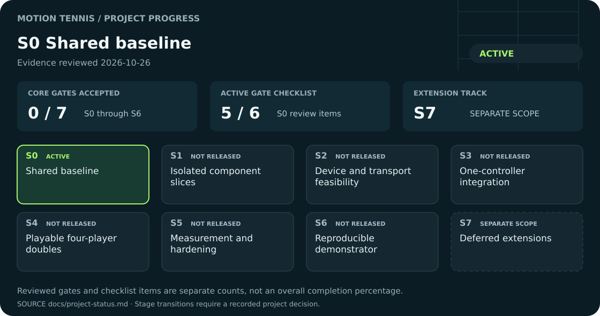

# Motion Tennis documentation

Motion Tennis is a multiplayer tennis demonstrator for up to four players. The main objective is to make distributed processing, latency, synchronization, data freshness, and measurable timing behavior visible. Sophisticated graphics are secondary.

**Current status:** six repositories contain coordinated documentation. This repository also provides generated host-codec and offline match-contract checks; `debug-units` provides an offline trace checker and synthetic integrity tests; the controller, tracking, physics and game runtimes are not implemented. The current reference uses the available Raspberry Pi 3 Model B, a Windows laptop with an RTX 5080, four wireless battery controllers, and webcam-first 2.5D gameplay. Detailed stacks and budgets are proposed, unverified implementation targets.

## Project progress

<!-- project-progress:start -->
<!-- Generated by scripts/render_progress.py; edit the central ledger, not this block. -->

[](docs/project-status.md)

**S1 — Isolated component slices** · Active, incomplete · Evidence reviewed **2026-10-26**.

**Accepted core gates: 1/7** · **Active gate checklist: 0/7**. These count reviewed gates and checklist items, not overall completion.

**Next checkpoint:** Deliver the controller's bounded local acquisition and safe-output slice with pinned board/Zephyr/toolchain inputs and explicit synthetic versus device evidence.

[Evidence and checklist](docs/project-status.md#active-gate-checklist) · [Stage plan](docs/project-stages.md) · [Take a bounded task](docs/contribution-workflow.md#task-brief)

<!-- project-progress:end -->

## Start here

For work by people and AI agents, first read the [repository orientation](docs/orientation.md) and [local workflow](docs/workflow.md), then check the [current project stage](docs/project-status.md). The [shared stages](docs/project-stages.md) bound implementation scope across all six repositories; the [task/handoff template](docs/contribution-workflow.md) keeps individual contributions reviewable. Detailed specifications describe the eventual system, not a request to implement it all at once.

1. Start with the [master plan](docs/master-plan.md), [machine-readable reference profile](spec/reference-profile.json), [overview](docs/overview.md) and [requirements](docs/requirements.md). [MPU-6050 over I²C with Zephyr is selected for the first prototype](docs/adr/0008-mpu6050-zephyr-prototype.md). The [additional IMU marker design](docs/imu-trigger-markers.md) preserves the continuous stream; the [IMU assessment](docs/imu-selection.md) records threshold timing and driver-integration gates.
2. Follow the [architecture and complete transaction](docs/architecture.md), including the mandatory physics-to-game ball-state request and response.
   The agreed game is [2v2 doubles with automatic movement and gesture serving](docs/gameplay.md); [player assignment](docs/player-assignment.md) defines team slots and the existing controller/person confirmation workflow.
3. Use [development setup](docs/development.md) to obtain the repositories and distinguish today's documentation checks from the proposed integrated startup.
4. Before implementing interfaces, review the [protocol](docs/protocol.md), [ball-state consistency](docs/physics.md), [timing and measurement](docs/timing.md), and agreed [Pi-reference synchronization with drift correction](docs/coordinates-and-time.md#pi-reference-clock-mapping). The debug tool must show time uncertainty and mapping validity.
5. Choose a bounded task within the [released stage](docs/project-status.md) using the [shared workflow](docs/contribution-workflow.md). Consult the [future backlog and open decisions](docs/roadmap.md) and validate against the relevant [test cases](docs/testing.md).

## Repositories and roles

These links derive from the inspected Git remotes. All local checkouts track `origin/main`, whose remote HEAD is `main`.

| Repository | Agreed software role | Target physical device |
| --- | --- | --- |
| [documentation](https://github.com/motion-tennis/documentation) | Shared specifications, decisions, setup, and validation guidance | Development workstation |
| [motion-tennis-controller](https://github.com/motion-tennis/motion-tennis-controller) | IMU measurements, transaction timing, LED and haptic feedback | Four wireless battery ESP32 handhelds; S3 reference proposed |
| [motion-tennis-camera-tracking](https://github.com/motion-tennis/motion-tennis-camera-tracking) | Continuous webcam pose estimation and identity tracking | Windows RTX 5080 laptop; RTMO-m reference proposed |
| [motion-tennis-physics-engine](https://github.com/motion-tennis/motion-tennis-physics-engine) | Temporal fusion, hit decisions, sole ball-state calculations | Available Raspberry Pi 3 Model B |
| [motion-tennis-game-engine](https://github.com/motion-tennis/motion-tennis-game-engine) | Committed ball-state service and separate visualization | Windows laptop; native C++/SDL3 reference proposed |
| [debug-units](https://github.com/motion-tennis/debug-units) | Offline trace audit now; live collection, viewer and fault harness planned | Windows analysis host; bounded emitters on all devices |

Tracking, state service, visualization and debug collection share the laptop as separate software components. Webcam-first 2.5D and Windows deployment supersede the earlier Kinect/Linux assumptions. Kinect/depth/stereo remains a later true-3D option, not a prerequisite. See [tracking integration](docs/tracking.md).

## Documentation map

| Area | Reference |
| --- | --- |
| Scope, evidence, language | [Overview](docs/overview.md), [requirements](docs/requirements.md) |
| Contribution scope and sequence | [Orientation](docs/orientation.md), [local workflow](docs/workflow.md), [shared stages](docs/project-stages.md), [current status](docs/project-status.md), [task and handoff template](docs/contribution-workflow.md) |
| Devices and data flow | [Master plan](docs/master-plan.md), [architecture](docs/architecture.md), [hardware](docs/hardware.md), [networking](docs/networking.md), [external AP versus Pi hotspot](docs/networking.md#external-ap-versus-pi-hotspot-comparison) |
| Component design | [Controller](docs/controller.md), [tracking](docs/tracking.md), [physics](docs/physics.md), [game engine](docs/game-engine.md) |
| S0 evidence and reproduction | [Technical baseline, checks, assumptions and component handoffs](docs/s0-baseline.md) |
| Shared contracts | [Protocol](docs/protocol.md), [Protobuf schema](spec/motion.proto), [reference profile](spec/reference-profile.json), [coordinate systems, calibration, and clocks](docs/coordinates-and-time.md) |
| Measurements | [Timing requirements and methodology](docs/timing.md), [independent IMU trigger markers](docs/imu-trigger-markers.md) |
| Prototype IMU | [Selected MPU-6050/Zephyr prototype, threshold interrupts and 200 Hz validation](docs/imu-selection.md) |
| Game and players | [Doubles rules, automatic movement, serving and team views](docs/gameplay.md), [controller/person/team assignment](docs/player-assignment.md) |
| Development and validation | [Setup](docs/development.md), [tracking stack](docs/tracking-stack.md), [debug environment](docs/debugging.md), [testing](docs/testing.md), [troubleshooting](docs/troubleshooting.md), [validation record](docs/validation.md) |
| Future work and decisions | [Roadmap and open decisions](docs/roadmap.md), [architecture decision records](docs/adr/README.md) |

## Status vocabulary

- **Implemented:** verified in repository source or existing artifacts. Documentation existence does not establish working runtime behavior.
- **Agreed design:** requirements established by the project brief, not evidence of implementation.
- **Proposed:** a concrete, compatible suggestion awaiting agreement and implementation.
- **Open:** information or a decision still needed. Open numerical limits must be resolved before acceptance trials.

## Check and contribute

Python 3.9 or later is the only dependency for the documentation checker. From this repository:

```sh
python3 scripts/check_docs.py
```

See [development](docs/development.md) for checking sibling repositories and [testing](docs/testing.md) for the checker's limits. No application build or run command exists yet.

Follow [AGENTS.md](AGENTS.md) for project context and repository editing rules. All project edits must be in English, including documentation, code, identifiers, comments, docstrings, examples, and diagram labels. Update shared contracts here and component usage in the corresponding README together. Separate implementation evidence from design status; attach validation evidence to changes. Preserve attribution and avoid committing credentials. New C/C++ comments must use `//`. Submit changes through the team's review process; no branch protection or review policy is assumed.

This repository is licensed under the [MIT License](LICENSE), copyright 2026 Motion Tennis Group. Component repositories retain their own existing MIT notices.
