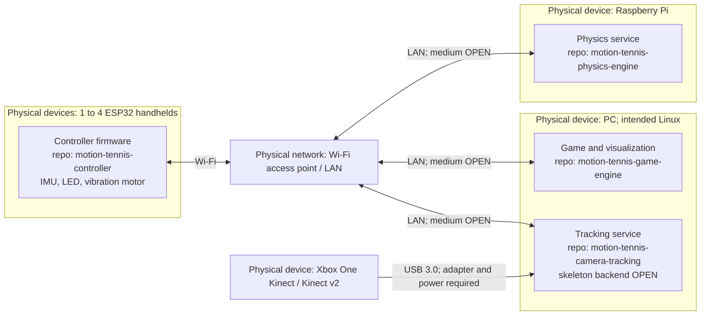
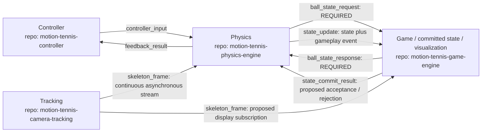

# Architecture and deployment

[Documentation home](../README.md) · [Protocol](protocol.md) · [Consistency](physics.md)

**Agreed design:** the device roles and ten-step controller transaction below. **Proposed:** buffering, serialized state changes, version checks, and commit acknowledgement. **Implemented:** no runtime components exist in the inspected repositories.

## Physical deployment

Devices are boxes; nodes inside them are software components and their repositories. The camera service and game engine may share one PC. The intended PC environment is Linux, subject to resolving the skeleton provider; no selected provider currently establishes a different requirement. If a Windows-only tracker is selected, explicitly revise the deployment decision rather than silently claiming it runs on Linux.



Addresses, ports, Raspberry Pi model/OS, PC resources, access-point layout, controller parts and wiring are [open hardware/deployment choices](hardware.md). There is no deployment URL or application endpoint to publish.

## Component communication

The arrows represent application messages, not physical cables. Message names and the extra commit acknowledgement are [proposed contracts](protocol.md). Both directions of the ball query are required.



The display subscription is proposed for smooth player visualization between controller events. It never authorizes the game to calculate hits or advance committed ball physics. The Pi receives an independent stream and owns pose selection for decisions.

## Complete controller transaction

**Agreed steps:**

1. An IMU interrupt occurs on an ESP32.
2. The controller records measurement start `t0` and assigns a transaction ID.
3. It sends movement data to the Raspberry Pi.
4. Physics resolves the controller/person association and obtains suitable continuously acquired skeleton data.
5. Physics requests the current ball state from the PC game engine.
6. The game returns the ball snapshot with its simulation tick/state version.
7. Physics combines the inputs and calculates hit/miss, outgoing angle/velocity, and the resulting state.
8. Physics sends the updated state/event to the game and corresponding feedback to the controller.
9. The controller matches the response, records `tr`, and drives LED/motor at the defined electrical boundary `t1`.
10. The game applies the result and displays the updated scene.

**Proposed refinement:** step 8 sends the state update first and awaits an acceptance response before sending normal hit/miss feedback. Application of the state can therefore precede controller feedback, while actual screen presentation remains asynchronous. This avoids confirming a hit that was rejected as stale; it adds a second PC exchange to measured latency. The mandatory step 5/6 exchange is not replaced by that acknowledgement.

```mermaid
sequenceDiagram
    participant I as ESP32 IMU / interrupt
    participant C as ESP32 controller
    participant T as PC tracking service
    participant P as Raspberry Pi physics
    participant G as PC game / committed state
    participant D as PC display
    loop Continuous acquisition independent of transactions
        T->>P: skeleton_frame with original capture time and frame ID
    end
    I->>C: IMU interrupt / measurement boundary
    Note over C: t0; assign controller_id, session_id, request_seq
    C->>P: controller_input with IMU sample IDs
    P->>P: Queue; resolve person; select buffered skeleton; validate age
    alt Valid inputs and association
        P->>G: ball_state_request (required)
        G-->>P: ball_state_response with state_version and simulation_tick (required)
        P->>P: Combine inputs and compute candidate result
        P->>G: state_update with base_state_version and event
        G->>G: Proposed atomic version check and commit
        G-->>P: state_commit_result (proposed)
        alt Commit accepted
            P-->>C: feedback_result hit or miss with committed version
            Note over C: tr at receipt of matching valid application result
            C->>C: LED / motor electrical actuation; record t1
            G->>D: Schedule updated scene and event
            Note over D: Display photons occur later, outside controller timing
        else Conflict or unresolved commit
            P-->>C: feedback_result state_conflict or timeout
            C->>C: Explicit error feedback; no normal hit / miss
        end
    else Invalid or unavailable tracking
        P-->>C: Correlated invalid_input / tracking_unavailable / stale_input
        C->>C: Explicit error feedback
    end
```

Connection loss may prevent any result reaching the controller. A local deadline then ends its measurement record as a timeout; late or unmatched responses are counted and cannot trigger a stale hit effect. A receipt acknowledgement, if added, is never `feedback_result` completion. See [protocol failure handling](protocol.md#error-and-lifecycle-behavior).

## State and scheduling boundaries

The proposed model gives the game sole ownership of committed snapshots and physics sole authority to calculate updates. Physics serializes controller jobs and periodic movement jobs into one ordered stream. Every controller decision reads a fresh version via the required query. Game application uses a version precondition; retries cannot apply one event twice.

Between events, periodic physics jobs integrate ball movement and submit updates through the same commit path. Rendering may interpolate committed snapshots for presentation; it must not write extrapolated state back as authoritative. Network waiting can delay a 5 ms target tick. A periodic scheduler alone is not evidence of meeting that target. [Physics](physics.md) specifies ordering, lag, recovery, and conflicts.

Skeleton capture continues regardless of controller activity. The proposed tracker pushes frames into bounded Pi buffers; transactions select an existing frame or wait up to a declared limit. They do not trigger new Kinect exposures. Source timestamp meaning, alignment, and uncertainty are specified in [coordinates and time](coordinates-and-time.md).
