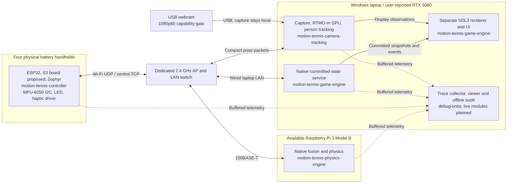
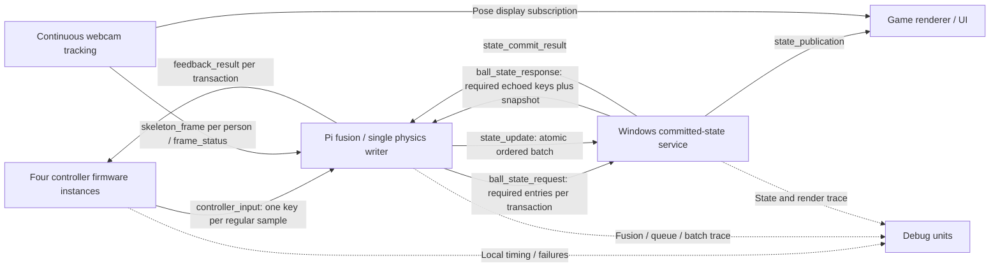

# Architecture and deployment

[Documentation home](../README.md) · [Master plan](master-plan.md) · [Protocol](protocol.md) · [Consistency](physics.md)

**Confirmed direction:** four wireless battery controllers, available Pi 3 Model B, Windows RTX 5080 laptop, webcam-first 2.5D play. **Proposed:** the detailed reference stack, batching, UDP/Protobuf and state-commit protocol. **Implemented:** documentation and offline debug tooling only.

## Physical deployment

Device boxes and software nodes are distinct. Webcam video stays on the laptop. The diagram shows **variant A, the initial baseline**: a separate access point handles the wireless controllers; Pi and laptop use wired LAN. The planned [variant B comparison](networking.md#external-ap-versus-pi-hotspot-comparison) moves the access-point role to the Pi's onboard WLAN while keeping its laptop link wired. Component roles and all application messages remain identical. No exact camera generation, AP or purchased controller parts are implied.

The Pi also owns the shared monotonic time reference and versioned offset/drift mappings for the ESP32 and laptop clock domains. Raw local clocks continue unchanged. Runtime freshness checks and the debug timeline use the same mapping versions; the viewer exposes their uncertainty and validity. Clock exchanges use the existing control path, and mapping export is asynchronous. See the agreed [clock design](coordinates-and-time.md#pi-reference-clock-mapping); implementation and accuracy remain unverified.

The agreed [2v2 doubles mode](gameplay.md) adds automatic avatar movement, overhead gesture serving, normal scoring and two elevated views behind the respective teams. Physical camera stations identify people and calibrate body-relative gestures; they are not avatar court positions. The Pi calculates the full match, the laptop stores one committed state, and both cameras display it. The [roster/serve/score/avatar contract extension](protocol.md#doubles-match-contract-extension) must precede implementation because current schema fields cover only the earlier ball-state proposal.



The diagram does not claim a live collector or GPU pipeline exists. Proposed responsibilities and actual tool status are in the [master plan](master-plan.md) and [debug plan](debugging.md).

## Component communication



Live envelopes use UDP/Protobuf; setup/administration and local renderer state subscription use framed TCP. Telemetry has separate queues. Both required ball-state arrows remain visible even though up to eight logical queries share a datagram.

## Complete controller transaction

The agreed path remains: regular IMU sampling boundary; `t0` and transaction assignment; movement sent to Pi; associated pose selection/fusion; explicit game-state query; versioned snapshot response; physics calculation; corresponding controller result and game update; controller electrical feedback; scene presentation. The proposed implementation batches network exchanges while retaining each transaction and adds commit confirmation before positive hit/miss feedback.

The additional [threshold IRQ marker](imu-trigger-markers.md) uses `t_trigger` and asynchronous diagnostic links to this existing path. It leaves all gameplay arrows, payloads, the continuous 200 Hz cadence, order and priorities unchanged. The debug viewer follows the marker through transaction/sample, selected pose, logical query, batch decision, commit and feedback identities; it can also show the separate rendering branch. No marker delivery is required before physics proceeds.

```mermaid
sequenceDiagram
    participant C as Four ESP32 controllers
    participant T as Windows webcam tracking
    participant P as Pi 3 fusion and physics
    participant G as Windows game state service
    participant R as Separate renderer
    loop Continuous independent capture and inference
        T-->>P: Per-person skeleton_frame and frame_status
    end
    C->>C: Regular sample boundary; record t0 and unique transaction
    C->>P: controller_input at 200 Hz per controller
    P->>P: Queue; associate; fuse delayed pose with IMU history
    alt Valid and timely inputs
        P->>G: ball_state_request with logical query for each selected transaction
        G-->>P: ball_state_response echoes queries and common version / tick
        P->>P: Recheck freshness; integrate once; calculate ordered decisions
        P->>G: state_update with base version, final state and ordered events
        G->>G: Validate and commit complete batch atomically
        G-->>P: state_commit_result
        alt Accepted batch
            P-->>C: Individual feedback_result with committed event identity
            C->>C: tr at complete receipt, retained after validation
            opt Eligible semantic cue before local expiry
                C->>C: Electrical output at t1
            end
            G-->>R: Committed state_publication
            R->>R: Render scene; photons measured separately
        else Conflict or uncertain commit
            P-->>C: Correlated failure or counted local timeout
            P->>P: Pause and resolve uncertain outcome
        end
    else Invalid tracking / stale input / overload
        P-->>C: Explicit error; never a fabricated miss
    end
```

Each sample has an application outcome, but electrical cues are limited to meaningful contact/completed-swing events. `t1` is not fabricated for samples with no eligible output. The screenshot's simplified parallel branches do not establish ordering guarantees; accepted game state can precede feedback and display presentation is asynchronous.

## Concurrency, periodic motion and failure boundaries

One state batch is in flight, at most eight transactions and at most two per controller; normal arrivals are four per 5 ms. The game stores committed state; only physics calculates advances. Periodic-only batches continue ball motion without controller events. Version checks, session/epoch fencing and deduplication prevent conflicting integrators or repeated events. See [physics](physics.md).

Bound queues, catch-up and retries. A late packet cannot restart an expired controller cue. Unknown commit outcomes pause new writes until resolved/reset. Tracking runs continuously; input does not trigger a new exposure. Camera age and historical-IMU alignment are verified separately from local application RTT. The reference targets deadline-aware service, not an unconditional hard real-time guarantee through Windows, GPU and Wi-Fi.
