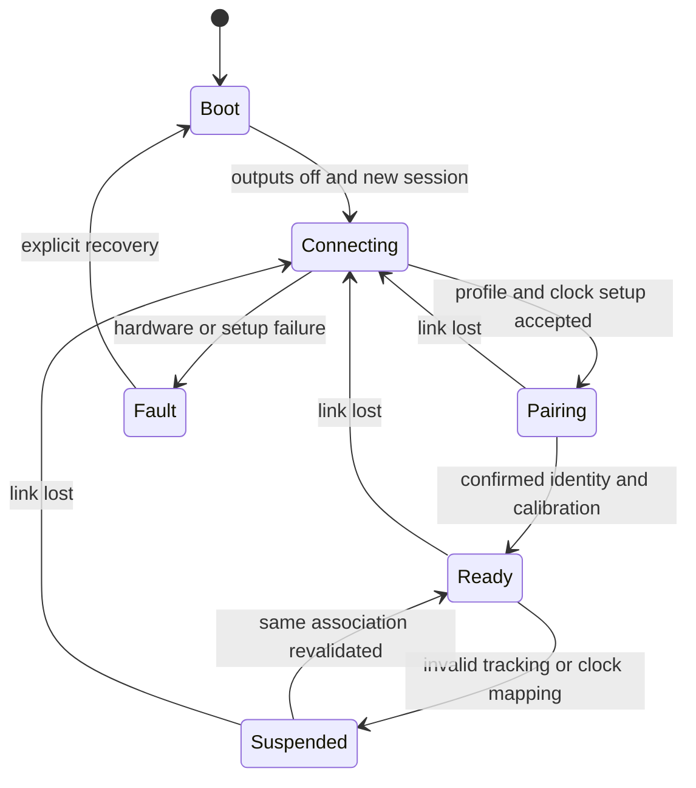

# Wireless battery controller design

[Documentation home](../README.md) · [Hardware](hardware.md) · [Protocol](protocol.md) · [Timing](timing.md)

**Agreed first prototype:** four wireless battery ESP32 handhelds using **MPU-6050 over I²C with Zephyr**, an unchanged continuous 200 Hz stream and an independent hardware threshold marker. **Proposed reference:** ESP32-S3-DevKitC-1-N8R8, LED and DRV2605L-driven matched LRA. Exact board/module revision, breakout, pins and Zephyr/HAL versions remain open. The [IMU assessment](imu-selection.md) and [ADR 0008](adr/0008-mpu6050-zephyr-prototype.md) record the selected prototype and its remaining validation gates; BMI270/ESP-IDF are historical choices. **Implemented:** no firmware, wiring validation, sensor driver integration or radio measurements yet.

## Task allocation and sampling

Configure accel/gyro at 200 Hz, with data-ready interrupt or another verified regular sampling boundary, explicit ranges/filter settings and original sensor timestamps. Every regular sampling boundary starts a distinct measurement transaction. Capture `t0` and request/sample identity in bounded work; enqueue the descriptor. A sensor task reads the sample/FIFO, applies axis/unit conversion and saturation checks, then sends `controller_input`. Preserve missing sample/IRQ counts; never fabricate a regular timestamp for an interrupt that was not observed. The independent threshold IRQ is diagnostic only.

Configure and read back the MPU-6050's filter and sample divider together. A 1 kHz base with divider four gives nominal 200 Hz; the selected DLPF mode determines the base and filtering delay, so a divider setting alone is insufficient. Verify the actual 5 ms cadence under radio and haptic load. The MPU-6050 has one shared INT output for data-ready and motion sources: a line edge alone is not proof of a new sample or of a threshold event. Attribute sources through a reviewed status/latch/clear path while preserving capture provenance and unresolved overlaps.

Use separate sensor, transmit/receive, feedback and low-priority trace-drain tasks. No JSON encoding, network wait, haptic I²C operation or log flush runs inside the interrupt. The controller sends specific force and angular rate; Pi fusion owns world orientation/position and hits. A local orientation estimate may be added for diagnostics but cannot silently change the shared sensor contract.

Each transaction key is `(controller_id, session_id, request_seq)`. Use a fresh session at boot. Allocate 16 pending entries; at 200 Hz this exceeds the 50 ms response expiry window with bounded headroom. If capacity is exhausted, assign and record the rejected attempt as `overloaded`, rather than quietly losing it. Input UDP is transmitted once; no application retransmission of stale sensor data. Preserve every transaction's terminal result or local timeout.

## Independent threshold marker

Add a configurable hardware acceleration-threshold IRQ beside regular sampling, following the [marker contract](imu-trigger-markers.md). Capture `t_trigger` and a session-scoped trigger ID in bounded work, then export asynchronously. Preserve the 200 Hz stream, packet payloads, queues, processing priorities, `t0` and local expiry. The marker does not cause an extra send or an authoritative hit decision.

Emit an explicit diagnostic link to the first regular sample captured at or after `t_trigger`, with its full transaction key and current association. Uncertain or missing capture provenance yields an unresolved link. Keep hardware triggering-sample information separately; the next received feedback may belong to an older sample. Compare the linked response or an explicitly related semantic cue to `t_trigger` in a separate metric population.

The selected MPU-6050 exposes one shared INT pin; no second marker output is assumed. The reviewed upstream Zephyr driver supports data-ready callbacks but needs extension for motion configuration/handling and early GPIO-edge timestamp capture. Pin and inspect the actual Zephyr version before implementing that extension. Preserve an early shared-line timestamp, then attribute it to validated interrupt status; report ambiguous/coincident sources as unresolved rather than assigning an exact threshold edge. A later sensor callback has its own timestamp and cannot stand in for the original IRQ.

Validate the actual part's motion-detector semantics, threshold units/axes, gravity treatment, filtering, detector cadence, duration, rearm behavior and configuration version. Legacy motion settings do not by themselves establish an absolute acceleration comparator or total detection latency. Test repeated crossings, shared-line overlaps and haptic self-triggering while continuous acquisition and gameplay behavior remain unchanged. Do not replace the hardware marker with a software threshold or switch acquisition modes without an explicit design change.

## Radio and connection lifecycle

Use the configured UDP endpoint through the selected WLAN variant: external AP baseline A or planned Pi hotspot B. The [A/B comparison](networking.md#external-ap-versus-pi-hotspot-comparison) preserves controller traffic, power-save policy and marker instrumentation; verify Windows debug-collector reachability as well as Pi replies. The active-play policy is to disable Wi-Fi modem sleep and leave Bluetooth unused. Select and verify the supported Zephyr ESP32 Wi-Fi power-save configuration in the pinned release, record it in the run manifest, and measure receive latency and battery cost. No ESP-IDF-specific API call is prescribed as a Zephyr application interface.

Boot with outputs off, register role/session/profile hash through physics control, establish clock mapping, pair to a tracker person/lane, validate calibration, then enter Ready. Disconnect, tracker identity ambiguity, invalid calibration or clock uncertainty suspends gameplay. Heartbeat every 250 ms and connection expiry at 1 s are proposed connection-health settings; they never extend the much shorter 50 ms measurement deadline. Reconnection revalidates session/association and pending work before play resumes.

Association installation requires a matching command acknowledgement and a later resume barrier. Store association/calibration in every pending transaction; on re-pairing or calibration change, retire old pending entries and cancel their queued cues before acknowledging installation. A late response from the same boot but a retired association cannot drive feedback. Keep failure/suppression records rather than losing those measurements.

## Response and electrical boundaries

Capture a candidate receipt time when the entire `feedback_result` datagram is available. Retain it as `tr` only after validating sender/session/transaction/schema and expiry. Receipt acknowledgement is not a decision. Normal hit/miss feedback requires `committed=true` and the matching game/epoch/batch/event identity. Duplicate, old-session, malformed or late feedback is counted and cannot actuate again.

Report `tr - t0` on the ESP32 monotonic clock. Capture electrical `t1` for a declared eligible cue using the same clock and verify it against actual LED or motor-driver output. An I²C write or queued driver operation is not by itself the motor electrical boundary. Record command timestamp separately, and characterize command-to-drive skew. Timer resolution is not timing accuracy.

At `t0 + 50 ms`, retire an incomplete transaction as a local timeout and suppress subsequent gameplay actuation. Do not turn a late accepted game commit into a second successful local completion. Battery fault, disconnect and watchdog stop active output at its local safety cap. No negative/unknown timestamp is replaced by zero.

## Proposed feedback semantics

The agreed [doubles mode](gameplay.md) assigns one controller to one person, avatar and stable team slot through the [existing pairing/ACK/resume workflow](player-assignment.md). The Pi moves avatars around the virtual court automatically. Human input supplies body-relative gestures and shot timing, including lifting the controller to toss for the assigned server and an overhead stroke to attempt the serve. Gesture recognition combines the continuous IMU stream with aligned camera evidence; the diagnostic threshold IRQ never substitutes for a serve or hit command. A non-server's lift cannot toss the match ball. Thresholds, rearm and toss/contact timing remain implementation and tuning gates.

Every sample produces a correlated outcome; not every sample is an eligible motor cue. A steady status LED update is not a new physical-feedback timing observation if its electrical level does not change. `Cue.electrical_eligible=false` must produce no per-transaction `t1` and is counted separately.

The Pi detects semantic swing episodes using angular-rate magnitude: proposed entry above 3 rad/s, exit below 1 rad/s continuously for 50 ms, maximum episode 500 ms, rearm 150 ms after completion. These are tuning defaults to validate against users and sensor orientation, not measured recognition accuracy. One contact generates one hit cue; an episode with valid tracking but no contact produces one miss cue attached to its closing transaction. Invalid tracking during an unresolved episode produces a tracking fault, not a missed-swing cue.

A sample or swing `miss` is not automatically a lost tennis point. The serve/rally state machine determines faults, lets, second bounces and score; an abandoned toss without a stroke attempt differs from an attempted serve that misses the ball. Tracking, clock and transport faults are technical outcomes, not net/out faults. Confirmed rule transitions require the planned complete match commit before score/display/cue effects are attributed to them.

| Outcome / event | Proposed feedback | Timing/accounting |
| --- | --- | --- |
| Hit contact | Distinct LED pattern; requested intensity 0.7 for 30 ms | One eligible cue per contact/swing identity; deduplicate before scheduling |
| Completed valid missed swing | Different LED pattern; intensity 0.25 for 15 ms | One eligible cue at swing closure; earlier sample misses remain non-eligible |
| Ordinary valid sample with no new cue | Update current status only; no motor pulse | Correlated response retained; electrical cue is not applicable |
| Tracking unavailable/stale/invalid | Tracking/input-fault LED pattern; motor off | Explicit failed result, never normal miss feedback |
| Communication timeout | Communication-fault pattern; motor off | No received `tr`; record local timeout and separate fault-output time |
| Overload/state conflict/internal error | Service-fault pattern; motor off | Failed result and diagnostic reason |

Intensity is a normalized request, not motor voltage or perceived vibration. Configure the selected driver from actuator ratings and clamp safe output. Maximum pulse is 50 ms. Use a two-entry cue queue; if a cue cannot start before its transaction expiry, suppress and record it. Hit cues take priority over obsolete miss cues, but every suppression is logged. Do not silently merge impulses and claim individual `t1` values. Fault LEDs can operate independently from the eligible-gameplay-cue population.

## Implementation and verification

Follow the proposed pin/power reference in [hardware](hardware.md), pin the selected Zephyr/HAL and MPU-6050 driver revisions, then supply a real reproducible build/flash manifest. Test I²C acquisition, filter/divider readback, sensor ranges/group delay, actual 200 Hz mode, shared-INT source attribution and overlap, marker links, FIFO/interrupt semantics, timestamp wrap/reboot, current draw and power stability, duplicate/late packets, output caps and capture-to-electrical timing. Validate the required motion-handler/early-timestamp extension and concrete Zephyr radio power-save behavior. Retain raw transaction and marker logs through `debug-units`; compare GPIO markers against actual output and optional vibration onset. No firmware command or successful hardware test is available yet.
