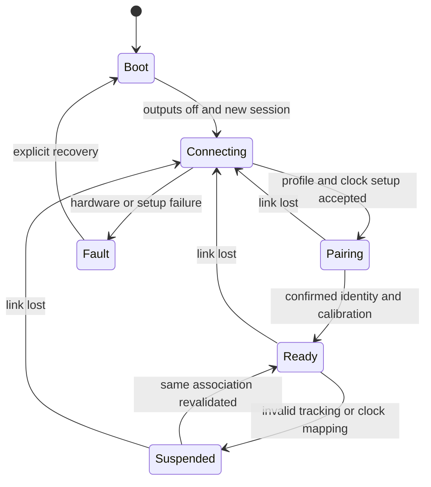

# Wireless battery controller design

[Documentation home](../README.md) · [Hardware](hardware.md) · [Protocol](protocol.md) · [Timing](timing.md)

**User requirement:** four wireless battery handhelds. **Proposed reference:** ESP32-S3-DevKitC-1-N8R8, ESP-IDF C/C++, BMI270 over SPI, LED and DRV2605L-driven matched LRA. **Implemented:** no firmware, wiring validation, sensor driver integration or radio measurements yet.

## Task allocation and sampling

Configure accel/gyro at 200 Hz, with data-ready interrupt, explicit ranges/filter settings and original sensor timestamps. Every interrupt starts a distinct measurement transaction. Capture `t0` and request/sample identity in bounded interrupt work; enqueue the descriptor. A sensor task reads the sample/FIFO, applies axis/unit conversion and saturation checks, then sends `controller_input`. Preserve missing sample/IRQ counts; never fabricate a regular timestamp for an interrupt that was not observed.

Use separate sensor, transmit/receive, feedback and low-priority trace-drain tasks. No JSON encoding, network wait, haptic I²C operation or log flush runs inside the interrupt. The controller sends specific force and angular rate; Pi fusion owns world orientation/position and hits. A local orientation estimate may be added for diagnostics but cannot silently change the shared sensor contract.

Each transaction key is `(controller_id, session_id, request_seq)`. Use a fresh session at boot. Allocate 16 pending entries; at 200 Hz this exceeds the 50 ms response expiry window with bounded headroom. If capacity is exhausted, assign and record the rejected attempt as `overloaded`, rather than quietly losing it. Input UDP is transmitted once; no application retransmission of stale sensor data. Preserve every transaction's terminal result or local timeout.

## Radio and connection lifecycle

Use the dedicated access point and UDP endpoint in the shared profile. During active play disable Wi-Fi modem sleep (`WIFI_PS_NONE`) and Bluetooth coexistence; benchmark the resulting power cost. The [Espressif power-save guide](https://docs.espressif.com/projects/esp-idf/en/latest/esp32s3/api-guides/wifi-driver/wifi-performance-and-power-save.html) explains the receive-latency effect; it does not promise a bound.

Boot with outputs off, register role/session/profile hash through physics control, establish clock mapping, pair to a tracker person/lane, validate calibration, then enter Ready. Disconnect, tracker identity ambiguity, invalid calibration or clock uncertainty suspends gameplay. Heartbeat every 250 ms and connection expiry at 1 s are proposed connection-health settings; they never extend the much shorter 50 ms measurement deadline. Reconnection revalidates session/association and pending work before play resumes.

Association installation requires a matching command acknowledgement and a later resume barrier. Store association/calibration in every pending transaction; on re-pairing or calibration change, retire old pending entries and cancel their queued cues before acknowledging installation. A late response from the same boot but a retired association cannot drive feedback. Keep failure/suppression records rather than losing those measurements.

## Response and electrical boundaries

Capture a candidate receipt time when the entire `feedback_result` datagram is available. Retain it as `tr` only after validating sender/session/transaction/schema and expiry. Receipt acknowledgement is not a decision. Normal hit/miss feedback requires `committed=true` and the matching game/epoch/batch/event identity. Duplicate, old-session, malformed or late feedback is counted and cannot actuate again.

Report `tr - t0` on the ESP32 monotonic clock. Capture electrical `t1` for a declared eligible cue using the same clock and verify it against actual LED or motor-driver output. An I²C write or queued driver operation is not by itself the motor electrical boundary. Record command timestamp separately, and characterize command-to-drive skew. Timer resolution is not timing accuracy.

At `t0 + 50 ms`, retire an incomplete transaction as a local timeout and suppress subsequent gameplay actuation. Do not turn a late accepted game commit into a second successful local completion. Battery fault, disconnect and watchdog stop active output at its local safety cap. No negative/unknown timestamp is replaced by zero.

## Proposed feedback semantics

Every sample produces a correlated outcome; not every sample is an eligible motor cue. A steady status LED update is not a new physical-feedback timing observation if its electrical level does not change. `Cue.electrical_eligible=false` must produce no per-transaction `t1` and is counted separately.

The Pi detects semantic swing episodes using angular-rate magnitude: proposed entry above 3 rad/s, exit below 1 rad/s continuously for 50 ms, maximum episode 500 ms, rearm 150 ms after completion. These are tuning defaults to validate against users and sensor orientation, not measured recognition accuracy. One contact generates one hit cue; an episode with valid tracking but no contact produces one miss cue attached to its closing transaction. Invalid tracking during an unresolved episode produces a tracking fault, not a missed-swing cue.

| Outcome / event | Proposed feedback | Timing/accounting |
| --- | --- | --- |
| Hit contact | Distinct LED pattern; requested intensity 0.7 for 30 ms | One eligible cue per contact/swing identity; deduplicate before scheduling |
| Completed valid missed swing | Different LED pattern; intensity 0.25 for 15 ms | One eligible cue at swing closure; earlier sample misses remain non-eligible |
| Ordinary valid sample with no new cue | Update current status only; no motor pulse | Correlated response retained; electrical cue is not applicable |
| Tracking unavailable/stale/invalid | Tracking/input-fault LED pattern; motor off | Explicit failed result, never normal miss feedback |
| Communication timeout | Communication-fault pattern; motor off | No received `tr`; record local timeout and separate fault-output time |
| Overload/state conflict/internal error | Service-fault pattern; motor off | Failed result and diagnostic reason |

Intensity is a normalized request, not motor voltage or perceived vibration. Configure the selected driver from actuator ratings and clamp safe output. Maximum pulse is 50 ms. Use a two-entry cue queue; if a cue cannot start before its transaction expiry, suppress and record it. Hit cues take priority over obsolete miss cues, but every suppression is logged. Do not silently merge impulses and claim individual `t1` values. Fault LEDs can operate independently from the eligible-gameplay-cue population.

## Implementation and verification

Follow the proposed pin/power reference in [hardware](hardware.md), then supply a real reproducible ESP-IDF build/flash manifest. Test sensor ranges/group delay, FIFO/interrupt semantics, timestamp wrap/reboot, current draw and power stability, duplicate/late packets, output caps and capture-to-electrical timing. Retain raw transaction logs through `debug-units`; compare GPIO markers against actual output and optional vibration onset. No firmware command or successful hardware test is available yet.
