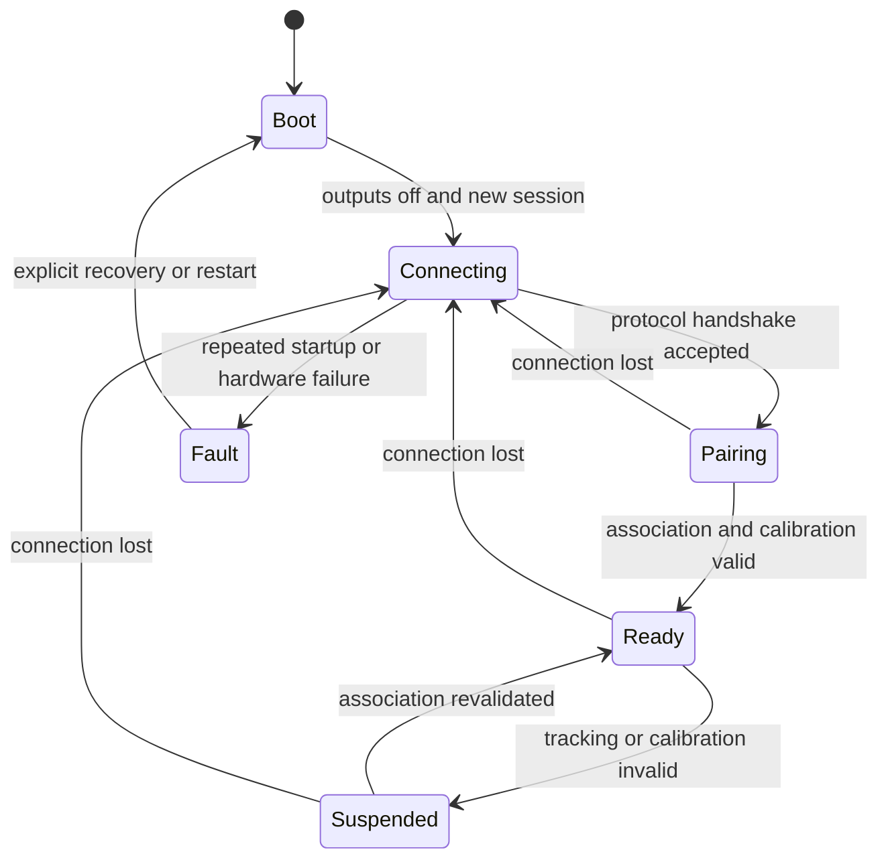

# ESP32 controller design and feedback

[Documentation home](../README.md) · [Hardware](hardware.md) · [Protocol](protocol.md) · [Timing](timing.md)

**Implemented:** no firmware, board configuration, build system, or controller test exists in the inspected repository. **Agreed design:** each handheld uses an ESP32, Wi-Fi, an IMU, an LED, and a vibration motor. It timestamps movement transactions, sends measurements to Raspberry Pi physics, receives the corresponding outcome, and drives local feedback. **Proposed:** lifecycle, buffering, and feedback policies below. **Open:** selected parts, framework, pins, timing limits, and final feedback patterns.

## Measurement transaction

The agreed boundary begins at an IMU interrupt or another precisely documented measurement boundary. Record `t0` on the controller's monotonic timer and assign `(controller_id, session_id, request_seq)` before dispatching the work. Preserve IMU sample IDs and any original sample timestamp separately: an interrupt may announce samples acquired earlier.

**Proposed:** keep interrupt work bounded to capturing the timestamp/marker and enqueuing a descriptor. A task reads the sample or FIFO, validates it, attaches sample metadata, and sends `controller_input`. Perform formatting, network work, and buffered-log flushing outside the interrupt path. Whether this split is possible and which timestamp is closest to the physical interrupt must be validated with the chosen firmware environment.

Physics associates the input with a valid skeleton observation, requests and receives the game engine's current ball state, calculates the outcome, and sends the matching `feedback_result`. A transport receipt acknowledgement does not complete the measurement transaction. Under the proposed consistency model, ordinary hit/miss feedback follows successful state commit; see [physics ownership](physics.md).

Capture a candidate receive timestamp when the complete framed application result becomes available. Retain it as `tr` only after validating protocol, payload, session/sequence/event identity and expiry, then activate the appropriate output. Post-receipt validation is excluded from `tr - t0` but included in `t1 - t0`. Record `t1` at the electrical actuation boundary and compare it against a GPIO/analyzer trace. `tr - t0` is application response time; `t1 - t0` is time to electrical feedback. Motor vibration onset is a separate physical measurement.

If LED and motor change at different times, retain separate output timestamps and declare which output defines the reported `t1`. A fault policy may intentionally keep the motor off; mark its actuation timestamp as not applicable rather than inventing a pulse. The timing definition must remain consistent within a reported experiment.

## Correlation and bounded operation

Keep a bounded pending-request table keyed by the full transaction identity, not sequence alone. A new boot/session must not accept an old session's response. `request_seq` must not wrap into an outstanding key; start a new session before sequence-space reuse. Each measurement attempt ends in a correlated result or an explicitly recorded local terminal failure.

**Proposed rules:**

- Log locally rejected or dropped inputs with their identity and reason. Full queues produce `overloaded` accounting rather than silent disappearance.
- Use a local response deadline and retire expired entries as `timeout`. A late result is counted and may update reconciliation metadata, but cannot trigger stale haptic feedback.
- Treat duplicate results as the same event; apply feedback at most once. Retry a transport operation with the same transaction identity only under the [protocol's retry policy](protocol.md).
- Reject mismatched controller/session IDs, unsupported protocol versions, invalid fields, and expired results. Count discarded responses, with reasons, independently of successful transactions.
- On disconnect, stop accepting gameplay as if connected, expire pending requests explicitly, turn off active motor output at its local cap, and expose the communication fault. Reconnect using session and association validation before resuming play.

The [protocol](protocol.md#matching-bounds-and-expiry) proposes initial queue caps; final queue sizes, local deadlines, reconnect backoff, output caps, and log capacity remain open numerical settings. They must be recorded in each experiment. A 200 Hz processing target does not establish that every sample can complete a skeleton-dependent network transaction within 5 ms. See [timing targets](timing.md).

## Proposed feedback semantics

The application outcome and feedback profile are separate fields. A profile contains normalized requested `intensity` in `[0, 1]` and bounded `duration_ms`, with LED pattern information defined by the selected hardware. Requested intensity is not calibrated acceleration, perceived strength, or a guaranteed motor voltage. Firmware clamps it to its hardware-safe profile and records the applied values.

| Outcome | Proposed user indication | Measurement meaning |
| --- | --- | --- |
| `hit` | Distinct hit LED pattern and stronger bounded vibration | Valid gameplay result from accepted physics processing |
| `miss` | Different LED pattern and weaker/shorter bounded vibration | Valid inputs evaluated as no collision |
| `tracking_unavailable` | Distinct tracking-fault LED pattern; no ordinary hit/miss vibration | Required body/joint information or association unavailable |
| `invalid_input` or `stale_input` | Distinct input-fault pattern | Measurement, calibration, timing, or input validation failed |
| `state_conflict` | Transaction-failure indication | Physics could not reconcile the ball-state version within policy |
| `timeout` or local connection loss | Communication-fault pattern; motor stops under its local cap | No timely correlatable completion available locally |
| `overloaded` or `internal_error` | Service-fault pattern | Resource or processing failure, not an ordinary miss |

No LED color is assumed: the selected LED may be single-color. Use distinguishable blink patterns if color is unavailable. Pattern durations and motor settings require hardware characterization and team agreement. Include a concise legend in the UI so a player can identify tracking faults independently from misses.

Concurrent results require an explicit output scheduling rule. **Proposed:** serialize feedback events with a bounded local queue and report time spent waiting before `t1`; expired events are counted and suppressed. Do not merge or overwrite feedback silently, since that would destroy per-transaction interpretation. Whether a 200 Hz input stream should yield a pulse for every valid result, or separate measurement results from selected gameplay cues, is an open interaction decision; every measurement still requires an outcome and complete accounting.

## Proposed lifecycle

Pending transactions remain individually tracked while the controller is ready; the lifecycle is not a single-request lock. Session changes invalidate pending keys and pairing information. Required signal behavior and failure reasons should remain observable even while no gameplay transaction can complete.

## Development and verification prerequisites

First select the board, IMU and driver, confirm the electrical design, choose a firmware framework, and add reproducible build/flash instructions with actual executable entry points. The repository currently provides none. Then test timestamp capture, sample identity, wrap/reboot handling, output default-off, deadline expiry, duplicate/late responses, and queue overflow before connecting physical gameplay.

Use GPIO markers and buffered logs to quantify instrumentation overhead. Verify output timing on the electrical signal, then optionally measure LED photons or motor vibration separately. Full movement-to-feedback tests require an independent physical reference. The [measurement plan](timing.md) and [test matrix](testing.md) define the required evidence; no hardware timing result is claimed here.
