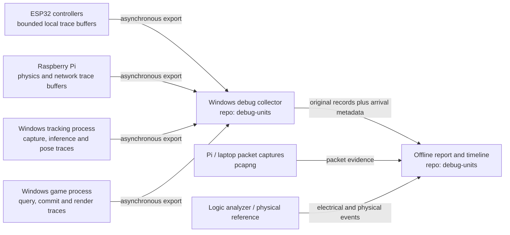

# Debugging, packet tracing, and experiment environment

[Documentation home](../README.md) · [Timing](timing.md) · [Protocol](protocol.md) · [Testing](testing.md)

**Design scope:** `debug-units` owns observation, reproducible experiments, and offline analysis across the entire system. It is a separate repository and must not become a required synchronous hop in gameplay. The reference deployment places collection and analysis on the Windows laptop; lightweight timestamp producers remain on each controller, the Raspberry Pi, and each PC process. Runtime collection, a live viewer, packet decoding, replay, and fault injection are implementation deliverables, not existing functionality.

The inspected repository is [debug-units](https://github.com/motion-tennis/debug-units), on its observed `main` branch. Its initial contents were a placeholder README and an MIT license. It now supplies a standard-library offline trace auditor, synthetic known-answer fixture and integrity tests; these are the only implemented debug tools. Consult its [README](https://github.com/motion-tennis/debug-units/blob/main/README.md) and [trace-v1 contract](https://github.com/motion-tennis/debug-units/blob/main/docs/trace-format.md) for actual commands, fields and remaining milestones. The full [master plan](master-plan.md) assigns devices and reference-profile limits.

## Three independent evidence layers

| Layer | Evidence and location | What it cannot prove alone |
| --- | --- | --- |
| Application trace | Transaction IDs, source clocks, sensor IDs, pose selection, query/response, decision, commit, feedback and rendering events | Accurate physical sensor onset, actual actuator motion, or screen photons |
| Packet capture | Pi and laptop network-interface captures, datagram identities, packet sizes, loss/retry/reordering evidence where observable | A received packet was validated, used for a decision, committed, or actuated |
| Electrical/physical reference | IMU interrupt, GPIO markers, LED/motor drive, optional photodiode/vibration sensor and calibrated movement reference | The internal reason for delay without correlated application records |

All three layers retain their own timestamp meaning and clock domain. A packet ACK is not an application decision; an accepted application result is not physical vibration. Join evidence by identifiers and calibrated mappings, never merely by visual proximity on a timeline.

## Debug architecture

The collector is a separate process from inference and rendering. It may run with reduced live detail during load trials, and raw traces can be analyzed afterward. A collector crash or blocked viewer must never block a controller interrupt, pose publisher, physics tick, state query, commit, or feedback handler. A remote observer is optional; the first deployment needs no cloud service.

The proposed live trace ingress is UDP port 41030; the debug operator API is reserved TCP port 41043. These are design assignments, not running endpoints. Compact records are batched within the central 1,200-byte datagram ceiling and normalized to JSONL after capture. Do not transmit a verbose JSON object for every high-rate event. The Pi 3B reference platform must be tested with the resulting logging load, not assumed to have spare capacity.

## Required component instrumentation

| Component | Required trace points |
| --- | --- |
| Controller | Transaction start `t0`; IMU sample identity/capture; send; valid complete response receipt `tr`; validation complete; first electrical output transition `t1`; local timeout/drop; discarded late/duplicate response; output suppression; link/session change |
| Camera tracking | Source frame/capture boundary; host arrival; inference start/end; pose publication; selected person/joint quality; frame skipped/dropped; identity/calibration change |
| Physics | Input arrival/admission; queue depth/wait; pose selection and ages; fusion start/end; ball query send/response; decision completion; update send/commit result; feedback send; tick release/start/end; state conflict/degradation |
| Game state service | Query receive/snapshot send; update receive; atomic acceptance/rejection; current session/version/tick; duplicate/rejected update |
| Game renderer | Snapshot/event received; scene update; render submission; presentation observation if exposed; stale avatar/ball markers |
| Debug infrastructure | Trace-buffer loss; source event-sequence gaps; collector queue/drop counters; capture packet drops; clock-mapping validity; run start/stop |

Record every admitted request and each rejected/dropped attempt. The complete controller transaction key is `(controller_id, session_id, request_seq)`. Preserve IMU sample IDs, tracking session/frame/person, association/calibration, query ID, update/event IDs, game session/version/tick and batch identity when used. A batch ID supplements individual transaction IDs; it cannot replace their outcome accounting.

## Buffering and observation overhead

Firmware and real-time processing write compact fixed-size records into preallocated bounded rings. A lower-priority task drains those records. Format text/JSON, write files, compress archives, and update charts outside the measured path. Record original event timestamps before exporting; collector arrival time is additional metadata.

Ring capacity, export rate and overflow policy belong in the run manifest and the reference profile. On overflow, increment a source-local cumulative loss counter and preserve the earliest sequence number still retained. Never block a critical operation to preserve a diagnostic record. Report incomplete trace coverage explicitly; do not silently construct a complete-looking transaction history from partial data.

Proposed starting capacities are 1,024 compact 64-byte records per ESP32 (64 KiB) and 32,768 such records per Pi/PC producer (2 MiB). Export at eight records per batch or after 10 ms, whichever occurs first, while respecting the 1,200-byte wire limit. These are reference allocations to benchmark on the actual devices, not proven free-memory or throughput guarantees. A 64-byte compact record uses event codes and session-scoped dictionary indices; it cannot contain all the verbose JSONL names, UUIDs and provenance strings directly. Export the dictionary/session descriptor and decode records off the critical path. Missing dictionary metadata makes affected records undecodable and counts as lost evidence.

Normalized trace-v1 `log_drop` records report loss deltas derived from those counters. Retain source sequence gaps separately; they may describe the same missing records and must not be added blindly. The offline auditor uses 30,000 us response and 40,000 us eligible-electrical reporting targets and 50,000 us controller expiry from the run header. Every 200 Hz sample has a result or failure record, while `electrical_output: null` explicitly marks responses that do not generate a separate physical cue.

Maintain two collection levels: complete compact event records for acceptance trials, and optional verbose payload/pose snapshots for diagnosis. Camera images and full packets can dominate storage and alter the workload; enable them deliberately and report their overhead. Compare externally instrumented minimal-logging and normal-logging runs before trusting timing results. High-rate console output is prohibited on the measured path.

## Packet observation

Use Wireshark for interactive inspection and `dumpcap` for bounded pcapng capture, with `tshark` for repeatable offline extraction after the capture finishes. These are planned external tools, not dependencies installed by this repository. The official [dumpcap manual](https://www.wireshark.org/docs/man-pages/dumpcap.html) describes ring-buffer capture; choose the interface, traffic filter, storage cap and capture duration explicitly for each experiment.

Capture on the Pi and laptop separately where possible, and retain interface identity, tool version, kernel/driver timestamp source, dropped-packet counters and configured timestamp resolution. Packet capture on the laptop does not observe over-air transmission timing or every access-point retransmission. Decode the Motion Tennis envelope into message type, transaction identity and state/session fields; the decoder belongs to `debug-units` and must follow the central protocol version.

Packet timestamp accuracy depends on the capture path, OS and hardware. In particular, a USB Ethernet adapter can add timing uncertainty before software capture. Do not interpret nanosecond file resolution as nanosecond accuracy or use pcap clock differences as one-way delay without mapping. See the [Wireshark timestamp guide](https://www.wireshark.org/docs/wsug_html_chunked/ChAdvTimestamps.html). The [TShark manual](https://www.wireshark.org/docs/man-pages/tshark.html) distinguishes capture filters from offline display filters.

## Viewer and run artifacts to implement

The planned local viewer has a per-transaction waterfall and a per-device timeline. Selecting a transaction must expose its original IMU samples, selected pose/frame, mapping uncertainty, query snapshot, commit, feedback and failure reason. Show four controller lanes simultaneously, queue depth, pose age, simulation lag, tracking status and dropped-trace counters. Never hide failures behind a successful-transactions-only latency chart.

Each run bundle should contain a manifest, original per-source event logs, collector metadata, mapping/calibration records, optional pcapng and electrical traces, a machine-readable metrics report and a readable summary. Record repository revisions, hardware/firmware/OS/GPU/runtime versions, network topology, camera settings, active-player count, profile values, workload/fault seed, run duration, warm-up policy and sample populations. Store no credentials. Raw camera recording requires an explicit trial need and appropriate handling.

Report median, p95, p99, observed maximum, deadline misses, timeouts, tracking failures, overload, state conflicts, missing/late/duplicate responses, queue waits, sensor ages and logging loss. Include explicit error responses in the overall response distribution and also break results down by outcome. Timeouts are censored observations, not zero or deadline-valued completions. Report electrical timing only for outputs eligible under the declared feedback policy; record intentionally absent and unexpectedly missing output separately.

## Simulation, replay, and fault injection to implement

| Tool | Required role and controls |
| --- | --- |
| Controller simulator | One to four logical controllers, independent sessions, configurable rates/bursts, deterministic IMU samples and pairing state |
| Tracking replay | Timestamp-preserving recorded or synthetic frames, explicit synthetic flag, occlusion/identity/confidence/age controls |
| Game state stub | Same query/update contract, versioned snapshots, configurable reply delay, conflicts, duplicate and lost commit responses |
| Application fault proxy | Seeded delay, jitter, loss, duplicates, reordering, corruption, disconnect and restart at named message boundaries |
| Load runner | Defined workloads and trial durations; Pi CPU/network load and laptop inference/render load measured separately |
| Trace auditor | Correlation, same-clock local latency, complete outcome accounting, version/event invariants and reproducible reports |

Packet faults and application faults are separate controls. A packet retransmission, an omitted application result and a lost commit acknowledgement produce different system behavior. Every test records the fault type, exact injection point and seed. Replay must never relabel synthetic data as live camera or hardware measurements.

## Delivery and acceptance sequence

1. Establish the trace contract and offline audit with synthetic known-answer fixtures.
2. Implement bounded emitters in the four runtime repositories, then asynchronous collection without a viewer in the critical path.
3. Implement one-player simulator/stub integration with both required ball-state arrows and all terminal outcomes.
4. Add the packet decoder, run bundles, clock-mapping records and a local timeline viewer.
5. Expand to four simultaneous controllers, controlled sensor/pose replay, fault injection and service restarts.
6. Attach actual hardware and compare application timestamps with GPIO/logic-analyzer evidence, then optional optical/mechanical onset measurements.
7. Run the [acceptance matrix](testing.md) with measured instrumentation overhead and complete failure populations. A passing synthetic trace is not a passing real-time system.

Debug tooling is complete only when a new operator can reproduce a run, locate every failed transaction, explain the delay stages within measured uncertainty, and distinguish missing evidence from successful processing. This page defines that target; each repository must keep implemented capabilities separate from remaining deliverables.
