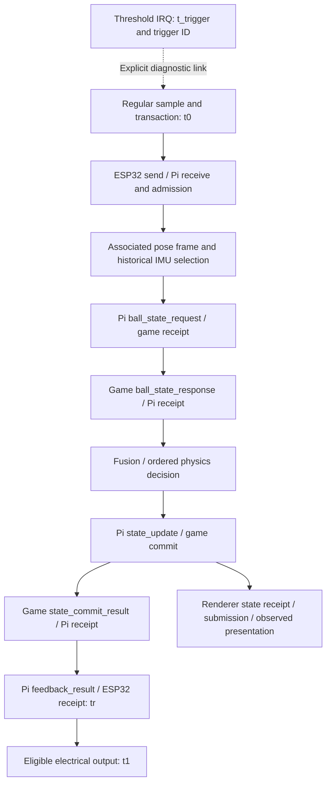

# IMU threshold markers and end-to-end trace correlation

[Documentation home](../README.md) · [Controller](controller.md) · [Timing](timing.md) · [Debugging](debugging.md) · [IMU selection](imu-selection.md)

Decision date: 2026-10-25. **Agreed design:** use MPU-6050 over I²C with Zephyr for the first prototype, retain the continuous 200 Hz controller stream, and develop a configurable hardware acceleration-threshold interrupt as a diagnostic marker across the complete processing path. **Proposed:** the detailed correlation and instrumentation rules below. **Open:** whether the selected MPU-6050 motion detector satisfies the intended threshold semantics and timing evidence. **Implemented:** documentation only; no marker firmware, live collection, marker-aware viewer or marker audit exists. The prototype choice is recorded in [ADR 0008](adr/0008-mpu6050-zephyr-prototype.md); it does not establish validated driver or marker functionality.

## Continuous samples and independent markers

The existing stream remains unchanged: 200 measurement transactions/s per controller, 5 ms nominal sample interval, unchanged `controller_input` and `feedback_result` wire fields, ordering, physics admission, batching, priorities and expiry. Each regular sampling boundary keeps its own `t0`, sample ID and `(controller_id, session_id, request_seq)` key. The additional threshold interrupt does not start another gameplay transaction, trigger an extra send, reset a deadline or bypass a queue. It does not gate sampling or promote an input to a hit.

The threshold interrupt creates `imu_threshold_trigger` evidence with a separate `t_trigger` and trigger identity. Use the existing asynchronous debug path, not a new synchronous gameplay hop. The diagnostic marker and link never need to be inserted into the gameplay Protobuf envelope. The collector/viewer reconstructs their relationship to existing transaction, frame, query, batch, event and cue identities. The [reference profile](../spec/reference-profile.json) records MPU-6050/Zephyr as `webcam-pi3-wireless-v2`; the gameplay schema, rates, limits, timing targets and ports remain unchanged.

A trigger indicates a **swing candidate**, not a verified swing or ball contact. Physics continues to classify motion and collision using ordinary IMU/pose inputs. A non-triggering or false-triggering movement still follows the same gameplay path. Preserve all-sample statistics alongside trigger-selected statistics; selecting interesting events must not hide failures or remove background traffic from the workload.

## Controller capture and correlation

1. Prefer capturing the threshold IRQ edge in hardware. Otherwise timestamp the earliest bounded GPIO interrupt handler and measure its offset/jitter from the actual edge. Use the same ESP32 monotonic clock/session as `t0`, `tr` and `t1`. A deferred Zephyr sensor callback is a different boundary and must not be relabeled as the electrical IRQ edge.
2. Allocate a session-scoped `trigger_id` and append a bounded compact record. Keep sensor-status reads, formatting, network waits and trace export out of the interrupt. The selected MPU-6050 has one shared INT output: retain an edge as a candidate until the later status read establishes its source; do not call every data-ready edge a threshold event. A threshold condition arising while the shared line is already asserted may produce no separate edge: a later status bit cannot recover its exact time. Mark such timing/linkage uncertain or unresolved. Two independently routed interrupt wires are not a requirement on this one-output device; they remain a possible advantage of later alternatives.
3. Record source trigger configuration, association/calibration versions, boundary kind and timing uncertainty. If sensor hardware identifies the sample that caused the threshold, retain that sample as separate provenance. Do not infer it merely from the latest I²C/register/FIFO read: detector filtering and interrupt latency may refer to earlier samples.
4. Use the proposed primary response-link rule `first_capture_at_or_after_trigger`: select the first regular sample captured at or after the recorded `t_trigger`, with the same live association/calibration. Emit an explicit `trigger_link` containing the full transaction key and sample ID. This deterministic rule preserves ordinary sending and includes any wait for the next sample. Hardware causative-sample provenance does not silently change this endpoint rule.
5. If capture timing, ordering, loss or uncertainty prevents identifying that first sample, record the link as unresolved. A nominal sample tick or nearest timestamp is insufficient evidence. Do not link to an already captured but not yet sent sample, a different controller session, or a new association after re-pairing. Preserve unresolved triggers when gameplay is paused, a sample is lost before its identity/capture can be established, or the controller restarts. A known primary sample that later drops or times out keeps its link and failed outcome.
6. Link the sample to the normal response, including an explicit failure response or counted local drop/timeout. Never use the first response arriving after the IRQ: it may belong to an older in-flight measurement. Multiple threshold events can share a sample; retain distinct markers and disclose shared endpoints rather than presenting them as independent samples.

The full trigger key is `(controller_id, session_id, trigger_id)`. The normalized [trace contract](https://github.com/motion-tennis/debug-units/blob/main/docs/trace-format.md) defines the diagnostic records. Session-scoped increasing decimal IDs are a proposed compact implementation. Link records may be exported after gameplay finishes; source timestamps and identities, not collector arrival order, determine the history.

## Full-path trace overlay

This diagram describes successful processing. An early rejection, missing packet, local timeout, rejected or unresolved commit ends or limits the available path explicitly. An absent stage must remain absent; the viewer must not manufacture a complete waterfall. Shared batch stages retain the individual member key and event index. Tracking runs continuously: selected pose acquisition may precede the trigger and is shown as input provenance, not as work caused by it. Rendering and electrical feedback are separate branches; presentation is not required before controller response.

The debug viewer must reveal queue residence, selected sample/frame ages, query/response, decision, commit, return delivery and any eligible output. Retain original source clocks; cross-device placement and one-way durations require the existing clock mappings and uncertainty. Local elapsed times on one ESP32 require no inter-device synchronization. Packet captures alone cannot discover a marker that is intentionally absent from gameplay packets; join packet and application evidence using the existing transaction IDs.

## Distinct measurements and populations

| Measurement | Definition and population |
| --- | --- |
| Per-sample application response | Existing `tr - t0` for each matched regular transaction; all-sample accounting and targets unchanged |
| Per-sample electrical feedback | Existing `t1 - t0` for an eligible cue; unchanged expiry and eligibility rules |
| Trigger to linked sample | Linked sample capture minus `t_trigger`, only with compatible capture timing; report uncertainty and source identity |
| Trigger to linked application response | `tr_linked - t_trigger`, using the explicit primary sample link and matching validated response; report outcome and missing/failed endpoints |
| Trigger to semantic swing outcome | Separate optional endpoint, using an explicit link to physics `swing_id` and the transaction that closes or hits that swing; not the primary sample response by default |
| Trigger to electrical cue | `t1_cue - t_trigger` only when a uniquely identified, eligible cue is explicitly linked to the trigger/swing; absence or suppression is reported without invented time |

The nominal wait to the next regular sample is less than one 5 ms interval when the schedule is on time; jitter, capture uncertainty or a missed sample can extend it. Include this wait in the marker metric. An IMU's internal conversion, filter, threshold-duration and IRQ delay before `t_trigger` are outside that interval. Therefore marker latency is an event-to-application/output measurement, not pure network RTT or physical-motion-to-feedback latency. Characterize physical onset separately using a common instrument.

The existing 30/40 ms targets and 50 ms local expiry remain tied to each transaction's `t0`. Do not silently apply those limits to the new trigger population or reset transaction expiry at the marker. Marker reporting cutoff and semantic endpoint selection must be declared in the run manifest; no separate trigger deadline is accepted yet. Retain unmatched, false, repeated, suppressed and lost markers, failed links, timeouts and absent cues alongside completion percentiles.

## Sensor and trigger configuration

The selected prototype uses MPU-6050 over I²C with Zephyr; BMI270/ESP-IDF are historical choices superseded for this prototype. The reviewed Zephyr MPU-6050 driver exposes data-ready triggering but does not provide the required motion configuration or earliest-edge timestamp integration. Its deferred sensor callback is not an IRQ-edge timestamp. Explicit DLPF/divider configuration and register readback must establish nominal 200 Hz, followed by measured cadence. See the [source-backed driver assessment and validation gates](imu-selection.md#mpu-6050-prototype-assessment).

The MPU-6050's documented legacy motion path uses filtering/reference semantics; it is not confirmed to implement the intended raw absolute acceleration comparison. Verify threshold scaling, detector cadence, duration, status clearing and concurrent streaming on the actual device revision. Label the observed event semantics honestly. Sensor selection does not waive these checks or authorize substituting a software threshold boundary. If evidence cannot meet the marker contract, report the limitation and evaluate the later sensor alternatives while keeping the ordinary prototype stream running.

Record sensor/board revision, pinned driver/RTOS/HAL revisions, I²C configuration, actual accelerometer and gyro ODRs, ranges, DLPF/divider readback, filters/FIFO behavior, event-engine rate, shared-INT routing/polarity/latching, and the following trigger settings:

- Threshold value and unit, per-axis absolute comparison versus vector magnitude or change-of-acceleration semantics, selected axes, gravity/offset treatment and calibration.
- Minimum duration in both register units and actual time, hysteresis or equivalent release rule, rearm/debounce policy and saturation handling.
- Trigger configuration revision, source-clock mapping, IRQ timestamp method, capture/link policy and uncertainty characterization.
- False-trigger classification, including motor vibration, handling shocks, controller rotation and repeated crossings during one swing. Any suppression must be explicit and counted without changing gameplay processing.

200 Hz means 5 ms per regular sample; it does not specify the motion detector's own cadence or interrupt latency. A faster internal detector may reduce detection delay without changing gameplay transmission, but it needs a characterized configuration and explicit sample provenance. For later alternatives offering 208 or 240 Hz, do not silently send at that rate, mislabel it as 200 Hz, or introduce hidden decimation. Resolve exact 200 Hz operation or an explicitly reviewed acquisition strategy before adopting another sensor. The [selection study](imu-selection.md) distinguishes the fixed first-prototype choice from open production hardware and unverified integration work.

## Implementation and acceptance

Extend the controller trace emitter and debug collector/viewer/auditor before claiming this feature works. The existing offline checker tolerates additional stage records but does not validate trigger links or compute the new metrics. No gameplay codec change is required for this diagnostic design.

Validate concurrent continuous sampling and threshold interrupts; true IRQ-to-handler latency; exact sample links across boundary races; older replies arriving after a trigger; simultaneous controllers; multiple triggers per sample; threshold chatter and haptic self-triggering; packet loss and late results; re-pairing/reboot; trace-buffer overflow and missing marker/link records. Compare stream cadence, transaction contents/order, scheduler policy and complete outcome counts with marker instrumentation enabled/disabled under controlled input, and measure observation overhead. A stopped collector must not alter sampling or feedback. Use GPIO/logic-analyzer evidence and publish unresolved cases before claiming a full-path trace.
