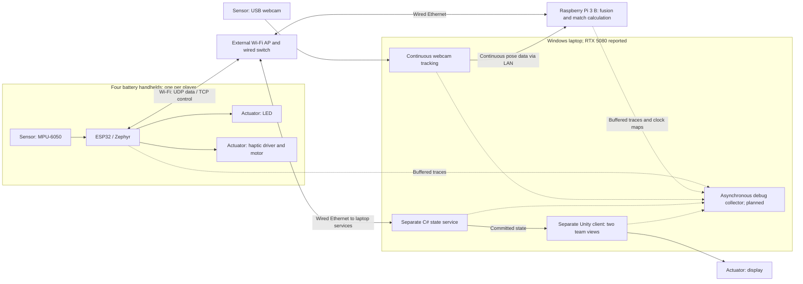

# Motion Tennis: design and integration tests

**Team: Motion Tennis | Milestone: M3 | Date: 2026-11-18 | Revision: R7**

**Status: M3 and Mx accepted by the team on 18 November 2026; Gate 2 complete.** All tests are specified, not executed. This report is self-contained.

## 1. System and current status

Applies: F-01, F-03, F-08, F-13, F-16-F-19; NF-05, NF-10.

Four people play 2v2 tennis using wireless, battery-powered ESP32 controllers. Each controller reads an MPU-6050 IMU over I²C using Zephyr. A webcam continuously observes body and arm movements. The first version uses calibrated 2.5D gestures; the Pi moves the virtual players automatically.

The **Raspberry Pi 3 B calculates** ball movement, player movement, hits, serves and score. A separate **C# service on the Windows laptop stores** the accepted match state. **Unity displays** that state in two team views. Tracking, storage, Unity and debugging are separate processes on the same laptop.

Recorded implementation evidence covers a deterministic physics core, an in-memory C# state store, a recorded-input tracking adapter and offline debug checks. Tracking-to-physics/debug controlled-fixture handoff is technically reviewed; controller acquisition, remaining game/physics fixes and shared S1 acceptance remain open. An integrated network/game runtime, target compatibility and hardware timing are not established. [F-08, NF-05, NF-10]

**Status terms:** agreed = recorded project decision; proposed = awaiting approval or measurement; open = unresolved. M2 F-01-F-21 and NF-01-NF-15 are the requirement baseline. M2 numerical objectives are retained. The Mx decision accepts the display/instrument and clock targets for its measurement plan; The team also accepted the M3 fine stage allocations and design on 18 November 2026. No numerical value here is a measured guarantee. The course M3/Gate 2 deliverable and internal S1-S7 implementation stages are separate: preparing this report does not release hardware integration.

## 2. Architecture

Diagram and deployment: F-01, F-03, F-08, F-12, F-13, F-16, F-19; NF-05, NF-06, NF-09.

The diagram shows **variant A**: controllers use an external access point; Pi and laptop use wired Ethernet. **Variant B** lets the Pi provide the hotspot while the laptop stays wired. Compare both with identical messages, sample rates and tests. B must first prove that every controller can reach the Windows debug collector. No faster variant has been measured. [F-01, NF-01, NF-05]

### Technical node view



There are six physical computing nodes: four ESP32 handhelds, one Pi and one Windows laptop. Tracking, state, Unity and debug processes on the laptop count as one physical node and share a host-failure domain. The AP/switch is network infrastructure, not an extra application-node claim. [NF-12, F-21]

Camera video stays on the laptop. The debug collector observes the system without blocking gameplay. The exact controller board, actuator, wiring, webcam and software versions must be pinned before hardware tests. [NF-05, NF-09]

## 3. Transactions and deadlines

Applies: F-02-F-10; NF-01-NF-04, NF-10; T-01-T-10; P-01, P-03.

A **transaction** is one sensor sample followed through the system. Its identity is `(controller ID, boot session, request sequence)`. Every regular sample gets its own identity, even when several samples share a network batch.

| Transaction | Owner role | Start → end | Proposed deadline / outcome | Requirements |
| --- | --- | --- | --- | --- |
| TX-01: controller feedback | Controller integration owner | Regular IMU boundary `t0` → valid matching response `tr` → eligible LED/motor electrical onset `t1` | Response p99 ≤30 ms; eligible electrical feedback p99 ≤40 ms. Local expiry is 50 ms: suppress new late gameplay cues | F-02-F-07; NF-01; T-01, T-02 |
| TX-02: visible event | Presentation integration owner | The same sample `t0` → accepted match event → photons in each team view | **P-01 Mx target:** p99 ≤80 ms for selected visible events. Accepted in Mx; hardware evidence pending | F-08, F-19; T-08; P-01 |

**p99** means that 99% of completed measurements meet the stated value; failures and timeouts must also be reported. These are statistical objectives, not hard real-time guarantees.

TX-02 is another output branch of the same sample, not an extra request stream. A 60 Hz display cannot show a separate frame for every 200 Hz sample. Its test selects clearly identifiable events. Samples without an eligible cue have no `t1`. Errors are recorded as errors, not sporting misses or lost points.

```mermaid
sequenceDiagram
    participant C as ESP32
    participant T as Tracking
    participant P as Pi physics
    participant S as C# state service
    participant U as Unity / display
    T-->>P: Continuous skeleton_frame and frame_status
    C->>C: Regular sample: t0 and transaction ID
    C->>P: controller_input
    P->>P: Queue; associate player; select suitable pose/history
    alt Invalid, stale or unavailable input
        P-->>C: Explicit failed feedback_result
    else Valid input
        P->>S: ball_state_request with a query for each sample
        S-->>P: ball_state_response with matching keys and snapshot
        P->>P: Recheck freshness; calculate ordered results
        P->>S: state_update with complete candidate match
        S->>S: Validate and commit atomically
        alt Accepted and acknowledged
            par Controller feedback
                S-->>P: state_commit_result
                P-->>C: feedback_result
                C->>C: Complete receipt tr; validate; eligible electrical onset t1
            and Display branch
                S-->>U: Committed state_publication
                U->>U: Scene update and measured display photons
            end
        else Rejected or unresolved
            P->>P: Roll back or pause; resolve uncertain commit
            P-->>C: Explicit failure, or counted local timeout
        end
    end
```

Both output branches are independent after commit; display need not wait for controller feedback. If a result is lost, the controller still accounts for its timeout. A commit discovered later may remain in match history, while its expired controller cue stays suppressed.

The Pi processes up to **eight inputs per 5 ms batch**, at most two per controller, with four queued inputs/controller and one state batch in flight. Every valid selected sample retains its required query/response. Periodic empty-query batches keep the ball moving. Only the Pi calculates changes; the service accepts or rejects the **whole** match update. Rejection also restores candidate score, avatar, contact and cue state. [F-02, F-04, F-05, F-09, NF-03]

### Stage budgets

The following is the complete routine-path allocation. Its finer category split is accepted under P-03. Input means reading data; action includes processing and waiting; transmission/reception include network and scheduling delays; output ends at actual electrical activation. All values are milliseconds.

| Stage / responsible role | Input | Action | Transmit | Receive | Output | Total |
| --- | ---: | ---: | ---: | ---: | ---: | ---: |
| Read and encode IMU / controller owner | 0.20 | 0.30 | 0 | 0 | 0 | 0.50 |
| Controller → Pi / network and Pi I/O owners | 0 | 0 | 3.50 | 1.50 | 0 | 5.00 |
| Wait for batch / Pi scheduler owner | 0 | 5.00 | 0 | 0 | 0 | 5.00 |
| Select and validate pose / fusion owner | 0.25 | 0.25 | 0 | 0 | 0 | 0.50 |
| Required query and response / Pi and state-service owners | 0 | 0.35 | 0.30 | 0.35 | 0 | 1.00 |
| Calculate ordered results / physics owner | 0 | 0.50 | 0 | 0 | 0 | 0.50 |
| Update and commit response / Pi and state-service owners | 0 | 0.35 | 0.30 | 0.35 | 0 | 1.00 |
| Feedback → controller / network and controller owners | 0 | 0 | 3.50 | 1.50 | 0 | 5.00 |
| Validate and activate / controller output owner | 0 | 1.00 | 0 | 0 | 0.50 | 1.50 |
| **TX-01 total** | **0.45** | **7.75** | **7.60** | **3.70** | **0.50** | **20.00** |

This gives **18.5 ms to response receipt**, **20 ms to electrical output**, and **3 ms batch service**, before variation/retries. A 10 ms planning margin is reserved; the separate electrical objective remains 40 ms. T-06 also proposes a 15 ms p99 diagnostic target from physics decision to electrical output. Measure complete intervals directly: adding individual stage percentiles does not prove their p99.

TX-02 shares the prefix through accepted commit. Its additional budget is:

| Stage / responsible role | Categories | Proposed budget |
| --- | --- | ---: |
| Shared sensor-to-commit prefix / controller, network, Pi and state owners | Input 0.450 + action 6.750 + transmission 4.100 + reception 2.200; conservative full commit envelope | 13.500 ms |
| Local publication / state-service and Unity owners | Transmission 0.400 + reception 0.600 | 1.000 ms |
| Frame wait and scene update / Unity owner | Action | 18.667 ms |
| Submission to photons / presentation owner | Output, including scanout/panel delay | 20.000 ms |
| **TX-02 total** | | **53.167 ms** |

The P-01 accepted 80 ms screen objective leaves 26.833 ms planning headroom. Publication does not actually wait for the Pi's commit acknowledgement. These display/frame assumptions need measurement on the selected hardware. Full physical movement-to-vibration latency remains open under T-08.

## 4. Global time

Applies: F-10, F-14, F-15; NF-02, NF-11; T-03, T-04, T-05, T-07; P-02.

The **Pi monotonic clock** is the common reference. Map each controller/laptop clock with `T_pi = a × local_time + b`: `b` corrects offset and `a` corrects drift. Preserve original timestamps, source/reference sessions and the mapping version. [F-15, NF-11]

| Property | Required/proposed value |
| --- | --- |
| Timestamp representation | Integer microseconds; this does not prove microsecond accuracy |
| Sampling/simulation granularity | 200 Hz per controller / 5 ms physics step |
| Cross-device accuracy | Proposed justified uncertainty ≤2 ms per source; two independent sources can give ±4 ms relative uncertainty, plus capture errors |
| Clock maintenance | Proposed refresh every 1 s; expire after 5 s, or sooner if uncertainty is too large |
| Camera timing | Separate proposed capture-time uncertainty ≤8 ms |
| Local measurement accuracy | P-02 Mx target: timestamp quantum ≤10 µs and combined interval uncertainty ≤0.10 ms; verify marker skew and instrument timebase |

Use complete four-timestamp clock exchanges and retain rejected observations. Do not assume equal network delays or calculate one-way delay as RTT/2. A restart invalidates affected future mappings; a Pi restart creates a new reference epoch. Keep earlier valid history. Unknown/expired mappings prevent cross-device freshness claims, while local sample accounting continues.

Measure `tr-t0` and `t1-t0` on the **same ESP32 clock**; they need no inter-device synchronization. Keep camera capture, arrival, inference completion and simulation time separate. Pose must align with historical IMU data. Apply all proposed gates, including uncertainty: IMU age ≤30 ms, pose age ≤80 ms, prediction ≤50 ms and alignment error ≤25 ms. Recheck after network waiting. The debug view must show uncertainty and leave unsupported timing unresolved.

The extra IMU threshold interrupt is only a diagnostic `t_trigger` marker. Explicitly link it to the first regular sample captured at/after it. It does not create a transaction, replace `t0`, change priority or reset expiry. The MPU-6050 has one shared interrupt line, so ambiguous edges remain unresolved. [F-02, F-14]

### Precision, granularity and feasibility obligations

**Accepted Mx target for NF-13:** global clock precision pi is the maximum justified pairwise deviation of mapped clocks within one valid Pi epoch. A 2 ms/source bound permits at most 4 ms between two such clocks, excluding sensor/event placement. Target pi <=4 ms and a coarse global granularity g =5 ms, so g > pi only when that bound is established. A 1 us timestamp representation and a 5 ms simulation step do not themselves establish global precision. Report coarse cross-node comparisons with the NF-13 +/-2g limit (here +/-10 ms) and the actual numeric capture/mapping uncertainty. Use the more conservative applicable interval; do not claim order when intervals overlap. Camera capture can add up to 8 ms/source and therefore cannot be treated as a precise 5 ms event. If measured pi >=g, stop coarse timestamp claims and obtain a reviewed granularity/mapping revision. [F-10, F-15; NF-02, NF-11, NF-13; CR-03]

**Reading phase:** sweep the IMU capture phase across the 5 ms batch-release interval in 0.5 ms increments. Repeat for camera capture/inference handoff phase at the measured frame cadence, with fresh and near-expiry poses. Capture-to-read delay includes phase wait, inference, queueing and network uncertainty. Recheck all NF-02 gates after the state response and before commit; an age-valid pose can still violate the 50 ms prediction horizon. Report each phase's failures and worst observed delay; a nominal 5 ms wait is not proven under scheduler jitter. [F-02, F-03; NF-02, NF-03, NF-14; IT-06, IT-07]

**Permanence and action delay:** sequence/version/epoch checks and explicit commit acceptance establish the usable state, rather than a fixed guessed network-permanence delay. Feedback can act only after matching acceptance and before local expiry; UI consumes only committed publications. Treat queued retransmissions, TCP buffers, renderer queues, debug queues and driver-delayed callbacks as hidden delay channels. Delayed messages must not regain authority after a restart or rebind. Trace their admission, release and rejection boundaries. [F-04, F-06, F-09, F-21; NF-07, NF-14; IT-04, IT-10, IT-11]

For each stage, measure execution time, release/arrival jitter, blocking time and timestamp uncertainty on target. A bounded claim requires sum(WCET + maximum waits/transfers + jitter + applicable uncertainty) <= the transaction deadline, plus a scheduling/phase argument. The routine allocations above and a sum of p99 values are not this proof. Wi-Fi, Windows/GPU scheduling and missing target measurements currently prevent a justified finite hard end-to-end bound. NF-14 is therefore deferred as a hard-bound feasibility claim; the design targets soft statistical service with firm stale-work rejection. No deadline is silently weakened. [NF-01, NF-03, NF-10, NF-14; CR-09]

**Reintegration state:** surviving outputs default safe; pause the writer, resolve any retained commit or reset the match session when its outcome is unknowable. Restore current match/setup versions, writer epoch, explicit controller/person/hand/team bindings, calibration, valid maps and installation acknowledgements. A restarted source gets a fresh session; a recovered link may retain its still-valid session. Resume only after the four-ready barrier for doubles; no old queue, cue or private physics latch is blindly replayed. [F-11, F-20, F-21; NF-09, NF-14; IT-11]

## 5. Interfaces and messages

Applies: F-02-F-12, F-15, F-20; NF-03, NF-07; T-09, T-10.

Use the accepted v0.3 contract, whose exact version string remains `0.3-proposed`. All participants must use the same schema/profile hashes. The complete interface summary required for this design is included below. [NF-07]

| Link | Transport | Messages / essential content | Failure handling |
| --- | --- | --- | --- |
| Controller ↔ Pi | UDP; Pi input 41000; negotiated controller reply endpoint | `controller_input`: transaction/sample/timestamps, IMU, association/calibration. `feedback_result`: matching transaction, outcome, committed event and cue eligibility | Input sent once. Reject wrong/old/duplicate replies; local expiry 50 ms |
| Tracking → Pi | UDP 41020 | `skeleton_frame`: person/frame, capture time, joints, quality. `frame_status`: visible people/readiness/drop count | Missing/stale/invalid pose disables hit eligibility |
| Pi ↔ state service | Dedicated TCP 41010 | `ball_state_request` / `ball_state_response`: per-sample queries and common versioned snapshot | Identical query retry at 2 ms; expiry 5 ms |
| Pi ↔ state service | Same dedicated TCP | `state_update` / `state_commit_result`: base version, full match, ordered events, acceptance/rejection | Identical retries at 2/4 ms; pause uncertainty at 8 ms; resolve via separate control |
| State service → Unity | Bounded local TCP subscription | `state_publication`: committed match/version/events | Slow rendering must not block state handling; retain event/loss accounting |
| Control and clocks | Separate TCP: Pi 41040, game 41041, tracking 41042 | `hello`/`hello_result`, `association`, `match_setup`, `control_command`, `clock_exchange` | Explicit setup/installation ACK and resume; reconnect/restart revalidates sessions |
| Nodes → debug | Planned UDP 41030; debug control TCP 41043 | Buffered traces, clock maps, marker links, source/loss counters | Never block gameplay; missing evidence stays visible |

UDP envelopes are ≤1,200 bytes. State/publication envelopes are ≤8,192 bytes with a four-byte big-endian length prefix. State framing has an 8 ms assembly deadline, three outbound frame slots and one inbound buffer. Control has a separate 65,536-byte outer limit and 1 s assembly deadline. Invalid/oversized/incomplete frames are rejected or closed before partial state effects; TCP recovery never extends transaction deadlines.

Preserve transaction, sample, frame/person, query, batch, event, session/epoch, association/calibration and state-version identities. Retain query/commit outcomes for 2 s, at most 512 batches; full retention causes explicit overload, not unsafe eviction. Changed bytes under an existing batch key are invalid. Confirm player/controller bindings explicitly; never silently assign a nearby person. Normal doubles requires four confirmed A1/A2/B1/B2 players. [F-11, F-20]


Message rules: wire physical values use SI units and must be finite. Capture times keep their clock domain and validity; unknown time is not zero. Joint coordinates are normalized image coordinates, not metric depth. Setup binds four unique controller/person/slot/avatar identities, playing hand, association/calibration revisions and immutable rules/configuration. A response echoes the complete transaction or query/batch key. Hit/miss feedback identifies an accepted game session, writer epoch, batch, event index, version and tick. Error outcomes are invalid_input, tracking_unavailable, stale_input, state_conflict, timeout, overloaded or internal_error; none may masquerade as hit/miss. [F-03-F-11, F-13, F-20; NF-07]

Before gameplay effects, reject incompatible versions/hashes, unknown/reused sessions, invalid lengths, missing identities and nonfinite values. Integer counters/timestamps are bounded to 2^56-1; sessions are 16 bytes, hashes 32 bytes. Updates hold at most eight decisions and sixteen rule events. History retains 256 IMU samples/controller and eight poses/person for alignment. [F-09, F-10; NF-02, NF-03, NF-07]

## 6. Fault hypothesis and test refinements

Applies: F-06, F-07, F-09-F-15, F-19, F-20; NF-02-NF-07, NF-09, NF-11.

The M2 fault hypothesis F-21 is k = 1 non-malicious fail-stop computing-node or link loss. Surviving nodes must enter safe degradation; uninterrupted play is not required. Loss of the Windows host affects all its processes together. Test each handheld, Pi, Windows host and network link/AP loss separately. Other fault families below refine the test specification; the explicit combined-fault experiments are outside the k = 1 guarantee. Their parameters require design review.

| ID | Fault family | Required reaction |
| --- | --- | --- |
| FH-01 | Network loss, delay, jitter, duplication, reordering or AP outage | Count failures, reject mismatches/late work, enforce expiry and revalidate reconnect |
| FH-02 | Invalid messages, incompatible versions, oversized/partial TCP frames or stalled stream | Bounded validation/close; no partial state/output; independent recovery control |
| FH-03 | Lost commit result, stale state, conflicting writer or restart around commit | Exact retries, atomic rejection/rollback, pause uncertainty, fence old sessions/epochs |
| FH-04 | Sensor/pose failure, old capture, bad calibration or ambiguous player binding | Explicit invalidity and suspended eligibility; no fabricated miss, point or depth |
| FH-05 | Clock drift/asymmetry, expired/missing map or clock restart | Fail cross-device freshness checks; preserve local metrics, raw history and epochs |
| FH-06 | Queue overflow, CPU/GPU/render load, low battery, thermal or actuator fault | Bounded overload/pause and safe outputs; no hidden sample-rate reduction |
| FH-07 | Collector/trace/marker loss, shared-IRQ ambiguity or observation overhead | Gameplay stays independent; count missing evidence and unresolved links |
| FH-08 | Missing/late publication, wrong team view or missing photons | Display only committed state; count missing presentation and preserve event identity |
| FH-09 | One non-malicious fail-stop physical node/link, partition or inconsistent membership | Pause affected play; no split scoring; safe surviving outputs and explicit reintegration [F-21] |
| FH-10 | Local I2C contention/error, brown-out, watchdog stall or constrained-resource exhaustion | Count invalid acquisition, preserve safe output, record high-water limits and fresh-session readiness [NF-09, NF-15] |

TCP packet reordering is not application-message reordering. Inject TCP message omission/replay at a complete-message boundary; deleting stream bytes tests framing corruption. Proposed exclusions are malicious/Byzantine peers, automatic failover and arbitrary combinations of permanent hardware failures. The design promises explicit failure/pause, not continued play under every fault.

## 7. Integration test specification

Applies: F-01-F-21, NF-01-NF-07, NF-09-NF-15, T-01-T-10, P-01-P-03. Each IT row inherits the shared measurement and evidence procedure; section 8 gives its exact requirement mapping.

**All tests below are planned, not run.** Missing hardware, runtime, approved fixture or instrument makes a test blocked.

### Shared setup, measurement and reporting

These instructions apply to every test in the table:

1. Record exact code/schema/profile/tool versions, hardware, topology/routes, workload, seed, calibration, player bindings and valid clock maps. Verify safe power/probe connections, bounded queues and setup/ACK/resume. A test instrument's resolution alone does not prove accuracy.
2. Record `t0` at the regular controller boundary, complete reception `tr`, validation completion and actual LED/motor drive `t1`. Capture IRQ/GPIO markers and actual drive with a common logic analyzer; characterize marker skew. Preserve IDs through pose selection, query, commit, feedback and output. An enqueue call is not electrical output.
3. For TX-02, observe keyed display patches with photodiodes on the same acquisition timebase as `t0`. Join each patch to the committed event, render frame and actual scene change in both views. Frame submission is not a photon timestamp. Record scan position and optical threshold.
4. Apply the test stimulus, audit expected behavior and save raw logs, clock maps, electrical/optical records, injected identities/parameters and verdict. Use role labels, device/session IDs and anonymous player slots only; exclude credentials, student names and identifiable participant images from submitted artifacts. Remove faults/load, resolve pending commits, restore safe outputs and valid sessions/readiness; then run a 60 s clean recovery check.

Baseline: **three 10-minute runs at each controller count 1-4, for A and B**; 24 runs total, with separate declared warmup. Keep ordinary 200 Hz traffic and continuous tracking. One-to-three-controller tests use explicit diagnostic fixtures, not an assumed doubles match or silent AI players. Fault tests repeat at one and four controllers in both variants; use seed `20261110 + test number`, at least 100 affected identities per message-level subcase unless a duration is stated. For disruptive fail-stop/power cases use five supervised cycles per selected boundary; never accelerate unsafe hardware operations to meet a count. Real measurements and synthetic fixture checks are labeled separately.

Report counts, minimum, mean, median, p95, p99, observed maximum, deadline misses, technical failures and missing evidence. Define nearest-rank percentiles on completed intervals. Count every started transaction once as gameplay result, explicit failure, local failure/timeout or pending. A timeout is an unknown completion time beyond the cutoff, not a fabricated 50 ms response. Report all-response and successful-only populations separately, and electrical timing only for eligible cues; missing eligible output still counts as failure.

Clean TX-01 gates: response p99 ≤30 ms, eligible electrical p99 ≤40 ms, ≤1% late-or-failed transactions, zero wrong bindings/duplicate commits/new expired cues and zero lost acceptance logs. Count each failing transaction once even if several criteria fail. Measure batch-service p99 ≤4 ms separately. Fault tests instead check bounded failure/recovery. TX-02's accepted sparse-event gate is p99 ≤80 ms per view with zero missing selected events; a general gameplay display policy remains open.

### Test cases

Each row inherits the setup, hardware measurement, correlation, evidence and cleanup above. The last column gives that test's additional pass/fail checks. Roles are responsibilities, not named team members.

| Test / transaction / owner | Faults and reproducible procedure | Additional pass/fail checks |
| --- | --- | --- |
| IT-01: full path · TX-01 · integration owner | No injected fault. Run the baseline matrix. Use approved expected-state fixtures and known hit, completed-miss and noncue motions; trace every valid sample through query, accepted commit and response | Clean gates met; correct fixture outcomes; no missing logical query, duplicate cue or invented `t1`. Preserve electrical LED/motor timestamps separately |
| IT-02: display · TX-02 · presentation owner | Nominal FH-08 checks. Select 200 identifiable committed events per active controller, ≥200 ms apart globally. Capture both patches and matching scene frames while 200 Hz traffic continues | Both views show the correct committed event/state; complete optical evidence and accepted screen gate. Missing photons cannot be replaced by submission times |
| IT-03: network · both · network owner | FH-01. Separate 60 s conditions: added delay 5/15/30 ms; uniform jitter 0-20 ms; loss 1/5/20%, independently per direction. Replay/reorder complete messages by 10 ms; disconnect AP for 2 s | Every source transaction accounted; no duplicate/mismatched/expired cue. Recovery revalidates endpoints. Preserve a committed event even if its feedback is lost |
| IT-04: state/restart · both · state-service owner | FH-03. Separately omit input, query, snapshot, update, commit result and feedback; include first-copy and all-retries cases. Delay known acceptance beyond `t0+60 ms`; replay stale/changed-key updates. Restart Pi/state/controller before update and after commit/before reply | Query 2/5 ms and commit 2/4/8 ms policies hold; one atomic commit, full candidate rollback on rejection, no next batch while uncertain. Old epochs fenced; UNKNOWN_BATCH requires recovery/reset; no late controller cue |
| IT-05: input/identity · both · tracking/fusion owner | FH-04. Occlude wrist/freeze/unplug camera for 2 s; inject saturation and failed sensor reads. Test uncertainty-inclusive age/alignment gates 1 ms below/above each limit. Move calibration, swap/reboot controller, reuse tracker ID and deliver an old association ACK/feedback | Invalid data yields explicit technical error, not miss/point. Historical IMU alignment retained; all freshness gates apply after waits. Unique binding, new-session confirmation, matching install/setup ACK and resume required |
| IT-06: clocks · both · time owner | FH-05. Labeled fixtures: offsets ±100 ms, drift ±100 ppm and directional exchange delays (0,10)/(10,0) ms. Block refresh for 6 s; exceed 2 ms uncertainty earlier; restart a source then Pi. Compare real clock bounds with independent reference where available | Error covered by declared bounds; invalid future maps rejected, valid history preserved. Local `tr-t0`/`t1-t0` remain usable. Viewer shows overlapping ±2 ms intervals as uncertain order; no RTT/2 assumption |
| IT-07: load/safety · both · integration/hardware owner | FH-06. Exercise batches of 0/1/4/8, third input/controller and fifth queued input. Add a labeled 10 s 1,000-input/s/controller synthetic burst; separately stall Unity 100 ms every 2 s for 60 s. Run 120 s Pi/Windows CPU/GPU load toward 90% observed utilization; record temperatures/throttling. Test reviewed low-battery/driver controls and overlong pulse requests | Queue/batch/retention limits hold; no second physics writer or hidden rate reduction. Catch-up ≤4 steps, pause above 20 ms lag. No late/replayed onset; reviewed part-specific pulse cap and safe default-off; the 50 ms transaction expiry is not a motor pulse-duration limit; unavailable part/threshold choices block hardware subcases |
| IT-08: diagnostics/markers · both · debug/time owner | FH-07. Stop collector 10 s, overflow one bounded trace ring, remove map/link records and trigger near sample boundaries/shared-INT overlap. Compare three 120 s pairs with full versus minimal logging/markers, using common external capture | Gameplay independent; loss/unresolved evidence explicit. Trigger links use actual sample identity, never nearest arriving reply; no extra transaction or changed priority. Quantify overhead and instrument uncertainty; incomplete logs cannot pass acceptance |
| IT-09: doubles/views · both · gameplay integration owner | FH-04/FH-08 plus nominal rules. Four confirmed humans: lift/overhead serve; cancelled toss/attempted miss; first/second fault/let; line/net/out/second bounce; deuce/tie-break/end changes; simultaneous swings and technical pause. Use versioned expected-rule fixtures. Separate negative view fixtures inject an old viewport version and swapped team-camera transform | Pi alone calculates movement/score; atomic matching state in both normal views; stable A1/A2/B1/B2 through end changes. Negative view mismatches must receive a failed-view audit verdict. No automatic hit, silent reassignment or technical-failure point. Periodic query/commits move ball between human actions |
| IT-10: protocol/bounds · both · interface owner | FH-02/FH-03/FH-06/FH-08. Send malformed/nonfinite/wrong-version/hash/identity fixtures, 1,201-byte UDP and 8,193-byte state frames; split/coalesce valid TCP frames and hold incomplete state 20 ms/control 1.2 s. Stop subscriber reads 2 s. In a labeled controlled-time host fixture fill 512 live retained batches and query after 2 s expiry | Bounded reject/close, no partial commit, no writer blocked by rendering. State 8 ms/control 1 s assembly limits remain distinct; exact retries deduplicate, changed payload rejects and expired status is UNKNOWN_BATCH. Host fixtures do not prove hardware throughput |
| IT-11: fail-stop and reintegration · both · integration support | FH-09. Five supervised cycles at acquisition, query, pre-commit and post-commit/pre-feedback boundaries: power down one handheld, stop Pi, stop the Windows host, isolate one link, then partition the AP. Inject contradictory membership/rejoin ACKs. Separately record a two-node stop as beyond-k evidence | No independent split scoring or stale cue; count timeouts, pause affected play, preserve confirmed state. Observe surviving output safety while the Windows host is running; apply the reintegration state above. The user selected stopping capture with Windows-host loss: retain the durable prefix, mark the run aborted/incomplete and post-failure safety inconclusive; no F-21 pass for that unobserved interval. Do not promise control over a dead node without reviewed fail-safe hardware. k=1 safe-degradation claim only [F-21, NF-09, NF-14] |
| IT-12: resources and local bus · TX-01 with TX-02 observation · controller/component owners | FH-10. After hardware limits are reviewed, inject I2C NACK/stalled acquisition, bus contention, controlled brown-out, electronic dummy-load overcurrent and watchdog-task stall if a watchdog exists. Record RAM/flash/stack/CPU/power high-water under above-peak input | Stay inside signed-off component limits; no indefinite ISR/bus wait, reset to safe output, new-session readiness and explicit lost-input accounting. Hardware subcases are blocked until ratings/current limits and fixture protection are approved [F-01, F-06, F-21; NF-09, NF-15] |

Also run three named combinations after their single-fault tests: **lost commit result + stopped collector**, **15 ms feedback delay + high Pi CPU load**, and **frozen pose + expired clock map**. Preserve each constituent reaction. Other combinations remain unverified. Before execution, each test fixture records its explicit input, expected result and configuration; an unavailable oracle blocks that subcase. [NF-05, NF-07]

### Initial hardware limits and observation decision - 18 November 2026

The team confirmed Mx, including its measurement/tool plan; the user confirmed available logic analyzer, oscilloscope and two photodiodes, and assigned hardware responsibility to controller/hardware support. Acquisition stops with Windows-host failure. Preserve the last durable prefix and classify that run as aborted/evidence incomplete; post-failure F-21 behavior is not proven. Normal node/link-fault measurements continue while the host remains available. This observation limitation does not remove safe-degradation requirements. [F-21; NF-04, NF-09, NF-10]

The user authorized these initial project limits, subject to stricter verified component ratings: one protected 1S cell, gameplay 3.30-4.20 V; warn <=3.50 V for 1 s or SOC <=20%; pause <=3.30 V for 1 s or SOC <=10%, or missing readings >2 s; manual resume only >=3.60 V and SOC >20%. Use regulated 3.3 V logic and nominal 5 V motor supply; exact board/regulator/protection compatibility remains a prerequisite. First cell-side bench current ceiling is 1.0 A, further limited by the weakest rated part. [NF-09, NF-15; IT-07,12]

DFR0440 motor cues default to 100 ms, cap at 200 ms, with >=300 ms off and <=2 s on per rolling 10 s; cap violations are counted suppressions, never delayed expired cues. Initial motor characterization uses 5 V, a 100 mA current-limited branch and <=50 ms pulses; this is an abort threshold, not a motor rating. Start/run/stall ratings must be verified before handheld use. Default-low/reset, a task-independent watchdog <=250 ms and a hardware gate are required before claiming a 200 ms CPU-failure-safe cutoff. DFR0605 LED uses one color at <=25% brightness and <=200 ms cue time, with 50 mA reserved supply budget; serial-data edges do not establish optical onset. [F-07; NF-09, NF-15; IT-01,07,11,12]

DFR0668 charging starts at 200 mA, project maximum 500 mA after verification, with no gameplay during charging. Its specified 4.2 V +/-1% can reach 4.242 V: validate the protected cell's tolerance and isolate the DFR0563 gauge/load during charging (gauge battery range ends at 4.2 V). Charge at measured cell 10-35 C, stop at >=40 C; operation uses ambient 15-30 C and stops at cell >=40 C or accessible enclosure >=45 C. External temperature monitoring is needed until an interlock exists. Neither a charger label nor a protected-cell listing proves assembly compatibility. [NF-09, NF-15; IT-12]

I2C targets 400 kHz only after part/rise-time verification, with <=2 ms acquisition wait, invalid-sample accounting, <=2 Hz low-priority fuel-gauge reads and pause after three consecutive failures. Keep 200 Hz identified sampling. Diagnostic rings use <=min(64 KiB, 10% of startup free RAM) per embedded node; retain >=20% stack headroom. Observation limits are <=50 us per trace point, <=1 added CPU percentage point and <=1 ms added E2E p99 in three paired 120 s runs; absolute transaction gates still apply. No measured result or WCET is implied. Use electronic dummy loads for overcurrent, never physical motor blocking or battery abuse. These are execution prerequisites; no runtime protection is claimed as implemented. [F-02; NF-03, NF-06, NF-09, NF-15; IT-07,08,12]

Manufacturer sources checked 18 November 2026: DFRobot DFR0440 https://wiki.dfrobot.com/dfr0440/ ; DFR0605 https://www.dfrobot.com/product-1848.html ; DFR0563 https://www.dfrobot.com/product-1734.html ; DFR0668 https://wiki.dfrobot.com/dfr0668/ . Numerical operating thresholds beyond those component specifications are project choices. [NF-05, NF-09]

## 8. Traceability

Each row below defines an existing project requirement and maps it to a transaction, node and test. P-01/P-02 are accepted Mx measurement targets; P-03 fine stage allocations are accepted design allocations. All timing limits remain unmeasured. C = controller, P = Pi, A = AP/network, T = tracking, S = state service, U = Unity, D = debug. Both = TX-01 and the selected TX-02 branch. Review-only requirements do not create a sensor transaction.

| Requirement | Definition | Transaction | Node | Test / evidence |
| --- | --- | --- | --- | --- |
| F-01 | Support 1-4 wireless battery controllers. | Both | C, P, A | IT-01, IT-03, IT-07 |
| F-02 | Keep one transaction per regular IMU sampling boundary. | Both | C, P | IT-01, IT-07, IT-08 |
| F-03 | Fuse active camera body/joint observations with IMU on Pi. | Both | C, T, P | IT-05, IT-06, IT-09 |
| F-04 | Give every valid selected input a matching ball-state query/response. | Both | P, S | IT-01, IT-04, IT-10 |
| F-05 | Pi calculates hit/miss and resulting ball motion. | Both | P, S | IT-01, IT-04, IT-09 |
| F-06 | Account for every generated transaction, including local failure. | Both | All | IT-01 to IT-12 |
| F-07 | Distinguish hit, completed-miss and fault feedback. | TX-01 | C, P, S | IT-01, IT-04, IT-07 |
| F-08 | Store one committed match on Windows; present it in separate Unity. | Both | P, S, U | IT-02, IT-07, IT-10 |
| F-09 | Use one ordered physics writer for concurrent and periodic work. | Both | P, S | IT-04, IT-07, IT-09 |
| F-10 | Preserve original capture timestamps and source identities. | Both | All | IT-01, IT-05, IT-06, IT-08 |
| F-11 | Handle connection, association, calibration, loss and restart explicitly. | Both | C, T, P, S | IT-03, IT-04, IT-05, IT-06 |
| F-12 | Provide cross-system debugging, tracing and fault-test support. | Both | All, D | IT-08; Mx review |
| F-13 | Treat webcam gestures as calibrated 2D/2.5D, not measured 3D. | Both | T, P, U | IT-05, IT-09 |
| F-14 | Keep the hardware threshold marker diagnostic; preserve sampling. | Both | C, D | IT-08 |
| F-15 | Map clocks to Pi with offset/drift correction and visible uncertainty. | Both | All, P, D | IT-06, IT-08 |
| F-16 | Play four-human 2v2 doubles with automatic avatar movement. | Both | C, T, P, S, U | IT-09 |
| F-17 | Recognize assigned-server lift/toss and overhead serve gestures. | Both | C, T, P, S, U | IT-09 |
| F-18 | Apply normal tennis scoring; technical failures do not award points. | Both | P, S, U | IT-04, IT-05, IT-09 |
| F-19 | Show one committed match in two elevated rear team views. | TX-02 | S, U, display | IT-02, IT-07, IT-09 |
| F-20 | Confirm unique controller/person/team-slot assignment before resume. | Both | C, T, P, S, U | IT-05, IT-09 |
| F-21 | Tolerate one non-malicious fail-stop node/link through safe degradation and controlled rejoin; no uninterrupted-play guarantee. | Both | All physical nodes | IT-04, IT-11 |
| NF-01 | Meet controller-local response/electrical timing objectives. | TX-01 | C, P, S | IT-01, IT-03, IT-04, IT-07 |
| NF-02 | Check sensor age, historical alignment and timing uncertainty. | Both | C, T, P | IT-05, IT-06 |
| NF-03 | Bound memory, queues, state batches and catch-up work. | Both | C, P, S, U, D | IT-07, IT-08, IT-10 |
| NF-04 | Report complete populations, failures, timeouts and observation loss. | Both | All | All tests |
| NF-05 | Make builds and test runs reproducible with exact version manifests. | Both | All | All test manifests |
| NF-06 | Keep logging nonblocking; measure its overhead and losses. | Both | All, D | IT-08 |
| NF-07 | Use compatible, versioned interfaces and exact contract hashes. | Both | All | IT-04, IT-05, IT-10 |
| NF-08 | Write project content and diagram labels in English. | Review | Report | Document review |
| NF-09 | Use safe battery/driver design, default-off and bounded pulses. | TX-01 | C | IT-05, IT-07, IT-12 |
| NF-10 | Separate statistical objectives from hard real-time guarantees. | Both | All | Timing/results review |
| NF-11 | Qualify cross-device durations using valid bounded clock maps. | Both | All, P, D | IT-06, IT-08 |
| NF-12 | At least five physical networked computing nodes and custom sensing/actuation. | Both | Four C, P, Windows | IT-01 inventory: six nodes |
| NF-13 | Establish measured global precision pi and granularity g > pi; respect reasonableness and +/-2g limits. | Both | C, P, Windows, D | IT-06; CR-03 |
| NF-14 | Target timing-feasibility case: WCET, jitter, phases, action delay and complete bound before bounded claims. | Both | All | IT-01, IT-06, IT-07, IT-11; CR-09 |
| NF-15 | Validate hardware resources, local bus, power and recovery against reviewed limits. | Both | C, P, Windows | IT-07, IT-12; CR-10 |
| T-01 | Response p99 <=30 ms from t0; local expiry 50 ms. | TX-01 | C, P, S | IT-01, IT-03, IT-04 |
| T-02 | Eligible electrical onset p99 <=40 ms; no new onset at/after expiry. | TX-01 | C, P, S | IT-01, IT-04, IT-07 |
| T-03 | Sample at 200 Hz/controller: nominal 5 ms, 800 inputs/s for four. | Both | C | IT-01, IT-07, IT-08 |
| T-04 | 5 ms physics step; service p99 <=4 ms; <=4 catch-up steps; pause >20 ms lag. | Both | P, S | IT-01, IT-07 |
| T-05 | Measure t0-to-Pi input delivery; routine allocation 5.5 ms. | Both | C, A, P | IT-01, IT-03, IT-06 |
| T-06 | Measure decision-to-electrical onset; proposed diagnostic p99 <=15 ms. | TX-01 | P, S, C | IT-01, IT-04, IT-06 |
| T-07 | IMU age <=30 ms; pose <=80 ms; prediction <=50 ms; alignment <=25 ms. | Both | C, T, P | IT-05, IT-06 |
| T-08 | Measure actual physical/optical onset separately; full movement/vibration limit open. | TX-02 / optional | Sensors, display, actuator | IT-02, IT-08; CR-03 |
| T-09 | Query: identical retry at 2 ms; expire at 5 ms. | Both | P, S | IT-04, IT-10 |
| T-10 | Commit: identical retries at 2/4 ms; pause ambiguity at 8 ms. | Both | P, S | IT-04, IT-10 |
| P-01 | Mx accepted target: selected visible event p99 <=80 ms/view, zero missing selected events. | TX-02 | S, U, display | IT-02; CR-03 decision |
| P-02 | Mx accepted target: native quantum <=10 us, measured interval uncertainty <=0.10 ms. | Both | C, instruments | IT-02, IT-06, IT-08; CR-03 |
| P-03 | Accepted design: fine budget category allocations in section 3. | Both | C, P, S, U | IT-01, IT-02; CR-03 |

## 9. Consistency review and acceptance

The author checked ownership, mandatory messages, budgets, clocks, test coverage and the submission rules. Fixed means corrected in this report. Accepted requires a recorded team decision; the M3 and Mx decisions are recorded below. [NF-04, NF-05, NF-07, NF-10]

| Finding | Requirement | Status | Owner role | Correction or closure |
| --- | --- | --- | --- | --- |
| CR-01: missing submission format, title and team | NF-05, NF-08 | fixed | Documentation | One PDF, prescribed team filename, team/milestone/date title, role-only metadata |
| CR-02: repository dependencies and undefined requirement IDs | F-10, NF-05, NF-07 | fixed | Documentation | Required tables, message extracts, diagrams and all requirement definitions are included; no external file lookup is needed |
| CR-03: display, accuracy and budget targets | T-08, NF-01, NF-02; P-01-P-03 | accepted | Time / UI | Team accepts design targets and fine stage allocations on 18 November 2026. Hardware evidence remains required; no full movement/vibration guarantee is claimed |
| CR-04: fault scope and execution prerequisites | F-06, F-12; NF-03, NF-05, NF-09 | deferred | Integration | Team accepts the specified fault scope on 18 November 2026. Integration retains fixture/protection/diagnostic validation as prerequisites before physical execution |
| CR-05: sample/marker and ownership ambiguity | F-02, F-04, F-08, F-09, F-14 | fixed | Physics / control | One regular sample remains one transaction; queries remain mandatory; Pi calculates, service stores and Unity presents |
| CR-06: percentile/clock claims could imply hard bounds | NF-04, NF-10, NF-11; T-01-T-07 | fixed | Time owner | Complete populations, direct durations, conservative mapping bounds and censored timeouts are explicit |
| CR-07: Windows documentation freshness mismatch | NF-05, NF-07 | fixed | Contract tooling | Portable path and LF/CRLF checks are implemented with regression tests. Deployment manifests still retain exact distributed hashes; this does not establish target codec interoperability |
| CR-08: missing separate Mx artifact | F-12; NF-05 | fixed | Integration support | Separate self-contained Mx R3 is supplied with bench, trace points, diagnostic sequence, fault reproduction and tool-readiness plan |
| CR-12: team approval of both reports | NF-05, NF-07 | accepted | Team review | Project user explicitly confirms M3 as-is and Mx acceptance on 18 November 2026. Gate 2 design approval recorded |
| CR-09: WCET/jitter proof and prior Gate 1 chronology | NF-10, NF-14; M2 Q-10/Q-12 | deferred | System design / requirements | No hard bound claimed. Obtain target timing/phase evidence; clarify the recorded 26 October 2026 requirements approval versus 24 October 2026 architecture chronology with the instructor without rewriting dates |
| CR-10: hardware safety/resources and acceptance parameters | NF-06, NF-09, NF-15; M2 Q-06/Q-08 | deferred | Controller / integration support | Initial project limits recorded in section 7 under user authorization; verify exact board/regulator/cell ratings, current/temperature protection, instrumentation and implementation before physical injection |
| CR-11: requirement-ID mismatch and missing fault hypothesis | F-21; NF-12-NF-15 | fixed | Documentation / system design | Align to M2 F-01-F-21 and NF-01-NF-15; retain k=1, six physical nodes, phase/precision/reintegration and traceability |

The PDF is an anonymous design/test specification, not a claim that hardware tests pass. Exact tool/device manifests are created when those tests become executable. The team remains responsible for the technical content, including AI-assisted drafting. [NF-04, NF-05, NF-10]

| Milestone decision | Present evidence | Status / required action |
| --- | --- | --- |
| Gate 2 consistency review | Consistency review complete; explicit team acceptance of M3 and Mx recorded on 18 November 2026 | Gate 2 complete. Deferred evidence and hardware prerequisites remain visible and binding |
| Mx - Integration Test Debugging Concept | Separate self-contained R2 concept with confirmed team decision on 18 November 2026 | Mx accepted; hardware implementation and calibration unverified |
| M3 | Requires acceptance of this report AND Mx | Reached at team design-acceptance level on 18 November 2026; course submission/evaluation remains separate |

Mx must define bench/startup procedures, exact timestamp/probe boundaries and calibration, ID joins, Pi clock-map evidence, packet/application fault hooks, bounded nonblocking logging and loss counters, and the reproducible run bundle/auditor. Sections 6-7 state the requirements consumed by this report; they do not substitute for Mx acceptance. [F-10, F-12, F-14, F-15; NF-04-NF-07, NF-11]


## 10. Gate 2 decision record

Submission deadline: 19 November 2026, 23:59 Europe/Vienna. Title-page team spelling is Motion Tennis, as confirmed for this delivery. Requirement meanings follow the M2 baseline dated 11 November 2026 (F-01-F-21, NF-01-NF-15); the earlier compact team spelling does not change requirement identity. All required definitions and design/test tables are reproduced here. [NF-05, NF-07, NF-08]

| Decision field | Required record / current value |
| --- | --- |
| Reviewed artifacts | M3 R6 and Mx R2 accepted on 18 November 2026; R7/R3 record acceptance without changing the technical design |
| Reviewing roles | Requirements, controller, tracking, physics, game presentation, integration support |
| Technical consistency review | Completed for the listed findings; deferred items remain visible |
| Team design decision | Explicit as-is M3 approval and prior Mx approval supplied by the project user on 18 November 2026 |
| Deferred-risk disposition | Team accepts CR-04/09/10 deferral on 18 November 2026 under the listed owner roles: fixture/hardware checks before physical tests, timing evidence before bounded claims, chronology clarification before the next requirements revision. No missing evidence is represented as passed |
| Mx acceptance | Confirmed by the project user on 18 November 2026; no hardware-test pass inferred |
| M3 completion | Both artifacts accepted; Gate 2 complete on 18 November 2026. Internal implementation stages are unchanged |

Scope note: this is a design and integration-test specification. Measurements and hardware readiness are not invented to satisfy the submission date. The team is responsible for checking technical content and approving the final artifacts. [NF-04, NF-05, NF-10, NF-14]
