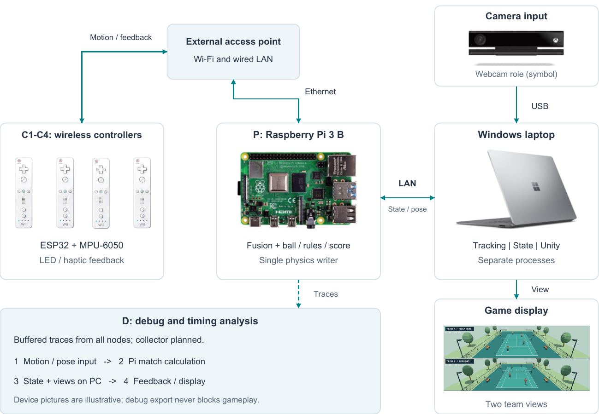
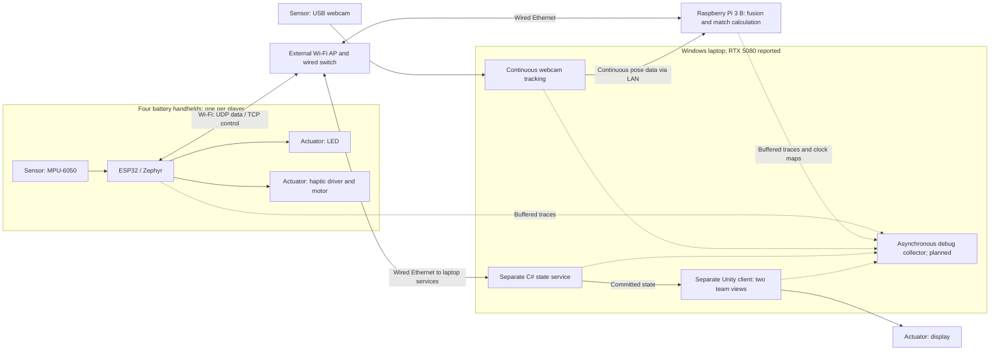

# Motion Tennis: design and integration tests

**Team: MotionTennis | Milestone: M3 | Date: 2026-11-10 | Revision: R4**

**Status: design review completed by the report author; team approval and Mx acceptance pending.** All tests are specified, not executed. This report is self-contained.

## 1. System and current status

Applies: F-01, F-03, F-08, F-13, F-16-F-19; N-05, N-10.

Four people play 2v2 tennis using wireless, battery-powered ESP32 controllers. Each controller reads an MPU-6050 IMU over I²C using Zephyr. A webcam continuously observes body and arm movements. The first version uses calibrated 2.5D gestures; the Pi moves the virtual players automatically.

The **Raspberry Pi 3 B calculates** ball movement, player movement, hits, serves and score. A separate **C# service on the Windows laptop stores** the accepted match state. **Unity displays** that state in two team views. Tracking, storage, Unity and debugging are separate processes on the same laptop.

Current implementation evidence covers an in-memory C# state-store core and offline checks. An integrated network/game runtime, target compatibility and hardware timing are not established. [F-08, N-05, N-10]

**Status terms:** agreed = recorded project decision; proposed = awaiting approval or measurement; open = unresolved. All timing numbers below are proposed targets, not measured guarantees.

## 2. Architecture

Diagram and deployment: F-01, F-03, F-08, F-12, F-13, F-16, F-19; N-05, N-06, N-09.

The diagram shows **variant A**: controllers use an external access point; Pi and laptop use wired Ethernet. **Variant B** lets the Pi provide the hotspot while the laptop stays wired. Compare both with identical messages, sample rates and tests. B must first prove that every controller can reach the Windows debug collector. No faster variant has been measured. [F-01, N-01, N-05]

### Big picture



The supplied device pictures illustrate roles: the planned hardware remains ESP32/MPU-6050 controllers, a webcam and Pi 3 B. The game picture illustrates the two-team view; it is not runtime validation. The following technical view separates the software nodes and their links. [F-01, F-03, F-08, F-13, F-19; N-05]

### Technical node view



Camera video stays on the laptop. The debug collector observes the system without blocking gameplay. The exact controller board, actuator, wiring, webcam and software versions must be pinned before hardware tests. [N-05, N-09]

## 3. Transactions and deadlines

Applies: F-02-F-10; N-01-N-04, N-10; T-01-T-10; P-01, P-03.

A **transaction** is one sensor sample followed through the system. Its identity is `(controller ID, boot session, request sequence)`. Every regular sample gets its own identity, even when several samples share a network batch.

| Transaction | Owner role | Start → end | Proposed deadline / outcome | Requirements |
| --- | --- | --- | --- | --- |
| TX-01: controller feedback | Controller integration owner | Regular IMU boundary `t0` → valid matching response `tr` → eligible LED/motor electrical onset `t1` | Response p99 ≤30 ms; eligible electrical feedback p99 ≤40 ms. Local expiry is 50 ms: suppress new late gameplay cues | F-02-F-07; N-01; T-01, T-02 |
| TX-02: visible event | Presentation integration owner | The same sample `t0` → accepted match event → photons in each team view | **P-01 proposal:** p99 ≤80 ms for selected visible events. This screen target is not yet approved | F-08, F-19; T-08; P-01 |

**p99** means that 99% of completed measurements meet the stated value; failures and timeouts must also be reported. These are statistical objectives, not hard real-time guarantees.

TX-02 is another output branch of the same sample, not an extra request stream. A 60 Hz display cannot show a separate frame for every 200 Hz sample. Its test selects clearly identifiable events. Samples without an eligible cue have no `t1`. Errors are recorded as errors, not sporting misses or lost points.

```mermaid
sequenceDiagram
    participant C as ESP32
    participant T as Tracking
    participant P as Pi physics
    participant S as C# state service
    participant U as Unity / display
    T-->>P: Continuous skeleton_frame and frame_status
    C->>C: Regular sample: t0 and transaction ID
    C->>P: controller_input
    P->>P: Queue; associate player; select suitable pose/history
    alt Invalid, stale or unavailable input
        P-->>C: Explicit failed feedback_result
    else Valid input
        P->>S: ball_state_request with a query for each sample
        S-->>P: ball_state_response with matching keys and snapshot
        P->>P: Recheck freshness; calculate ordered results
        P->>S: state_update with complete candidate match
        S->>S: Validate and commit atomically
        alt Accepted and acknowledged
            par Controller feedback
                S-->>P: state_commit_result
                P-->>C: feedback_result
                C->>C: Complete receipt tr; validate; eligible electrical onset t1
            and Display branch
                S-->>U: Committed state_publication
                U->>U: Scene update and measured display photons
            end
        else Rejected or unresolved
            P->>P: Roll back or pause; resolve uncertain commit
            P-->>C: Explicit failure, or counted local timeout
        end
    end
```

Both output branches are independent after commit; display need not wait for controller feedback. If a result is lost, the controller still accounts for its timeout. A commit discovered later may remain in match history, while its expired controller cue stays suppressed.

The Pi processes up to **eight inputs per 5 ms batch**, at most two per controller, with four queued inputs/controller and one state batch in flight. Every valid selected sample retains its required query/response. Periodic empty-query batches keep the ball moving. Only the Pi calculates changes; the service accepts or rejects the **whole** match update. Rejection also restores candidate score, avatar, contact and cue state. [F-02, F-04, F-05, F-09, N-03]

### Stage budgets

The following is the complete routine-path allocation. Its finer category split is proposed under P-03. Input means reading data; action includes processing and waiting; transmission/reception include network and scheduling delays; output ends at actual electrical activation. All values are milliseconds.

| Stage / responsible role | Input | Action | Transmission | Reception | Output | Total |
| --- | ---: | ---: | ---: | ---: | ---: | ---: |
| Read and encode IMU / controller owner | 0.20 | 0.30 | 0 | 0 | 0 | 0.50 |
| Controller → Pi / network and Pi I/O owners | 0 | 0 | 3.50 | 1.50 | 0 | 5.00 |
| Wait for batch / Pi scheduler owner | 0 | 5.00 | 0 | 0 | 0 | 5.00 |
| Select and validate pose / fusion owner | 0.25 | 0.25 | 0 | 0 | 0 | 0.50 |
| Required query and response / Pi and state-service owners | 0 | 0.35 | 0.30 | 0.35 | 0 | 1.00 |
| Calculate ordered results / physics owner | 0 | 0.50 | 0 | 0 | 0 | 0.50 |
| Update and commit response / Pi and state-service owners | 0 | 0.35 | 0.30 | 0.35 | 0 | 1.00 |
| Feedback → controller / network and controller owners | 0 | 0 | 3.50 | 1.50 | 0 | 5.00 |
| Validate and activate / controller output owner | 0 | 1.00 | 0 | 0 | 0.50 | 1.50 |
| **TX-01 total** | **0.45** | **7.75** | **7.60** | **3.70** | **0.50** | **20.00** |

This gives **18.5 ms to response receipt**, **20 ms to electrical output**, and **3 ms batch service**, before variation/retries. A 10 ms planning margin is reserved; the separate electrical objective remains 40 ms. T-06 also proposes a 15 ms p99 diagnostic target from physics decision to electrical output. Measure complete intervals directly: adding individual stage percentiles does not prove their p99.

TX-02 shares the prefix through accepted commit. Its additional budget is:

| Stage / responsible role | Categories | Proposed budget |
| --- | --- | ---: |
| Shared sensor-to-commit prefix / controller, network, Pi and state owners | Input 0.450 + action 6.750 + transmission 4.100 + reception 2.200; conservative full commit envelope | 13.500 ms |
| Local publication / state-service and Unity owners | Transmission 0.400 + reception 0.600 | 1.000 ms |
| Frame wait and scene update / Unity owner | Action | 18.667 ms |
| Submission to photons / presentation owner | Output, including scanout/panel delay | 20.000 ms |
| **TX-02 total** | | **53.167 ms** |

The P-01 proposed 80 ms screen objective leaves 26.833 ms planning headroom. Publication does not actually wait for the Pi's commit acknowledgement. These display/frame assumptions need measurement on the selected hardware. Full physical movement-to-vibration latency remains open under T-08.

## 4. Global time

Applies: F-10, F-14, F-15; N-02, N-11; T-03, T-04, T-05, T-07; P-02.

The **Pi monotonic clock** is the common reference. Map each controller/laptop clock with `T_pi = a × local_time + b`: `b` corrects offset and `a` corrects drift. Preserve original timestamps, source/reference sessions and the mapping version. [F-15, N-11]

| Property | Required/proposed value |
| --- | --- |
| Timestamp representation | Integer microseconds; this does not prove microsecond accuracy |
| Sampling/simulation granularity | 200 Hz per controller / 5 ms physics step |
| Cross-device accuracy | Proposed justified uncertainty ≤2 ms per source; two independent sources can give ±4 ms relative uncertainty, plus capture errors |
| Clock maintenance | Proposed refresh every 1 s; expire after 5 s, or sooner if uncertainty is too large |
| Camera timing | Separate proposed capture-time uncertainty ≤8 ms |
| Local measurement accuracy | P-02 proposal: timestamp quantum ≤10 µs and combined interval uncertainty ≤0.10 ms; verify marker skew and instrument timebase |

Use complete four-timestamp clock exchanges and retain rejected observations. Do not assume equal network delays or calculate one-way delay as RTT/2. A restart invalidates affected future mappings; a Pi restart creates a new reference epoch. Keep earlier valid history. Unknown/expired mappings prevent cross-device freshness claims, while local sample accounting continues.

Measure `tr-t0` and `t1-t0` on the **same ESP32 clock**; they need no inter-device synchronization. Keep camera capture, arrival, inference completion and simulation time separate. Pose must align with historical IMU data. Apply all proposed gates, including uncertainty: IMU age ≤30 ms, pose age ≤80 ms, prediction ≤50 ms and alignment error ≤25 ms. Recheck after network waiting. The debug view must show uncertainty and leave unsupported timing unresolved.

The extra IMU threshold interrupt is only a diagnostic `t_trigger` marker. Explicitly link it to the first regular sample captured at/after it. It does not create a transaction, replace `t0`, change priority or reset expiry. The MPU-6050 has one shared interrupt line, so ambiguous edges remain unresolved. [F-02, F-14]

## 5. Interfaces and messages

Applies: F-02-F-12, F-15, F-20; N-03, N-07; T-09, T-10.

Use the accepted v0.3 contract, whose exact version string remains `0.3-proposed`. All participants must use the same schema/profile hashes. The complete interface summary required for this design is included below. [N-07]

| Link | Transport | Messages / essential content | Failure handling |
| --- | --- | --- | --- |
| Controller ↔ Pi | UDP; Pi input 41000; negotiated controller reply endpoint | `controller_input`: transaction/sample/timestamps, IMU, association/calibration. `feedback_result`: matching transaction, outcome, committed event and cue eligibility | Input sent once. Reject wrong/old/duplicate replies; local expiry 50 ms |
| Tracking → Pi | UDP 41020 | `skeleton_frame`: person/frame, capture time, joints, quality. `frame_status`: visible people/readiness/drop count | Missing/stale/invalid pose disables hit eligibility |
| Pi ↔ state service | Dedicated TCP 41010 | `ball_state_request` / `ball_state_response`: per-sample queries and common versioned snapshot | Identical query retry at 2 ms; expiry 5 ms |
| Pi ↔ state service | Same dedicated TCP | `state_update` / `state_commit_result`: base version, full match, ordered events, acceptance/rejection | Identical retries at 2/4 ms; pause uncertainty at 8 ms; resolve via separate control |
| State service → Unity | Bounded local TCP subscription | `state_publication`: committed match/version/events | Slow rendering must not block state handling; retain event/loss accounting |
| Control and clocks | Separate TCP: Pi 41040, game 41041, tracking 41042 | `hello`/`hello_result`, `association`, `match_setup`, `control_command`, `clock_exchange` | Explicit setup/installation ACK and resume; reconnect/restart revalidates sessions |
| Nodes → debug | Planned UDP 41030; debug control TCP 41043 | Buffered traces, clock maps, marker links, source/loss counters | Never block gameplay; missing evidence stays visible |

UDP envelopes are ≤1,200 bytes. State/publication envelopes are ≤8,192 bytes with a four-byte big-endian length prefix. State framing has an 8 ms assembly deadline, three outbound frame slots and one inbound buffer. Control has a separate 65,536-byte outer limit and 1 s assembly deadline. Invalid/oversized/incomplete frames are rejected or closed before partial state effects; TCP recovery never extends transaction deadlines.

Preserve transaction, sample, frame/person, query, batch, event, session/epoch, association/calibration and state-version identities. Retain query/commit outcomes for 2 s, at most 512 batches; full retention causes explicit overload, not unsafe eviction. Changed bytes under an existing batch key are invalid. Confirm player/controller bindings explicitly; never silently assign a nearby person. Normal doubles requires four confirmed A1/A2/B1/B2 players. [F-11, F-20]


Message rules: wire physical values use SI units and must be finite. Capture times keep their clock domain and validity; unknown time is not zero. Joint coordinates are normalized image coordinates, not metric depth. Setup binds four unique controller/person/slot/avatar identities, playing hand, association/calibration revisions and immutable rules/configuration. A response echoes the complete transaction or query/batch key. Hit/miss feedback identifies an accepted game session, writer epoch, batch, event index, version and tick. Error outcomes are invalid_input, tracking_unavailable, stale_input, state_conflict, timeout, overloaded or internal_error; none may masquerade as hit/miss. [F-03-F-11, F-13, F-20; N-07]

Validation rejects incompatible versions/hashes, unknown or reused sessions, invalid lengths, missing identities and nonfinite values before gameplay effects. Counters/timestamps use integer values bounded to 2^56-1; session IDs are 16 bytes and hashes 32 bytes. A state update holds at most eight decisions and sixteen rule events. The source history retains 256 IMU samples/controller and eight poses/person for bounded historical alignment. [F-09, F-10; N-02, N-03, N-07]

## 6. Proposed fault hypothesis

Applies: F-06, F-07, F-09-F-15, F-19, F-20; N-02-N-07, N-09, N-11.

No approved standalone fault hypothesis was found. The following fault families define this report's test scope. Test single fault families first, then the stated combinations. Scope and exclusions need team approval.

| ID | Fault family | Required reaction |
| --- | --- | --- |
| FH-01 | Network loss, delay, jitter, duplication, reordering or AP outage | Count failures, reject mismatches/late work, enforce expiry and revalidate reconnect |
| FH-02 | Invalid messages, incompatible versions, oversized/partial TCP frames or stalled stream | Bounded validation/close; no partial state/output; independent recovery control |
| FH-03 | Lost commit result, stale state, conflicting writer or restart around commit | Exact retries, atomic rejection/rollback, pause uncertainty, fence old sessions/epochs |
| FH-04 | Sensor/pose failure, old capture, bad calibration or ambiguous player binding | Explicit invalidity and suspended eligibility; no fabricated miss, point or depth |
| FH-05 | Clock drift/asymmetry, expired/missing map or clock restart | Fail cross-device freshness checks; preserve local metrics, raw history and epochs |
| FH-06 | Queue overflow, CPU/GPU/render load, low battery, thermal or actuator fault | Bounded overload/pause and safe outputs; no hidden sample-rate reduction |
| FH-07 | Collector/trace/marker loss, shared-IRQ ambiguity or observation overhead | Gameplay stays independent; count missing evidence and unresolved links |
| FH-08 | Missing/late publication, wrong team view or missing photons | Display only committed state; count missing presentation and preserve event identity |

TCP packet reordering is not application-message reordering. Inject TCP message omission/replay at a complete-message boundary; deleting stream bytes tests framing corruption. Proposed exclusions are malicious/Byzantine peers, automatic failover and arbitrary combinations of permanent hardware failures. The design promises explicit failure/pause, not continued play under every fault.

## 7. Integration test specification

Applies: F-01-F-20, N-01-N-07, N-09-N-11, T-01-T-10, P-01-P-03. Each IT row inherits the shared measurement and evidence procedure; section 8 gives its exact requirement mapping.

**All tests below are planned, not run.** Missing hardware, runtime, approved fixture or instrument makes a test blocked.

### Shared setup, measurement and reporting

These instructions apply to every test in the table:

1. Record exact code/schema/profile/tool versions, hardware, topology/routes, workload, seed, calibration, player bindings and valid clock maps. Verify safe power/probe connections, bounded queues and setup/ACK/resume. A test instrument's resolution alone does not prove accuracy.
2. Record `t0` at the regular controller boundary, complete reception `tr`, validation completion and actual LED/motor drive `t1`. Capture IRQ/GPIO markers and actual drive with a common logic analyzer; characterize marker skew. Preserve IDs through pose selection, query, commit, feedback and output. An enqueue call is not electrical output.
3. For TX-02, observe keyed display patches with photodiodes on the same acquisition timebase as `t0`. Join each patch to the committed event, render frame and actual scene change in both views. Frame submission is not a photon timestamp. Record scan position and optical threshold.
4. Apply the test stimulus, audit expected behavior and save raw logs, clock maps, electrical/optical records, injected identities/parameters and verdict. Use role labels, device/session IDs and anonymous player slots only; exclude credentials, student names and identifiable participant images from submitted artifacts. Remove faults/load, resolve pending commits, restore safe outputs and valid sessions/readiness; then run a 60 s clean recovery check.

Baseline: **three 10-minute runs at each controller count 1-4, for A and B**; 24 runs total, with separate declared warmup. Keep ordinary 200 Hz traffic and continuous tracking. One-to-three-controller tests use explicit diagnostic fixtures, not an assumed doubles match or silent AI players. Fault tests repeat at one and four controllers in both variants; use seed `20261110 + test number`, at least 100 affected identities per subcase unless a duration is stated. Real measurements and synthetic fixture checks are labeled separately.

Report counts, median, p95, p99, observed maximum, deadline misses, technical failures and missing evidence. Define nearest-rank percentiles on completed intervals. Count every started transaction once as gameplay result, explicit failure, local failure/timeout or pending. A timeout is an unknown completion time beyond the cutoff, not a fabricated 50 ms response. Report all-response and successful-only populations separately, and electrical timing only for eligible cues; missing eligible output still counts as failure.

Clean TX-01 gates: response p99 ≤30 ms, eligible electrical p99 ≤40 ms, ≤1% late-or-failed transactions, zero wrong bindings/duplicate commits/new expired cues and zero lost acceptance logs. Count each failing transaction once even if several criteria fail. Measure batch-service p99 ≤4 ms separately. Fault tests instead check bounded failure/recovery. TX-02's proposed sparse-event gate is p99 ≤80 ms per view with zero missing selected events; a general gameplay display policy remains open.

### Test cases

Each row inherits the setup, hardware measurement, correlation, evidence and cleanup above. The last column gives that test's additional pass/fail checks. Roles are responsibilities, not named team members.

| Test / transaction / owner | Faults and reproducible procedure | Additional pass/fail checks |
| --- | --- | --- |
| IT-01: full path · TX-01 · integration owner | No injected fault. Run the baseline matrix. Use approved expected-state fixtures and known hit, completed-miss and noncue motions; trace every valid sample through query, accepted commit and response | Clean gates met; correct fixture outcomes; no missing logical query, duplicate cue or invented `t1`. Preserve electrical LED/motor timestamps separately |
| IT-02: display · TX-02 · presentation owner | Nominal FH-08 checks. Select 200 identifiable committed events per active controller, ≥200 ms apart globally. Capture both patches and matching scene frames while 200 Hz traffic continues | Both views show the correct committed event/state; complete optical evidence and proposed screen gate. Missing photons cannot be replaced by submission times |
| IT-03: network · both · network owner | FH-01. Separate 60 s conditions: added delay 5/15/30 ms; uniform jitter 0-20 ms; loss 1/5/20%, independently per direction. Replay/reorder complete messages by 10 ms; disconnect AP for 2 s | Every source transaction accounted; no duplicate/mismatched/expired cue. Recovery revalidates endpoints. Preserve a committed event even if its feedback is lost |
| IT-04: state/restart · both · state-service owner | FH-03. Separately omit input, query, snapshot, update, commit result and feedback; include first-copy and all-retries cases. Delay known acceptance beyond `t0+60 ms`; replay stale/changed-key updates. Restart Pi/state/controller before update and after commit/before reply | Query 2/5 ms and commit 2/4/8 ms policies hold; one atomic commit, full candidate rollback on rejection, no next batch while uncertain. Old epochs fenced; UNKNOWN_BATCH requires recovery/reset; no late controller cue |
| IT-05: input/identity · both · tracking/fusion owner | FH-04. Occlude wrist/freeze/unplug camera for 2 s; inject saturation and failed sensor reads. Test uncertainty-inclusive age/alignment gates 1 ms below/above each limit. Move calibration, swap/reboot controller, reuse tracker ID and deliver an old association ACK/feedback | Invalid data yields explicit technical error, not miss/point. Historical IMU alignment retained; all freshness gates apply after waits. Unique binding, new-session confirmation, matching install/setup ACK and resume required |
| IT-06: clocks · both · time owner | FH-05. Labeled fixtures: offsets ±100 ms, drift ±100 ppm and directional exchange delays (0,10)/(10,0) ms. Block refresh for 6 s; exceed 2 ms uncertainty earlier; restart a source then Pi. Compare real clock bounds with independent reference where available | Error covered by declared bounds; invalid future maps rejected, valid history preserved. Local `tr-t0`/`t1-t0` remain usable. Viewer shows overlapping ±2 ms intervals as uncertain order; no RTT/2 assumption |
| IT-07: load/safety · both · integration/hardware owner | FH-06. Exercise batches of 0/1/4/8, third input/controller and fifth queued input. Add a labeled 10 s 1,000-input/s/controller synthetic burst; separately stall Unity 100 ms every 2 s for 60 s. Run 120 s Pi/Windows CPU/GPU load toward 90% observed utilization; record temperatures/throttling. Test reviewed low-battery/driver controls and overlong pulse requests | Queue/batch/retention limits hold; no second physics writer or hidden rate reduction. Catch-up ≤4 steps, pause above 20 ms lag. No late/replayed onset; pulse cap ≤50 ms, safe default-off; unavailable part/threshold choices block hardware subcases |
| IT-08: diagnostics/markers · both · debug/time owner | FH-07. Stop collector 10 s, overflow one bounded trace ring, remove map/link records and trigger near sample boundaries/shared-INT overlap. Compare three 120 s pairs with full versus minimal logging/markers, using common external capture | Gameplay independent; loss/unresolved evidence explicit. Trigger links use actual sample identity, never nearest arriving reply; no extra transaction or changed priority. Quantify overhead and instrument uncertainty; incomplete logs cannot pass acceptance |
| IT-09: doubles/views · both · gameplay integration owner | FH-04/FH-08 plus nominal rules. Four confirmed humans: lift/overhead serve; cancelled toss/attempted miss; first/second fault/let; line/net/out/second bounce; deuce/tie-break/end changes; simultaneous swings and technical pause. Use versioned expected-rule fixtures. Separate negative view fixtures inject an old viewport version and swapped team-camera transform | Pi alone calculates movement/score; atomic matching state in both normal views; stable A1/A2/B1/B2 through end changes. Negative view mismatches must receive a failed-view audit verdict. No automatic hit, silent reassignment or technical-failure point. Periodic query/commits move ball between human actions |
| IT-10: protocol/bounds · both · interface owner | FH-02/FH-03/FH-06/FH-08. Send malformed/nonfinite/wrong-version/hash/identity fixtures, 1,201-byte UDP and 8,193-byte state frames; split/coalesce valid TCP frames and hold incomplete state 20 ms/control 1.2 s. Stop subscriber reads 2 s. In a labeled controlled-time host fixture fill 512 live retained batches and query after 2 s expiry | Bounded reject/close, no partial commit, no writer blocked by rendering. State 8 ms/control 1 s assembly limits remain distinct; exact retries deduplicate, changed payload rejects and expired status is UNKNOWN_BATCH. Host fixtures do not prove hardware throughput |

Also run three named combinations after their single-fault tests: **lost commit result + stopped collector**, **15 ms feedback delay + high Pi CPU load**, and **frozen pose + expired clock map**. Preserve each constituent reaction. Other combinations remain unverified. Before execution, each test fixture records its explicit input, expected result and configuration; an unavailable oracle blocks that subcase. [N-05, N-07]

## 8. Traceability

Each row below defines an existing project requirement and maps it to a transaction, node and test. P-01-P-03 are new review proposals, not accepted baseline changes. All timing limits remain proposed/unmeasured. C = controller, P = Pi, A = AP/network, T = tracking, S = state service, U = Unity, D = debug. Both = TX-01 and the selected TX-02 branch. Review-only requirements do not create a sensor transaction.

| Requirement | Definition | Transaction | Node | Test / evidence |
| --- | --- | --- | --- | --- |
| F-01 | Support 1-4 wireless battery controllers. | Both | C, P, A | IT-01, IT-03, IT-07 |
| F-02 | Keep one transaction per regular IMU sampling boundary. | Both | C, P | IT-01, IT-07, IT-08 |
| F-03 | Fuse active camera body/joint observations with IMU on Pi. | Both | C, T, P | IT-05, IT-06, IT-09 |
| F-04 | Give every valid selected input a matching ball-state query/response. | Both | P, S | IT-01, IT-04, IT-10 |
| F-05 | Pi calculates hit/miss and resulting ball motion. | Both | P, S | IT-01, IT-04, IT-09 |
| F-06 | Account for every generated transaction, including local failure. | Both | All | IT-01 to IT-10 |
| F-07 | Distinguish hit, completed-miss and fault feedback. | TX-01 | C, P, S | IT-01, IT-04, IT-07 |
| F-08 | Store one committed match on Windows; present it in separate Unity. | Both | P, S, U | IT-02, IT-07, IT-10 |
| F-09 | Use one ordered physics writer for concurrent and periodic work. | Both | P, S | IT-04, IT-07, IT-09 |
| F-10 | Preserve original capture timestamps and source identities. | Both | All | IT-01, IT-05, IT-06, IT-08 |
| F-11 | Handle connection, association, calibration, loss and restart explicitly. | Both | C, T, P, S | IT-03, IT-04, IT-05, IT-06 |
| F-12 | Provide cross-system debugging, tracing and fault-test support. | Both | All, D | IT-08; Mx review |
| F-13 | Treat webcam gestures as calibrated 2D/2.5D, not measured 3D. | Both | T, P, U | IT-05, IT-09 |
| F-14 | Keep the hardware threshold marker diagnostic; preserve sampling. | Both | C, D | IT-08 |
| F-15 | Map clocks to Pi with offset/drift correction and visible uncertainty. | Both | All, P, D | IT-06, IT-08 |
| F-16 | Play four-human 2v2 doubles with automatic avatar movement. | Both | C, T, P, S, U | IT-09 |
| F-17 | Recognize assigned-server lift/toss and overhead serve gestures. | Both | C, T, P, S, U | IT-09 |
| F-18 | Apply normal tennis scoring; technical failures do not award points. | Both | P, S, U | IT-04, IT-05, IT-09 |
| F-19 | Show one committed match in two elevated rear team views. | TX-02 | S, U, display | IT-02, IT-07, IT-09 |
| F-20 | Confirm unique controller/person/team-slot assignment before resume. | Both | C, T, P, S, U | IT-05, IT-09 |
| N-01 | Meet controller-local response/electrical timing objectives. | TX-01 | C, P, S | IT-01, IT-03, IT-04, IT-07 |
| N-02 | Check sensor age, historical alignment and timing uncertainty. | Both | C, T, P | IT-05, IT-06 |
| N-03 | Bound memory, queues, state batches and catch-up work. | Both | C, P, S, U, D | IT-07, IT-08, IT-10 |
| N-04 | Report complete populations, failures, timeouts and observation loss. | Both | All | All tests |
| N-05 | Make builds and test runs reproducible with exact version manifests. | Both | All | All test manifests |
| N-06 | Keep logging nonblocking; measure its overhead and losses. | Both | All, D | IT-08 |
| N-07 | Use compatible, versioned interfaces and exact contract hashes. | Both | All | IT-04, IT-05, IT-10 |
| N-08 | Write project content and diagram labels in English. | Review | Report | Document review |
| N-09 | Use safe battery/driver design, default-off and bounded pulses. | TX-01 | C | IT-05, IT-07 |
| N-10 | Separate statistical objectives from hard real-time guarantees. | Both | All | Timing/results review |
| N-11 | Qualify cross-device durations using valid bounded clock maps. | Both | All, P, D | IT-06, IT-08 |
| T-01 | Response p99 <=30 ms from t0; local expiry 50 ms. | TX-01 | C, P, S | IT-01, IT-03, IT-04 |
| T-02 | Eligible electrical onset p99 <=40 ms; no new onset at/after expiry. | TX-01 | C, P, S | IT-01, IT-04, IT-07 |
| T-03 | Sample at 200 Hz/controller: nominal 5 ms, 800 inputs/s for four. | Both | C | IT-01, IT-07, IT-08 |
| T-04 | 5 ms physics step; service p99 <=4 ms; <=4 catch-up steps; pause >20 ms lag. | Both | P, S | IT-01, IT-07 |
| T-05 | Measure t0-to-Pi input delivery; routine allocation 5.5 ms. | Both | C, A, P | IT-01, IT-03, IT-06 |
| T-06 | Measure decision-to-electrical onset; proposed diagnostic p99 <=15 ms. | TX-01 | P, S, C | IT-01, IT-04, IT-06 |
| T-07 | IMU age <=30 ms; pose <=80 ms; prediction <=50 ms; alignment <=25 ms. | Both | C, T, P | IT-05, IT-06 |
| T-08 | Measure actual physical/optical onset separately; full movement/vibration limit open. | TX-02 / optional | Sensors, display, actuator | IT-02, IT-08; CR-03 |
| T-09 | Query: identical retry at 2 ms; expire at 5 ms. | Both | P, S | IT-04, IT-10 |
| T-10 | Commit: identical retries at 2/4 ms; pause ambiguity at 8 ms. | Both | P, S | IT-04, IT-10 |
| P-01 | New proposal: selected visible event p99 <=80 ms/view, zero missing selected events. | TX-02 | S, U, display | IT-02; CR-03 decision |
| P-02 | New proposal: native quantum <=10 us, measured interval uncertainty <=0.10 ms. | Both | C, instruments | IT-02, IT-06, IT-08; CR-03 |
| P-03 | New proposal: fine budget category allocations in section 3. | Both | C, P, S, U | IT-01, IT-02; CR-03 |

## 9. Consistency review and acceptance

The author checked ownership, mandatory messages, budgets, clocks, test coverage and the submission rules. Fixed means corrected in this report. Accepted requires a recorded team risk decision; no such decision was supplied. [N-04, N-05, N-07, N-10]

| Finding | Requirement | Status | Owner role | Correction or closure |
| --- | --- | --- | --- | --- |
| CR-01: missing submission format, title and team | N-05, N-08 | fixed | Documentation | One PDF, prescribed team filename, team/milestone/date title, role-only metadata |
| CR-02: repository dependencies and undefined requirement IDs | F-10, N-05, N-07 | fixed | Documentation | Required tables, message extracts, diagrams and all requirement definitions are included; no external file lookup is needed |
| CR-03: new display, accuracy and budget proposals | T-08, N-01, N-02; P-01-P-03 | deferred | Time / UI | Team must approve or revise 80 ms display target, selected-event policy, measurement accuracy and fine budget allocations; full physical movement/vibration target stays open |
| CR-04: fault scope and execution prerequisites | F-06, F-12; N-03, N-05, N-09 | deferred | Integration | Approve hypothesis/exclusions, expected-result fixtures, actual hardware/driver limits, diagnostic slot setup and bounded trace/publication policies |
| CR-05: sample/marker and ownership ambiguity | F-02, F-04, F-08, F-09, F-14 | fixed | Physics / control | One regular sample remains one transaction; queries remain mandatory; Pi calculates, service stores and Unity presents |
| CR-06: percentile/clock claims could imply hard bounds | N-04, N-10, N-11; T-01-T-07 | fixed | Time owner | Complete populations, direct durations, conservative mapping bounds and censored timeouts are explicit |
| CR-07: exact-byte deployment checks differ on Windows | N-05, N-07 | deferred | Contract tooling | Align distributed contract bytes and portable freshness checks before claiming target compatibility; do not silently change accepted identities |
| CR-08: approvals and separate Mx missing | F-12; N-05 | deferred | Review + debug | Record role-only design decision and provide acceptance of the separately versioned Mx concept |

The PDF is an anonymous design/test specification, not a claim that hardware tests pass. Exact tool/device manifests are created when those tests become executable. The team remains responsible for the technical content, including AI-assisted drafting. [N-04, N-05, N-10]

| Milestone decision | Present evidence | Status / required action |
| --- | --- | --- |
| Gate 2 consistency review | Author review and findings above; no independent team decision supplied | Review complete by author; team design approval pending. Resolve or explicitly accept deferred design risks and record roles, revision, decision and date; no student names |
| Mx - Integration Test Debugging Concept | Required enablement is defined below; separate accepted artifact not supplied | Pending artifact/acceptance |
| M3 | Requires acceptance of this report AND Mx | Not reached; neither acceptance is recorded |

Mx must define bench/startup procedures, exact timestamp/probe boundaries and calibration, ID joins, Pi clock-map evidence, packet/application fault hooks, bounded nonblocking logging and loss counters, and the reproducible run bundle/auditor. Sections 6-7 state the requirements consumed by this report; they do not substitute for Mx acceptance. [F-10, F-12, F-14, F-15; N-04-N-07, N-11]
