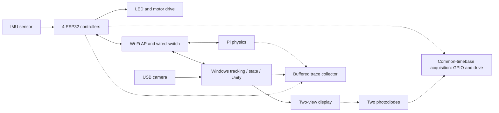

# Integration Test Debugging Concept

**Team: Motion Tennis | Milestone: Mx | Date: 2026-11-18 | Revision: R3**

**Owner: integration support. Status: team acceptance confirmed on 18 November 2026; hardware validation remains pending.** This self-contained concept accompanies the M3 design report. Deadline: 19 November 2026, 23:59 Europe/Vienna. It plans tools before hardware integration; it does not report executed hardware tests or authorize a new implementation stage. [F-12; NF-05, NF-10]

## 1. Bench and observable transactions

The application has six physical computing nodes: four battery ESP32/Zephyr controllers with MPU-6050 IMUs, one Raspberry Pi 3 B and one Windows laptop. The laptop runs tracking, a separate C# committed-state service, Unity and diagnostics. Software processes on that host share one physical failure domain. Sensors are IMU and USB camera; actuators are LED, haptic motor/driver and the display. [F-01, F-03, F-07, F-08; NF-12]

Baseline A uses external AP plus wired Pi/laptop. Variant B uses a Pi hotspot with the laptop wired; verify every producer can reach the collector before testing B. Freeze endpoints, interfaces and traffic shape. Debug transport is asynchronous and must not become a gameplay dependency. [F-10, F-12; NF-05, NF-06, NF-07]

| Transaction / owner role | Hardware measurement and criterion |
| --- | --- |
| TX-01 controller feedback / controller integration | Regular IMU boundary t0 to complete validated matching response receipt tr; t0 to eligible first LED/motor electrical edge t1. Same-controller clock intervals; logic-analyzer confirmation. Response p99 <=30 ms, eligible electrical p99 <=40 ms; local expiry 50 ms suppresses new expired cues. No eligible cue means no invented t1. [F-02, F-06, F-07; NF-01] |
| TX-02 visible event / game presentation integration | Same t0 to photons for an explicitly selected committed event in each viewport. Two photodiodes and t0 marker use one acquisition timebase. M3 proposes p99 <=80 ms/view and zero missing selected events; accepted as a design target, with hardware evidence pending. Keep normal 200 Hz traffic; select sparse visible events at least 200 ms apart globally. [F-08, F-19; NF-04, NF-10] |

**Confirmed bench decision, 18 November 2026:** logic analyzer, oscilloscope and two photodiodes are available. The designated hardware responsibility is recorded as controller/hardware support. Acquisition stops if the Windows game host fails; no recorder surviving that host is required. Save the injection plan before the run and retain the last durably stored prefix. Planned stops close the run; abrupt host loss may prevent a final stop timestamp. After restart, mark the run **aborted / evidence incomplete**, retain pending transactions without invented durations and start a new run/session after recovery. Exclude this censored run from clean-pass statistics and report it separately. This is an accepted observation limitation, not proof of F-21 post-failure output safety; the Windows-host IT-11 subcase remains inconclusive for that claim. Other node/link failures are observed while the host stays available. A stopped observer alone must not stop gameplay. [F-12, F-21; NF-04, NF-05, NF-10]

Record actual drive edges, not GPIO API calls, and scene-correlated light, not only render submission. For a WS2812 module the data-pin edge is not LED activation: use its optical onset or a validated internal electrical probe and label the boundary. Motor drive onset is not mechanical vibration. Probe levels/grounds and fixture protection must be verified before connection. [F-07, F-19; NF-01, NF-09, NF-15]

## 2. Trace points, collection and time

Every regular sample keeps (controller ID, boot session, request sequence); a batch retains each query/decision. Join by identities, never nearby timestamps. Pi computes state; the PC stores an atomic accepted state; Unity only presents it. An early technical rejection records the reached prefix and an explicit failure, not fabricated downstream stages. [F-02, F-04-F-10; NF-07]

| Point | Location / boundary | Collection and correlation |
| --- | --- | --- |
| TP-00 | Controller: regular sampling boundary t0; separate threshold t_trigger | Early monotonic capture plus diagnostic GPIO; sample ID, session, sequence. Shared-INT ambiguity stays unresolved; the threshold creates no gameplay transaction. |
| TP-01 | Controller: acquisition complete and send admission | Fixed-size source record: sensor status, current sample, queue admission/drop, association/calibration. |
| TP-02 | Pi: complete input receive, queue, selected pose | Source record retains transaction; raw pose frame/person, capture clock, historical IMU IDs, mapping version, ages and uncertainty. |
| TP-03 | Pi and state service: query send/receive, snapshot response send/complete receive | Batch/query keys plus snapshot version/tick; separately measure Pi-local query round trip. TCP packet ACK is not a state response. |
| TP-04 | Pi: validation after waiting, calculation and candidate update | Revalidated freshness, decision index, selected inputs, candidate digest and base version. Rejected inputs retain explicit outcomes. |
| TP-05 | Service: atomic accept/reject; Pi: complete commit acknowledgement | Game session/writer epoch/batch, result version/tick, ordered decision/rule IDs; lost ACK remains an uncertain commit. |
| TP-06 | Pi feedback send; controller complete receive tr and validation complete | Exact transaction and commit/cue identity; raw tr retained only for valid timely results. Discarded/late records are diagnostic, not second completions. |
| TP-07 | Controller: first actual LED/motor drive t1 or suppression | Logic analyzer on electrical output; distinct output/cue ID. Keep suppressed, ineligible and failed outputs separate. |
| TP-08 | Service publication, Unity consumption/submission, display photons | Match version, event ID, viewport/team and render-frame ID; two photodiodes and an event-linked patch synchronized with the actual scene. |

All TP rows serve F-10/F-12 and NF-04/NF-07; TP-00/TP-07 serve NF-01/NF-09; TP-02/TP-03 serve NF-02/NF-11; TP-08 serves F-19. Planned compact producer rings retain original sequence numbers, including gaps. Off-path batches reach the collector over proposed UDP 41030; it writes normalized JSONL and a source registry. Queue capacity/high-water, overflow and per-source captured/emitted/dropped counts are retained. Section 7 defines initial capacity and overhead limits, to be verified on each target; a full queue drops counted diagnostics rather than blocking gameplay. [NF-03, NF-06, NF-15]

Use original integer-microsecond clocks. Pi-issued affine maps T_pi = a*t_source+b retain source/reference epochs, validity and uncertainty. Mapping policy: 1 s refresh, 5 s expiry, <=2 ms justified mapping uncertainty/source; camera capture uncertainty is separately <=8 ms. Cross-source intervals sum applicable bounds; two 2 ms mappings contribute +/-4 ms before capture error. Unknown maps leave local lanes. The accepted design target is clock precision pi <=4 ms and coarse granularity g=5 ms, conditional on target validation; g>pi and the coarse +/-2g limit must be respected. A 1 us representation is not 1 us accuracy. [F-15; NF-02, NF-11, NF-13]

Accepted instrument specification: >=8 channels and >=10 MS/s for electrical/digital optical edges; use an oscilloscope for threshold/drive characterization. Calibrate sampling/timebase, GPIO-marker skew, optical comparator delay and threshold repeatability. Local interval uncertainty <=0.10 ms and timestamp quantum <=10 us are accepted targets requiring calibration evidence; availability alone does not establish compliance. Record central value and uncertainty, not only decimal resolution. [NF-10, NF-13, NF-14]

## 3. Debugging order and error classification

| Step | Question / action | Tools and stopping rule |
| --- | --- | --- |
| 1. Whole transaction | Reconcile all t0 starts with responses, explicit failures, local drops/timeouts and cutoff-pending records. Check TX-01 electrical and TX-02 optical endpoints independently. | Offline trace auditor, logic analyzer, two photodiodes. Missing acceptance evidence is inconclusive, never a clean pass. [F-06, F-12; NF-04] |
| 2. Stage | Join TP-00..TP-08 and find first absent, inconsistent or over-budget stage. Compare direct whole-loop duration before stage allocations. | Offline JSON report now; timeline viewer planned. Pi-map uncertainty and source gaps remain visible. Do not add stage p99 values into an E2E claim. [F-10, F-15; NF-10, NF-14] |
| 3. Node | Inspect local queue residence, scheduler release, CPU/stack, bus status, GPU/inference completion and safe-output state around the identified event. | Zephyr logs/debugger and GPIO probes; Pi process tracing/performance counters; Windows performance tools and Unity Profiler. Instrumentation overhead must be declared. [NF-03, NF-06, NF-15] |
| 4. Message | Check protocol/hash, complete frame, transaction/query key, epoch, base version, retry bytes and commit identity. | Wireshark/TShark, planned Protobuf/framed-stream decoder and existing offline pipeline checker. Packet timestamps alone do not prove application completion. [F-04, F-09; NF-07] |
| 5. Minimal reproduction | Replay the same raw inputs and fault schedule against deterministic stubs or the isolated offending node, then repeat on hardware. | Seeded replay/fault harness planned; existing synthetic fixtures/auditor available. Preserve semantic failure first; synthetic replay does not establish physical timing. [NF-05, NF-10] |
| 6. Regression and recovery | Remove the fault, reconcile uncertain commits, restore sessions/maps/association and explicit readiness; run the original case and a 60 s clean recovery check. | Shared fixture tests, source counters and common-timebase acquisition. A change passes only if identity, atomicity and timing criteria survive integration. [F-11, F-20, F-21; NF-07] |

| Verdict class | Example / decision rule |
| --- | --- |
| Timing violation | Correct matching result arrives late or eligible electrical onset misses its criterion. Treat statistical p99/late fraction separately from the 50 ms expiry invariant. With a measured interval [L,U] and deadline D: U<=D is definitely within, L>D definitely late, overlap inconclusive. [NF-01, NF-04, NF-10] |
| Functional error | Wrong player/result/state, duplicate commit/cue, stale actuation, malformed accepted message or technical failure counted as a point, even if fast. May coexist with a timing violation. [F-05-F-09, F-18, F-20] |
| Expected fault response | Explicit rejection, pause or censored timeout under the injected hypothesis, with safe outputs and declared recovery. Evaluate against fault-test oracle, not clean-run success rate. [F-06, F-21; NF-09] |
| Evidence failure | Missing source/link/map, overflow, uncertain capture or absent photons. Preserve failure/inconclusive status and raw records; do not invent latency. [F-10, F-12, F-15; NF-04] |

## 4. Fault injection and exact reproduction

The M2 hypothesis is k=1 non-malicious fail-stop node/link with safe degradation, not uninterrupted play. Fault-free and single-fault tests come first. Malicious peers, automatic replica failover and arbitrary multi-node failures are not guaranteed. A stopped Windows host affects all its processes. The named combination tests and two-node stop are explicitly beyond-k observations. [F-21; NF-09, NF-10]

| Fault family / test | Injection boundary and reproducible schedule | Expected observation |
| --- | --- | --- |
| FH-01 / IT-03 | Network relay: separate 60 s tests with 5/15/30 ms delay, 0-20 ms jitter, 1/5/20% loss each direction; 10 ms application reorder/replay; AP outage 2 s. | Counted failures, unchanged identity/expiry, no duplicated cue; revalidate routes on recovery. |
| FH-02/FH-03 / IT-04, IT-10 | Complete-message proxy: omit query/response/commit ACK/feedback; exact and changed retries; reject stale state; partial/oversize frames; restart around commit. | Mandatory query preserved; exact retries idempotent; pause commit ambiguity at 8 ms; no next batch or unconfirmed hit/miss. |
| FH-04/FH-05 / IT-05, IT-06 | Recorded input/map adapter: stale/frozen pose, wrong calibration/person, thresholds +/-1 ms; offsets +/-100 ms, drift +/-100 ppm, asymmetric exchanges, 6 s refresh loss. | Explicit technical invalidity; no invented point; valid history retained and current invalid maps unusable. |
| FH-06/FH-07 / IT-07, IT-08 | Bounded load and debug hooks: above-peak input, queue overflow, stalled renderer, stop collector 10 s, lost marker/map/link, shared-INT ambiguity. | Bounded backlog, visible loss and unchanged 200 Hz sampling. Observer failure does not stop gameplay; missing evidence cannot pass acceptance. |
| FH-08 / IT-02, IT-09 | Renderer fixture: old view version, wrong team transform, dropped selected visible event; paired optical capture. | Failed-view/absent-photon verdict, not a fabricated display duration. |
| FH-09 / IT-11 | Five supervised stop/rejoin cycles per node/link and selected phase: acquisition, query, pre-commit, post-commit/pre-feedback. Contradictory membership and partition fixtures. | Safe surviving outputs, no split scoring; restored state/setup/maps and four-ready barrier. Fresh boot session on restart. Windows-host stop ends capture: save the prefix and mark post-failure behavior inconclusive. |
| FH-10 / IT-12 | Reviewed bench only: I2C NACK/contention, controlled brown-out, task/watchdog stall and electronic dummy-load overcurrent test; no physical motor blocking. | Explicit acquisition/power fault, reviewed current/pulse/resource limits and safe reintegration. Unspecified limits block physical execution. |

All injection rows serve F-12/F-21 and NF-05/NF-07. Keep untouched baseline data and record injector version, seed, exact affected IDs, parameters, source-clock times and boundary. Never confuse TCP packet order with application message order: TCP byte deletion is a framing-corruption test. Test loss of first copy separately from loss of all retries. Query retry/expiry are 2/5 ms; commit retries are 2/4 ms with ambiguity pause at 8 ms; no retry extends controller expiry. [F-04, F-06, F-09; NF-01, NF-07]

Use seed 20261110 + IT number, >=100 affected identities per message-level subcase, or the stated duration/cycle count. Named combinations: lost commit result + stopped collector; 15 ms feedback delay + high Pi CPU; frozen pose + expired map; two-node stop. Record available electrical/optical outcomes; host-loss capture is censored as defined in section 1. Do not generalize to untested combinations. [F-21; NF-04, NF-05]

Run bundle: anonymous run ID; device/software/tool versions and checksums; schema/profile; topology/routes; calibration and role/slot bindings; workload, warmup and start/stop boundaries; original input/trace data; all Pi map versions/exchanges/uses; injection schedule; electrical/optical acquisition and calibration; expected/actual verdicts; source/loss counters. Exclude credentials and student identities. Default replay data is synthetic/pose-derived; identifiable raw camera images require an explicit retention/access decision before collection. [F-10; NF-04, NF-05, NF-07]

Clean acceptance uses three 10-minute trials at each count 1-4, for each topology: 24 trials, plus separately recorded warmup. Report minimum, mean, median, p95/p99, observed maximum, complete failures and censored timeouts; <=1% late-or-failed attempts and zero wrong associations/duplicate commits/stale cues/lost acceptance records. For TX-02 select 200 visible events/controller without changing the sample stream. [F-01, F-19; NF-01, NF-04]

## 5. Integration tools to build or obtain

Dates and role assignments below were confirmed as the team plan on 18 November 2026, not as completed deliveries. The report/specification is due 19 November; executable hardware tools need internal S2/S3 release, parts and owners. If those gates are not ready, rebaseline the dates explicitly. No purchase or runtime deployment is authorized by this concept. [F-12; NF-05, NF-09]

| Tool / build or obtain | Purpose and served requirement/test | Owner role | Agreed ready-by / current status |
| --- | --- | --- | --- |
| Existing offline auditor and fixtures / retain | Local outcomes, markers, map/uncertainty and query/commit provenance. F-06, F-10, F-12, F-15; NF-04, NF-07; IT-01,04,06,08,10 | Integration support | 18 Nov 2026: reproducible offline package review; implementation recorded, real producer adoption incomplete |
| Source trace adapters and run registry / build | Bounded nonblocking TP records, full identities and captured/emitted/lost counts. NF-03, NF-05, NF-06; IT-01,08 | Each component; integration support coordinates | 26 Nov 2026: isolated exports; planned, requires S2 and node readiness |
| Collector and run-bundle writer / build | Bounded receive/disk queues; manifests and completeness. F-12; NF-04-NF-06; IT-08 | Integration support | 26 Nov 2026: isolated collector; planned |
| Logic analyzer with >=8 channels, >=10 MS/s / borrow or obtain | Common-clock sample/receipt/drive edges and GPIO calibration. NF-01, NF-09, NF-13; IT-01,06,08,11 | Integration support with controller | 24 Nov 2026: calibration and capability check; analyzer available |
| Two photodiodes, comparator and oscilloscope / build or borrow | Two-view photons, analog threshold characterization and drive verification. F-19; NF-10, NF-13; IT-02,09 | Game presentation with integration support | 26 Nov 2026: calibrated optical fixture; two photodiodes and oscilloscope available, conditioning/calibration pending |
| Packet capture and protocol decoder / obtain + build | Wireshark/TShark plus v0.3 UDP/TCP framing decode, identity/counter checks. NF-07; IT-03,04,10 | Network/interface support | 24 Nov 2026: capture/decoder smoke test; tool installation unverified |
| Seeded fault proxy / build | Complete-message delay/drop/duplicate/reorder; exact affected-ID schedule, including lost commit ACK. F-21; NF-05, NF-07; IT-03,04,10,11 | Integration support | 26 Nov 2026: isolated fault cases; planned |
| Input replay, physics/state stubs and communication harness / build or adapt | Known outcomes, periodic/eight-entry batches and before/after integration properties. F-04, F-09; NF-05, NF-07; IT-01,04,09,10 | Physics and state service with integration support | 26 Nov 2026: shared replay package; component cores exist, integrated harness pending |
| Pi map exporter and clock-validation fixture / build | Raw four-timestamp exchange, immutable map/selection/use provenance; reference pulses. F-15; NF-11, NF-13; IT-06 | Physics/time support | 26 Nov 2026: isolated export and calibration protocol; actual mapper evidence pending |
| Timeline viewer / build | Whole transaction to stage/message drill-down with uncertainty and evidence gaps. F-12; NF-04; IT-01,06,08 | Integration support | 30 Nov 2026: first one-controller view, conditional on S3; planned |
| Safe power/bus fault fixture / borrow and configure | Current-limited supply, reviewed driver load and I2C fault hook. NF-09, NF-15; IT-07,12 | Controller/hardware support | 24 Nov 2026: verify section 7 limits and exact assembly; 26 Nov bench readiness; hardware role assigned, validation pending |

Existing evidence covers 72 offline debug tests and four synthetic traces, plus a technically reviewed tracking-to-debug controlled fixture handoff. This does not establish live collection, real clock accuracy, hardware fault injection or a complete viewer. Every new tool needs one positive case, one deliberate failure/loss case, a reproducible command and a recorded resource/overhead bound before integration acceptance. [NF-03-NF-07, NF-10, NF-15]

## 6. Requirement glossary, review and acceptance

Definitions below preserve the M2 IDs needed to interpret this concept without external files. Test labels are fully defined in section 4; TX-01/TX-02 are defined in section 1. F-18/F-20 govern functional verdicts even when the timing is correct. [NF-05, NF-07]

**Functional IDs.** F-01: one-to-four battery wireless controllers. F-02: one identified regular IMU transaction, target 200 Hz. F-03: active camera/IMU fusion. F-04: identified state query/response per valid input. F-05: correct eligible hit/miss and motion. F-06: every sample has an outcome. F-07: distinguish semantic/fault cues. F-08: one committed match with separate presentation. F-09: ordered concurrent/periodic work. F-10: raw capture/time identities. F-11: explicit connection, calibration and restart handling. F-12: whole-transaction diagnosis. F-14: independent diagnostic hardware marker. F-15: versioned reference time and uncertainty. F-18: technical failures do not become tennis points. F-19: same match in two team views. F-20: explicit unique association/readiness. F-21: k=1 fail-stop safe degradation and controlled reintegration.

**Nonfunctional IDs.** NF-01: response/electrical timing and 50 ms expiry. NF-02: uncertainty-inclusive freshness/alignment. NF-03: bounded resources/work. NF-04: complete populations/failures. NF-05: reproducible manifests. NF-06: nonblocking diagnostics and measured overhead. NF-07: interface compatibility and preserved integration properties. NF-09: reviewed hardware safety. NF-10: honest timing classifications. NF-11: qualified clock mapping. NF-12: at least five physical computing nodes. NF-13: measured precision/granularity. NF-14: target WCET/jitter/phase/action-delay feasibility. NF-15: resources, local bus and power validation.

**Review and decision record, 18 November 2026.** The project user confirmed that the team's content confirmation constitutes Mx acceptance, including the specified measurement targets and tool plan. Logic analyzer, oscilloscope and photodiodes are available; controller/hardware support is responsible for the assembly. The user selected stopping acquisition with the Windows host and authorized integration support to define the initial operating envelope in section 7. This records an actual human decision, not an inference from offline tests. [F-12; NF-05, NF-07]

The host-loss observation gap is accepted for this concept; F-21 behavior after that loss is still unverified. Device ratings, regulator/protection compatibility, instrument calibration and implementation of the limits remain execution prerequisites. The project user subsequently confirmed M3 as-is on 18 November 2026: both reports are accepted and Gate 2 is complete. This administrative revision records that decision; it does not claim executed tests or release internal S2/S3. [F-21; NF-09, NF-10, NF-13-NF-15]

## 7. Initial hardware operating envelope

These are conservative **project limits set under the user's authorization on 18 November 2026**, not manufacturer absolute ratings or measured behavior. Apply the lower of this envelope and the verified assembled-part rating; do not raise a limit merely because a startup test fails. Controller/hardware support records the board, regulator, wiring, protection, firmware and instrument manifest before energizing the assembly. Integration support owns the limit checks in IT-07/IT-08/IT-12. [F-01, F-07; NF-05, NF-09, NF-15]

### Selected parts and compatibility

The first prototype retains MPU-6050/Zephyr. The two offered replacements are BMI323 6DOF and BMI323+BMM350 9DOF, both specified for 3.3 V; substitution requires driver, interrupt and timestamp validation. Button DFR0029-B and joystick DFR0061 remain optional and do not change the gameplay input contract. [F-02, F-03, F-14; NF-07; H5-H6]

The feedback candidates are DFR0440 motor module (5 V supply, logic/PWM control) and DFR0605 WS2812 LED (3.3-5.5 V, maximum listed current 48 mA). DFR0563 fuel gauge uses 3.3-6 V VCC, 2.5-4.2 V battery input and 3.3 V I2C logic. Use 3.3 V logic, verify pull-ups/level conversion and never power a motor from a GPIO. A raw cell must not feed a 3.3 V rail directly. [NF-09, NF-15; H1-H3,H7]

DFR0668 is a single-cell lithium CC/CV charger despite its LiPo label: 5 V input, selectable 50/200/500 mA and 4.2 V +/-1% termination. It is a candidate for a conventional 4.2 V Li-ion cell, not blanket approval of the selected protected assembly. The tolerance can reach 4.242 V, above the gauge's listed 4.2 V input range. Verify the exact cell/PCB charging tolerance; disconnect the controller/gauge load during charging and reconnect only within their verified range. The linked protected 18650 still needs its exact protection-board ratings and holder fit checked. Do not assume charger thermal regulation senses cell temperature or provides load sharing. [NF-09, NF-15; H3-H4,H8]

| Area | Initial project limit and required behavior | Verification / owner |
| --- | --- | --- |
| Cell and supply | One protected 1S cell; gameplay window 3.30-4.20 V at the cell. Warn at <=3.50 V for 1 s or SOC <=20%; pause and inhibit cues at <=3.30 V for 1 s or SOC <=10%. Missing voltage/SOC for >2 s also pauses. Resume manually only at >=3.60 V, SOC >20% and valid readiness. These are application thresholds, not a replacement for cell protection. | IT-07,12: emulate thresholds with a current-limited supply, not deep-discharge a cell. Controller/hardware. |
| Rails and input power | Regulated 3.3 V logic/sensors; separately regulated nominal 5 V motor supply. Exact regulators remain a build prerequisite. Initial cell-side bench current limit 1.0 A maximum (<=4.2 W at 4.2 V), further reduced to the weakest verified part/wire rating. A current-limit trip aborts the run; it is not an accepted brown-out. | Verify startup/Wi-Fi/motor transients and rail tolerances before battery use. The ESP32 reference needs a regulator capable of at least 500 mA; this is capacity, not measured draw. IT-07,12; controller/hardware. |
| Charging and temperature | DFR0668: regulated 5 V input, 200 mA initial charge setting; maximum project charge current 500 mA only after cell/PCB and thermal verification. No simultaneous gameplay/charging. Charge only at measured cell temperature 10-35 C; stop charging at >=40 C. Indoor bench ambient 15-30 C; stop operation at cell >=40 C or accessible enclosure >=45 C. | External temperature probe/operator supervision is required until a sensor/interlock exists. Confirm actual termination and exact cell rating; charging remains blocked if tolerance compatibility is unresolved. Controller/hardware; IT-12. |
| Haptic output | Default 100 ms cue; absolute commanded on-time <=200 ms; >=300 ms off between pulses and <=2 s total on-time in any rolling 10 s. No extension/retrigger of an active pulse. Cap breaches suppress and record the cue; never queue it beyond transaction expiry. Motor supply nominal 5 V; first characterization uses a separate 100 mA current-limited branch and <=50 ms pulses. This 100 mA value is a test abort ceiling, not a manufacturer current rating or proof that startup succeeds. | Start/run/stall ratings are absent from the listed motor specs: confirm them before handheld use. A failed current-limited start blocks use; no blind current increase. Validate timer/default-low on reset. IT-07,12; controller/hardware. |
| LED | One module/controller, one active color at brightness <=25% for normal cues, <=200 ms cue duration. Reserve 50 mA in the supply budget for one module; normal software brightness is not overcurrent protection. Default off at setup/reset/pause. | Verify actual current and optical onset; use hardware-timed output to avoid blocking IMU sampling. IT-01,02,07; controller/hardware. |
| Watchdog and safe outputs | Motor control pulled low at boot/reset; timer disables each pulse by 200 ms. A task-independent watchdog resets a stalled controller within 250 ms. A hardware one-shot/output gate is needed before claiming the 200 ms cap survives CPU failure; software timing alone does not prove it. Power/reset the LED rail if stale latched light cannot be cleared. | IT-07,11,12: verify output-off on reset and stalled task with the actual board. No watchdog or gate implementation is claimed. No physical blocked-motor or battery short/overcharge injection. Controller/hardware. |
| I2C and acquisition | Target 400 kHz only when every attached part and measured bus rise time support it. Per acquisition bus wait <=2 ms, no indefinite retry; report invalid sample on timeout. Maintain identified 200 Hz sampling. Fuel-gauge reads <=2 Hz, lower priority than IMU. After three consecutive acquisition failures pause gameplay; recover off-path and require fresh readiness. | IT-05,12: NACK/stall fixture, bus occupancy and GPIO timing. IMU range/ODR and interrupt behavior remain pinned per selected sensor; no silent sample-rate reduction. Controller. |
| Diagnostics and resources | Fixed rings: diagnostic memory <=min(64 KiB, 10% of measured free RAM at startup) per embedded node; at least 20% stack headroom per task under load. Trace-point execution <=50 us observed maximum; diagnostics add <=1 percentage point CPU utilization and <=1 ms E2E p99 in paired runs. Absolute transaction limits must still pass. Queue full drops counted diagnostics, never gameplay. | IT-08: three 120 s full/minimal-logging pairs; declare sample counts and observation maxima, not WCET. Reject the instrumented configuration if limits fail; reduce trace cost rather than hide loss. Integration support with component owners. |

Battery thresholds use validated readings and conservative uncertainty; hardware brown-out/overcurrent protection remains independent of the 1 s application debounce. If power falls outside a verified rail range, halt the test immediately. Physical stress uses a current-limited supply and electronic dummy load; never deliberately short, overcharge or deeply discharge the protected cell. Limits above are design requirements to implement and measure, not existing protection features. [NF-09, NF-10, NF-15]

### Hardware source record

Manufacturer specifications checked on 18 November 2026; the report reproduces the relevant values above so it stands alone. H8 identifies the user's selected protected assembly; exact assembly ratings remain unverified. Project thresholds, duty limits, temperatures and resource caps are engineering choices, not quotations of these sources. [NF-05, NF-09]

H1 DFRobot DFR0440 motor: https://wiki.dfrobot.com/dfr0440/

H2 DFRobot DFR0605 LED: https://www.dfrobot.com/product-1848.html

H3 DFRobot DFR0563 fuel gauge: https://www.dfrobot.com/product-1734.html

H4 DFRobot DFR0668 charger: https://wiki.dfrobot.com/dfr0668/

H5 DFRobot BMI323 6DOF: https://www.dfrobot.com/product-3122.html

H6 DFRobot BMI323+BMM350 9DOF: https://www.dfrobot.com/product-3128.html

H7 Espressif ESP32-S3 power guidance: https://docs.espressif.com/projects/esp-techpedia/en/latest/esp-friends/get-started/try-firmware/try-firmware-hardware/esp32s3.html

H8 User-selected protected NCR18650B 3400 mAh assembly: Akkushop Austria, product NCR18650B, listing dimensions approximately 69 x 18.61 mm. The protected assembly is not specified by an unprotected-cell datasheet alone.
