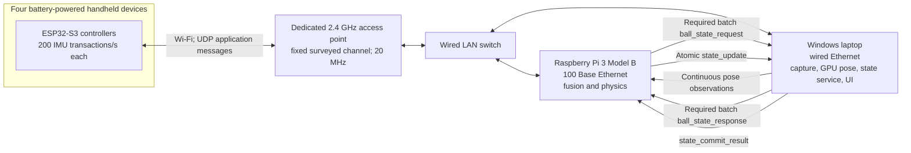

# Network architecture and transport profile

[Documentation home](../README.md) · [Protocol](protocol.md) · [Timing](timing.md) · [Hardware](hardware.md)

**Agreed context:** four battery-powered controllers must support wireless play; the available physics host is a Raspberry Pi 3 Model B and the camera/game host is a Windows laptop with an RTX 5080. **Proposed reference design:** the topology, UDP profile, limits and experiment gates below. **Implemented:** no component networking implementation or measured network performance exists yet.

## Reference topology

Use a dedicated access point for the four controllers. Connect both the Raspberry Pi and laptop to the same wired LAN through the access point's Ethernet switch or a separate switch. Use a wired USB Ethernet adapter for the laptop if its built-in ports require one. The Pi is a wired station, not the access point. Camera video stays local to the laptop; send compact pose observations to the Pi.

The Pi 3 Model B has a 1.2 GHz quad-core processor, 1 GB RAM and 100 Base Ethernet. Do not document it as a Pi 3 B+ or a Gigabit Ethernet device. These are manufacturer specifications, not throughput or scheduling measurements of this setup. [Raspberry Pi specification](https://www.raspberrypi.com/products/raspberry-pi-3-model-b/).

The reference controller is ESP32-S3, whose integrated radio supports 2.4 GHz 802.11b/g/n. A 5 GHz-only SSID cannot serve that controller. Use a separate, uncongested 2.4 GHz SSID with a surveyed fixed channel, 20 MHz bandwidth, and no unrelated clients for baseline trials. Keep association, DHCP and any name resolution outside the measured gameplay transaction. Record the actual channel, AP model/firmware, RSSI, interference and association state in the run manifest. [Espressif ESP32-S3 specification](https://www.espressif.com/en/products/socs/esp32-s3).

## Why Wi-Fi is the initial wireless profile

Wi-Fi is not a deterministic delivery mechanism. It is the reference because it is built into the selected ESP32 family, interoperates with the Pi without a custom radio gateway, and supports packet capture and ordinary IP tools. Small packets and low aggregate payload volume make latency, contention, endpoint scheduling and loss more important than advertised peak throughput.

| Candidate | Position in this plan | Reason and remaining work |
| --- | --- | --- |
| Dedicated Wi-Fi plus UDP | Reference wireless implementation | Direct ESP32-to-Pi IP communication, observable application packets, explicit expiry and no transport head-of-line blocking between datagrams |
| USB CDC controller-to-Pi | Bench and measurement reference only | Removes the radio variable while preserving the same application identities; cables do not satisfy wireless gameplay requirements |
| ESP-NOW plus an ESP32 gateway | Optional later comparison | Adds a radio gateway, framing, another queue and clock domain; it is still a connectionless Wi-Fi protocol, not a hard-real-time guarantee |
| Custom radio, BLE, or a scheduled industrial wireless system | Separate architecture study if the reference fails | Requires its own capacity, latency, interference, gateway and diagnostic design; no compatible implementation is assumed |

Espressif documents ESP-NOW's default 1 Mbps rate, its version-dependent payload sizes, and that successful MAC-layer delivery does not establish application receipt. It therefore still needs transaction correlation, expiry and application feedback. Replacing Wi-Fi/IP with ESP-NOW alone does not resolve the Windows/GPU/state-service timing dependencies. [ESP-NOW documentation](https://docs.espressif.com/projects/esp-idf/en/stable/esp32s3/api-reference/network/esp_now.html).

During active gameplay, the proposed ESP32 profile disables Wi-Fi modem sleep with `WIFI_PS_NONE` and leaves Bluetooth unused. This trades battery life for receive latency; characterize power consumption and runtime instead of quoting a guessed battery duration. Espressif notes that modem sleep may defer receive delivery to a DTIM or listen interval, and radio coexistence can still limit Wi-Fi activity. [Espressif power-saving guidance](https://docs.espressif.com/projects/esp-idf/en/release-v5.3/esp32s3/api-guides/wifi.html).

## Application transport

The [protocol specification](protocol.md) owns the exact schemas, and [reference profile](../spec/reference-profile.json) owns the configuration values. The new reference profile is `0.2-proposed`: Protocol Buffers application messages in UDP datagrams, replacing the earlier unimplemented TCP/JSON proposal. Separate TCP control connections handle setup, pairing, calibration, recovery and run administration. JSON remains useful for human-readable examples and offline trace exports; it is not the live gameplay encoding.

| Listener | Port / transport | Purpose |
| --- | --- | --- |
| Pi controller input | 41000 / UDP | Controller measurements and matching feedback through the registered endpoint |
| Windows game state | 41010 / UDP | Required ball queries/responses and atomic updates/commit results |
| Pi pose input | 41020 / UDP | Continuous timestamped tracking observations |
| Windows debug collector | 41030 / UDP | Bounded asynchronous trace delivery |
| Pi control | 41040 / TCP | Session, association and physics administration |
| Windows game control | 41041 / TCP | State-session and game administration |
| Windows tracking control | 41042 / TCP | Tracking/calibration administration |
| Windows debug control | 41043 / TCP | Run control and debug administration |

These are proposed application listeners, not already running services or reserved public registrations. Record any deployment override in the shared profile and all participants; do not change one repository's port independently. Control stream frames are capped at 65,536 bytes by the reference profile and must use explicit framing rather than TCP packet boundaries.

- Cap each application datagram at 1,200 bytes. Validate encoded size before sending and reject oversized or malformed input. Do not rely on IP fragmentation for correctness.
- Preserve controller/session/request identity, original sensor times, message/query/update IDs, game session, writer epoch and state versions. UDP delivery order is not processing order.
- Keep sockets nonblocking and separate network receipt from bounded physics work. Parse into preallocated, bounded structures; reject excessive arrays and unknown incompatible versions.
- Bind listeners to configured LAN interfaces. Use a private authenticated WLAN and explicit peer/role/session registration. A source IP address or device ID alone is not application authentication; any cryptographic session protection must fit the same size/timing profile and be recorded.
- Keep telemetry and administration separate from gameplay queues and state ownership. Capture failure or a slow debug consumer must not block controller feedback or a commit.
- A receipt acknowledgement or UDP send completion never substitutes for `feedback_result` or `state_commit_result`.

A batch state update must remain one atomic update and fit the payload cap. If it cannot, reduce/compact its schema or fail the configuration; never split it into independently committed pieces. Large diagnostic blobs belong in the debug/export path. Pose messages may represent one person from a frame so that four-person data does not require fragmented datagrams; the protocol must retain the common frame identity, timestamps, presence/loss information and any completeness rules. Do not infer a missing person from one missing packet.

## Four-controller load and batching

Each controller produces one identified measurement transaction at each 200 Hz IMU boundary: four controllers therefore offer **800 logical transactions per second**. Every transaction retains its own `t0`, sample identity, result or counted failure. Batching reduces PC exchanges; it does not remove logical requests or silently discard samples.

The Pi releases a batch every 5 ms when the preceding batch has resolved. A normal batch contains up to four inputs. The processing cap is eight inputs, at most two per controller, so the system has some burst-recovery capacity. A strict maximum of four would equal the nominal arrival rate and leave no capacity to drain a queue after jitter. Keep a bounded queue of four inputs per controller and use fair selection before deterministic ordering within the batch.

For each batch:

1. Select valid, unexpired controller transactions and record their order.
2. Send the required `ball_state_request` with an entry and query identity for every selected transaction.
3. Receive `ball_state_response` entries referring to one shared committed snapshot. Every entry remains correlatable to its transaction.
4. Advance from that snapshot and evaluate ordered inputs, deriving later candidate states from earlier candidates in the same batch. These are not independently committed snapshots.
5. Send one atomic `state_update` containing the final ball state and ordered per-transaction outcomes, guarded by the shared base version.
6. After `state_commit_result` accepts that batch, send each controller its corresponding feedback. All accepted events in the batch refer to the same resulting committed version.

Periodic movement uses the same single writer and commit path, including batches with no controller inputs. The game must not independently integrate authoritative movement. See [physics processing](physics.md) for same-tick event ordering and recovery.

**Capacity gate:** the measured batch-service p99 target is at most 4 ms, excluding the wait for the next 5 ms release. This is a provisional headroom target, not proof of schedulability. The design cannot sustain a 5 ms committed cadence if the required PC query and commit exchanges routinely take longer than that period.

At an illustrative encoded input size of 160 bytes and feedback size of 160 bytes, 800 inputs plus 800 responses per second contribute 256,000 application bytes/s, or about 2.05 Mbit/s. This arithmetic excludes protocol, Ethernet/Wi-Fi, acknowledgements, retries, pose traffic and logging, and is not a measured capacity result. The reference Pi's 100 Mbit/s link is not the obvious payload bottleneck; measure packet processing and latency tails rather than relying on this comparison.

## Retry, expiry and overload policy

All intervals below are **proposed reference values** and use the responsible device's monotonic clock. They do not assert maximum network delivery time.

| Operation | Reference policy | Terminal behavior |
| --- | --- | --- |
| Controller input | Send once; no application retransmission | Controller records a timeout at 50 ms from `t0` if no timely valid result exists |
| Required ball query | Retry once, with the identical query/batch identity, after 2 ms; query expires at 5 ms | Fail affected transactions explicitly; never use an expired response |
| State update/commit | Retry the identical update at 2 ms and 4 ms if unresolved; ambiguity threshold 8 ms | Pause the writer and resolve/reset the session; do not invent a new update ID and apply the event twice |
| Controller feedback | Normal feedback follows accepted commit; duplicates are harmless and late results are counted | No gameplay actuation at or after the controller's local expiry |
| Pi admission queue | Four inputs per controller; processing cap two per controller per batch | Return `overloaded` for a recoverably identified rejected input; record every drop if delivery is impossible |
| Slow batch or missed tick | One batch in flight; bounded catch-up of at most four 5 ms steps | Pause/degrade if simulation lag exceeds 20 ms; no unbounded backlog or silent time jump |

Do not start a new batch while an earlier commit is uncertain. Query retry is allowed only before any corresponding update was sent. Deduplication must return the original query response or commit result, not silently turn an identical retry into a new operation. Reconnection and restart fencing remain mandatory.

Controller expiry is independent of remote retry timers. A commit can prove accepted after the controller has timed out; retain the committed game history, record failed feedback delivery, and suppress stale actuation. A currently fetched ball snapshot alone cannot establish whether a particular uncertain update committed.

## Host scheduling profile

On the Pi 3 Model B, use a headless 64-bit Linux deployment and a native C++ physics/fusion service. Keep GPU inference, video encoding and the debug UI on the laptop. Separate bounded input reception, the single state writer, and low-priority telemetry export. Avoid synchronous terminal or filesystem writes, unbounded allocation, and lock contention in the measured path. Record CPU affinity, priorities, thermal state, throttling and power conditions rather than assuming a core assignment establishes a deadline.

Evaluate `PREEMPT_RT` only with the actual Pi kernel and workload. Raspberry Pi documents 64-bit kernel support for Pi 3 and notes that real-time support is available in mainline Arm64 kernels from Linux 6.12; this does not mean a stock installed image has that configuration enabled. Preserve a bootable baseline and record the chosen kernel/configuration. [Raspberry Pi kernel documentation](https://www.raspberrypi.com/documentation/computers/linux_kernel.html).

`PREEMPT_RT` reduces nonpreemptible kernel sections and scheduling latency. It cannot bound wireless contention, an external Windows service, GPU inference or display presentation. Use scheduler measurements to identify local causes and application traces to measure the full chain. [Linux real-time design](https://docs.kernel.org/core-api/real-time/theory.html), [Linux RTLA tools](https://docs.kernel.org/tools/rtla/rtla.html).

On Windows, keep the authoritative snapshot/commit service independent of the renderer's frame loop and inference worker. Use bounded work and measured scheduling configuration; do not indiscriminately set processes to `REALTIME_PRIORITY_CLASS`, which Microsoft warns can interfere with system input and disk activity. [Windows scheduling priorities](https://learn.microsoft.com/en-us/windows/win32/procthread/scheduling-priorities).

## Network acceptance experiment

Run the same four-controller transaction workload first through the USB bench transport, then through the dedicated Wi-Fi profile. Repeat with rendering and inference active, controlled CPU load, interfering traffic, disconnects and application-level loss/duplicate/reorder faults. Record complete application RTT, electrical-feedback latency, input/feedback loss, query and commit RTT, queue residence, batch-service distribution, expired transactions and simulation lag.

Use packet capture at the wired endpoints plus application trace identities to locate missing stages. An endpoint capture does not by itself reveal radio airtime, retransmission count or the receiver's application scheduling. Preserve all observation clock domains; use [clock mapping](coordinates-and-time.md) before claiming one-way durations. Follow the full [acceptance matrix](testing.md).

The deliverable is a measured deadline-aware wireless system with explicit failures. A claim of hard end-to-end real-time guarantees would require bounded hardware, OS, network, acquisition and execution behavior beyond the present Windows/GPU/Wi-Fi reference architecture.
