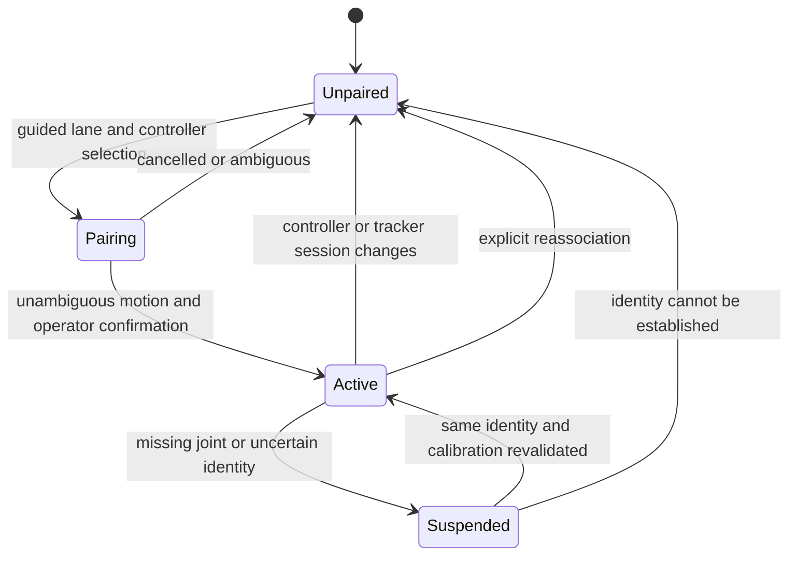

# Webcam tracking, player association, and fusion inputs

[Documentation home](../README.md) · [Master plan](master-plan.md) · [Tracking stack](tracking-stack.md) · [Coordinates and time](coordinates-and-time.md) · [Protocol](protocol.md)

**Agreed direction:** start with a webcam on the available Windows laptop with an RTX 5080, support four players with battery-powered wireless controllers, and use calibrated 2.5D gameplay before a later true-3D phase. Body and joint observations remain active inputs to gameplay. The available Raspberry Pi is a Raspberry Pi 3 Model B. **Proposed reference implementation:** the stack and processing rules below. **Implemented:** documentation only; no capture service, model integration, fusion code, or camera measurement exists. The exact webcam generation and tested driver/runtime versions remain **Open**.

The webcam-first direction supersedes the earlier Kinect-first deployment. Kinect v2 is a possible later depth-input route, not a prerequisite for the first milestone. Do not infer that `libfreenect2` alone provides skeleton tracking. The central [master plan](master-plan.md) owns the complete deployment and timing profile.

## Device and software boundary

The Windows laptop performs camera capture, GPU pose estimation, temporal person tracking, and pose publication. The Pi performs controller/person association, temporal alignment, calibrated plane mapping, IMU/pose fusion, and physics. The game UI displays the association and tracking state; it does not silently correct the authoritative fusion result. The tracker and game remain separate processes so a rendered frame cannot intentionally block pose publication.

Use a native Media Foundation capture adapter with a bounded shared-memory handoff to a Python RTMO worker as the proposed production boundary. The capture adapter undistorts each image using the versioned camera calibration to produce a rectified image with intrinsics `K_rect`. Start with RTMO-m, full-frame letterboxing of that rectified image to 640 × 640, and a verified ONNX Runtime GPU execution path. The adapter, worker, and manifest are planned modules, not existing executables. [Tracking stack](tracking-stack.md) explains the primary-source evidence, alternatives, and compatibility gates.

The camera is physically attached to the laptop, not to the Pi 3 Model B. Raw video and inference stay on the laptop. Only compact observations cross the LAN; neither camera encoding nor GPU inference belongs on the Pi's critical path.

## Continuous acquisition and bounded publication

1. Negotiate and verify the actual camera mode: desired 1920 × 1080 at 60 frames/s. Record the exact generation, firmware, pixel format, exposure, camera controls and USB topology. Advertised 60 fps is not a measured delivery rate.
2. Assign a capture-stream session and monotonically increasing frame ID at the capture boundary. Preserve source timestamps and their meaning, plus host arrival. Capture continues independently of controller requests.
3. Keep exactly one waiting image between capture and inference. Replace an older waiting image with the newest and increment the skipped-frame counter; do not queue seconds of old images. A frame already in inference can finish, but reject its output if it is stale at publication.
4. Undistort the raw captured image once in the capture adapter, producing the calibrated rectified image with `K_rect`. Letterbox that full rectified image into the model input. Record scale and padding, then undo them before publishing coordinates normalized to the rectified image's original dimensions. The Pi uses `K_rect` and must not undistort the coordinates again. Digital face framing, background replacement and other camera transformations must be disabled or explicitly included in the calibration.
5. Run pose inference and identity association; publish one `skeleton_frame` datagram per person, with a shared source frame ID. Publish a compact `frame_status` for the same source frame listing observed person IDs and loss/health information.
6. Under the proposed `0.2-proposed` protocol, each UDP/Protobuf datagram must fit within 1,200 bytes. Enforce the encoded-size limit. Do not fragment one large multi-person JSON frame or send video through this interface.
7. The Pi retains eight pose frames per person and 256 IMU samples per controller. Old observations are discarded with counters. UDP sequence gaps, missing person packets and processing skips are distinct measurements.

A missing datagram is not an explicit declaration that a body disappeared. `frame_status` identifies the expected person observations; incomplete frames must be counted, and eligibility must use a complete valid observation still within the age rules. A no-person frame and a stalled camera are different faults. Out-of-order packets cannot silently move the displayed or fused state backward.

## Observation contract

The [protocol](protocol.md) defines exact wire fields and encoding. The tracker must provide this information without inventing spatial or temporal precision:

| Information | Required interpretation |
| --- | --- |
| Tracking session, source frame ID, person ID | Person identity is scoped to a tracker session; every person's packet from one image shares the same frame ID |
| Capture timestamp and clock identity | Original camera/driver timestamp with its declared boundary and unit, or explicit unavailability; preserve it through all stages |
| Host arrival and processing completion | Separate laptop monotonic timestamps; neither overwrites the source timestamp |
| Capture uncertainty and mapping identity | Evidence needed to compare camera observations with Pi/controller clocks |
| Joint representation | Seventeen COCO body keypoints normalized to the original rectified image, with per-joint confidence and validity; this is 2D camera data |
| Image metadata | Rectified width/height, `K_rect` through the calibration identity, and preprocessing transform identity so normalization and letterboxing are reversible |
| Calibration identity and tracking quality | Which camera/intrinsic/plane configuration applies; tracked, inferred or unavailable status with explicit failure reasons |
| Model and runtime identity | Model artifact checksum and processing-profile version in session metadata and debug records |

Use rectified-image `u = x / width`, `v = y / height`, with the top-left origin, +u right and +v down. Undo letterboxing first. Here width/height describe the rectified image before model resizing, not the distorted raw sensor image or the 640 × 640 model tensor. Physics converts these points to rays with `K_rect`; lens correction has already occurred on the laptop and must not occur twice. Raw distorted frames and their original timestamps may be retained by independently buffered debug recording, with their different representation labeled explicitly. Invalid joints are marked invalid, not replaced with `(0, 0)` or a plausible-looking extrapolation. The ordered joint names are nose, left/right eye, left/right ear, left/right shoulder, left/right elbow, left/right wrist, left/right hip, left/right knee, and left/right ankle. Protocol definitions must preserve this order and identify it explicitly.

RTMO confidence is a model score, not a calibrated probability or a measured position covariance. Select and validate model-specific confidence thresholds before enabling gameplay. The playing-side wrist, elbow, shoulder and torso/hip reference must be usable. Do not infer racket-face orientation directly from a 2D wrist point.

## Controller-to-person association

Physics owns a versioned mapping from `(controller_id, session_id)` to `(tracking_session_id, person_id)`, player slot, playing hand and calibration. The initial profile uses four marked, separated play lanes, with one controller and one confirmed person per slot. Extra detected people are unpaired; detection order never assigns controllers.

The proposed tracker uses bounded temporal association from bounding-box overlap and joint continuity, with gated Hungarian assignment. It must reject ambiguous crossings instead of always producing an ID. This is a design choice, not an implemented tracking guarantee. Tracking IDs alone are insufficient to prove that a person still holds the same controller.

Pair one controller at a time: show its ID in the UI, identify the intended lane/person, ask for a guided hand motion, and compare temporally mapped IMU motion with the wrist trajectory. Require operator confirmation. Increment `association_version` on a change; invalidate queued work using the old mapping. Do not silently assign the controller to the nearest remaining person after occlusion.

A tracker restart invalidates its old person IDs even if the same numbers reappear. A controller restart requires a new session and mapping validation. The UI may hold a stale avatar briefly for display, but physics must disable its hit eligibility.

## 2.5D geometry and delayed observation fusion

The initial profile maps camera rays onto a calibrated, declared play plane for each lane. The Pi owns this mapping. The resulting wrist position is a **constrained gameplay estimate**, not measured free-space wrist depth. The camera must publish image observations without labeling them as metric 3D joint positions. Moving substantially away from the calibrated plane invalidates the model; a neural network's smooth-looking output does not establish geometric accuracy. See [coordinate conventions](coordinates-and-time.md).

The Pi aligns each delayed camera observation with historical IMU samples near its capture time, applies the plane-position observation at that time, and replays calibrated orientation updates to the current decision time. Retain the historical sample IDs as well as the current transaction's sample ID. Use bounded plane-position prediction from visual motion; do not double-integrate acceleration to invent long-term position. Six-axis inertial orientation needs a heading-reference/drift policy because gravity alone does not constrain yaw. The [physics specification](physics.md) owns the estimator and collision behavior.

Candidate gates from the shared reference profile:

| Quantity | Reference limit or target | Meaning |
| --- | --- | --- |
| Camera input | Desired 1080p60 | Capability and measured delivery gate |
| Pose output under four-person load | Sustained at least 30 Hz; 60 Hz preferred | Includes capture/preprocessing/inference/tracking scheduling, not just a model benchmark |
| Waiting image queue | One frame | Latest waiting frame wins; overwritten frames counted |
| Pi pose history | Eight frames per person | Bounded alignment history, not permission to use stale data |
| Pi IMU history | 256 samples per controller | At 200 Hz this spans approximately 1.28 s; use only temporally eligible samples |
| Pose age at decision | At most 80 ms including uncertainty | Original observation freshness; transport arrival alone cannot establish it |
| Current transaction IMU age | At most 30 ms including uncertainty | Separate from historical samples used to align a delayed pose |
| Capture alignment | At most 25 ms including uncertainty | Camera observation versus its selected historical IMU sample(s), not versus the newest IMU timestamp |
| Plane-position prediction | At most 50 ms including uncertainty | Prediction from the selected observation to the evaluation instant; this may be stricter than the 80 ms age gate |
| Network-clock mapping uncertainty | At most 2 ms per mapped clock | Conservative bounds must be propagated across comparisons |
| Camera exposure-to-timestamp uncertainty | At most 8 ms, measured | Unknown or larger uncertainty prevents a verified bounded-age decision |

These are proposed acceptance limits, not measured capabilities. Add clock, capture-boundary and prediction uncertainty conservatively; do not subtract uncertainty to make an old observation pass. Interpolation retains both source frame/sample IDs and weights. Prediction never changes the recorded capture time. Recheck age, alignment, identity/calibration, prediction horizon and transaction expiry after ball-state waiting and immediately before submitting a result.

The full controller targets, including p99 application response at most 30 ms, eligible electrical cue at most 40 ms and local transaction expiry at 50 ms, are defined in [timing](timing.md). They do not mean that a new camera exposure and inference occur within every transaction. Continuous tracking can produce older observations whose separate freshness gates must pass.

## Loss behavior and acceptance

Missing required joints, ambiguous pairing, out-of-plane motion, unavailable time mapping or violated temporal limits produce explicit `tracking_unavailable`, `stale_input` or `invalid_input` outcomes as specified centrally. They are not ordinary misses. UDP loss, queue replacement, inference failure and stale-output suppression need separate counters. Recovery requires valid identity, calibration and time mappings.

Acceptance requires reproducible one-to-four-person tests with controlled swings, lane boundaries, occlusion, crossings, distractors, exit/reentry, controller swaps, camera movement, service restart, delayed frames and render/GPU load. Measure input eligibility rate and rejected-pose reasons alongside latency; fast error responses alone do not establish useful gameplay. Use the [debug environment](debugging.md) to join frame, transaction and state identifiers. No such hardware or inference test has been performed in the current repository.
