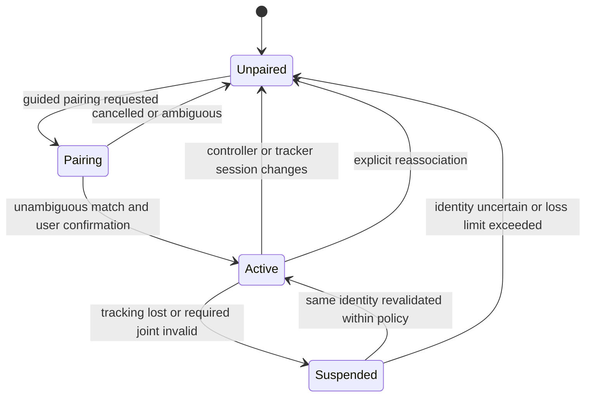

# Kinect skeleton tracking and player association

[Documentation home](../README.md) · [Coordinates and time](coordinates-and-time.md) · [Protocol](protocol.md)

**Implemented:** the camera-tracking repository contains no acquisition code, skeleton backend, dependencies, configuration, or tests. **Agreed design:** Kinect v2 skeleton tracking actively contributes body and joint information to player and racket motion. **Proposed:** all mechanisms below unless identified as an external dependency fact. **Open:** backend selection, host OS, required quality thresholds, and calibration tolerances.

## Backend selection

The project uses Xbox One Kinect / Kinect v2. Do not substitute Kinect v1 or Azure Kinect assumptions. The [OpenKinect libfreenect2 project](https://github.com/OpenKinect/libfreenect2) provides color, infrared, depth, and image-registration capabilities; it does not itself provide the body/skeleton tracker needed here. Linux sensor access is therefore only part of a possible solution.

Two routes need an explicit feasibility decision:

| Candidate route, not selected | Evidence required before adopting it |
| --- | --- |
| Linux acquisition plus a separate skeleton/pose estimator | Reproducible install; Kinect v2 data integration; metric 3D joints; identity stability for one to four people; capture-time mapping; confidence behavior; processing and resource measurements; license compatibility |
| Microsoft Kinect for Windows SDK 2.0 body tracking | Working installation on the actual host; documented OS/driver constraints; exported joint/identity/time semantics; network adapter into the common interface; deployment impact if tracking requires a separate Windows machine |

The [official Microsoft SDK 2.0 page](https://www.microsoft.com/en-us/download/details.aspx?id=44561) lists Windows 8/8.1/Embedded Standard 8 requirements. It does not establish Linux support. A successful Linux depth-stream demo, an unrelated pose model, or an SDK for another Kinect generation is not evidence that this project has selected a usable skeleton tracker. The published [Microsoft Kinect tutorial](https://kinect.github.io/tutorial/) provides a Windows SDK integration reference, not Motion Tennis setup instructions.

## Continuous acquisition and proposed output

Capture and skeleton processing run continuously, independently of controller requests. The service publishes asynchronous `skeleton_frame` messages. Physics maintains a bounded history and selects already captured poses appropriate to each transaction. A controller event does not trigger a fresh Kinect exposure.

The [protocol](protocol.md) owns exact field definitions. The required interface carries:

| Information | Meaning |
| --- | --- |
| Tracking session and frame identifiers | A fresh tracking session after restart; monotonically increasing frame sequence within it |
| Original capture timestamp and clock identity | Source-device exposure/frame time and its documented clock domain; preserve the original value through all adapters |
| Processing-completion timestamp | When pose estimation finishes in the tracking host's clock; distinct from capture and network arrival |
| Per-person identity | A body identifier scoped to the tracking session, not a permanent real-world identity |
| Joint data | Named metric joint positions; required-joint tracking states; optional backend confidence with its documented scale |
| Calibration and coordinate-frame identifiers | Which transforms apply to positions and orientations |
| Quality/loss information | Tracked, inferred, or unavailable observations and an explicit indication that a person/frame is lost |

Physics records arrival in its own clock separately. A transport receive time must not overwrite capture time. If the backend only exposes a host receipt time, label it honestly, record unknown acquisition delay, and treat capture-age guarantees as unverified.

Normalize each backend's joint names and status codes in its adapter. Do not invent a universal numerical confidence threshold across incompatible estimators. The initial required joints are **proposed** to include the playing-side hand/wrist, elbow, shoulder, and torso reference; the final set and behavior for inferred joints must be agreed with the collision model.

## Controller-to-person association

Maintain a versioned association record linking `(controller_id, session_id)` to `(tracking_session_id, person_id)`, playing hand, player slot, and calibration. Increment `association_version` whenever the mapping changes. Physics owns the active association used for decisions; the UI shows it for confirmation.

**Proposed pairing procedure:** put an unassigned controller into a visible pairing state, select its displayed ID in the UI, and ask that player to perform a guided hand movement while other players remain still. Compare controller movement and the candidate wrist trajectory only with valid time mapping and quality. Require explicit UI confirmation before enabling play. This is a proposed workflow, not an existing pairing button or firmware mode. An automatic match alone is insufficient when people overlap or movements are ambiguous.

Permit one active controller per player slot in the initial model, with at most four active players. Do not silently move an established controller to the nearest detected person. Reject duplicate assignments. Reassociation creates a new association version and invalidates queued transactions that refer to the previous mapping.

The loss/revalidation duration is an open parameter. A tracking service restart invalidates all its body IDs even if the same numeric IDs reappear. A controller restart requires a new session and confirmation of its mapping. Queue invalidation must produce a correlated failure outcome rather than an ordinary miss.

## Selecting and combining measurements

At admission, physics performs early controller-session, association-version and calibration checks. At job execution, revalidate these and map the IMU observation time into the pose clock domain with uncertainty. Select the nearest valid pose, or interpolate between valid bracketing frames when the agreed policy permits it. Waiting for a future bracketing frame adds transaction latency and must be bounded and logged. Retain both frame IDs and the interpolation weight if interpolation is used. Recheck age, alignment uncertainty, association/calibration and transaction expiry after the required ball-state response and immediately before submitting the result: data valid before a network wait may be stale at decision time.

For each decision, record source IMU sample IDs/timestamps, selected skeleton frame IDs/capture times, pose arrival time, alignment residual, estimated data age and uncertainty, calibration, association version, and quality. Apply configured maximum pose age and maximum alignment error before evaluating a hit. Threshold values are open until the backend is measured. A missing mapping or excessive uncertainty is a reason to reject the input, not to claim freshness from arrival time.

Skeleton joint positions anchor the player's body, wrist, and racket origin in the world. Controller orientation and angular/movement observations refine the racket orientation and swing dynamics after sensor-to-controller and controller-to-racket calibration. Long-term position must not be inferred by blindly double-integrating IMU acceleration. The fusion estimator, gravity handling, drift correction, collision shape, and temporal interpolation are still open implementation decisions. See [coordinate transforms](coordinates-and-time.md#spatial-frames-and-calibration) and [physics](physics.md).

## Loss behavior and validation

On missing/invalid required joints, stale poses, ambiguous association, or unavailable tracking, physics returns an appropriate `tracking_unavailable`, `stale_input`, or `invalid_input` result. Preserve the reason and correlation IDs. The controller uses a distinct fault indication; the game UI shows tracking degradation and suspends that player's hit eligibility. The proposed ball simulation can continue independently while player inputs are unavailable; a game-wide pause policy is an open gameplay decision.

Do not synthesize a miss from an absent skeleton. If the UI briefly holds the last avatar pose for visual continuity, mark it stale and exclude it from collision decisions. Recovery must validate identity and calibration before resuming eligibility.

Acceptance requires recorded tests for one to four people, occlusion, people crossing, exit/reentry, controller swaps, camera movement, service restart, missing joints, delayed frames, and unsupported timestamp mappings. Inspect both identity correctness and age/quality metrics. No such tests have run in the inspected project; the [integration matrix](testing.md) describes the planned evidence.
